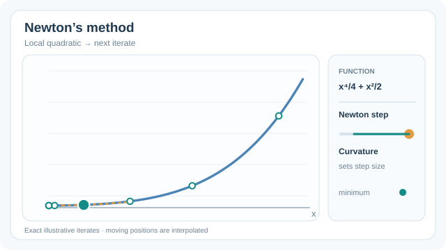
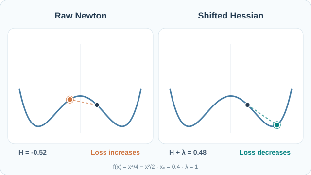
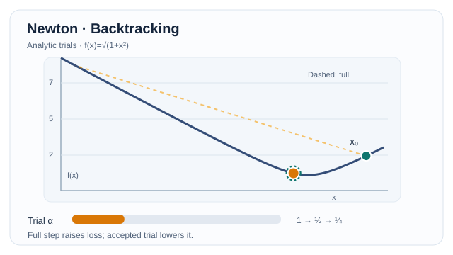

# Newton's Method

Newton's method uses a local quadratic model to seek a stationary point of a smooth loss. A positive-definite Hessian makes the model's stationary point its unique minimum. Step-size control and suitable local conditions support reliable minimisation and rapid convergence. Part of [Calculus and optimisation foundations](index.md).[^newton]

## Overview

Basic gradient descent uses the update $\theta_{k+1}=\theta_k-\eta_k\nabla L(\theta_k)$, with a scalar learning rate $\eta_k$. Its step length also depends on the gradient magnitude. On an ill-conditioned quadratic, a single scalar scale can lead to zigzagging and slow progress. Newton's method instead uses curvature to choose a direction from a local quadratic model.[^newton]

## Key concepts

- **Second-order model** uses the gradient and Hessian in a Taylor approximation of the loss.
- **Newton direction** $p_k$ solves $H_kp_k=-g_k$, where $g_k=\nabla L(\theta_k)$ and $H_k=\nabla^2 L(\theta_k)$.
- **Positive definiteness** makes a nonzero Newton direction a descent direction. An indefinite Hessian can lead toward a saddle or maximum.
- **Damping** scales the direction by a step size chosen using the true objective.
- **Quadratic convergence** is a local rate that requires regularity and a sufficiently close starting point.[^convergence]

## How it works

### Build and solve the local model

At the current iterate, the quadratic model is

$$
m_k(p)=L(\theta_k)+g_k^\top p+\tfrac12p^\top H_kp.
$$

Its stationarity equation and the damped update are

$$
H_kp_k=-g_k,
\qquad
\theta_{k+1}=\theta_k+\alpha_kp_k.
$$

The full Newton step uses $\alpha_k=1$. With $H_k$ positive definite and $g_k\ne0$, the model has a unique minimum and $g_k^\top p_k=-p_k^\top H_kp_k<0$. This guarantees descent for sufficiently small positive step sizes. The existing backtracking example below shows why a full step still needs checking.[^newton]

Solve the linear system directly rather than forming an explicit inverse. A dense Hessian has $n^2$ entries for $n$ parameters. Hessian-free variants can solve approximately using Hessian-vector products, so explicit dense storage is a choice of implementation. Their cost and convergence depend on the accuracy of the solve and curvature information.[^large-scale]

For logistic regression, Newton updates can be written as iteratively reweighted least squares (Bishop, 2006). Their practicality depends on the problem dimensions and linear-solve cost.

### Accept a step using the true loss

Armijo backtracking starts at $\alpha_k=1$ and repeatedly multiplies it by $\beta\in(0,1)$ until the trial point lies in the domain and satisfies

$$
L(\theta_k+\alpha_kp_k)
\le L(\theta_k)+c\alpha_k g_k^\top p_k,
\qquad 0<c<1/2.
$$

For a differentiable objective and a descent direction at an interior point, sufficiently small steps satisfy this condition. When the Hessian is indefinite, check whether $g_k^\top p_k<0$. A curvature modification or another direction can provide descent when this check fails.[^line-search]

### Measure progress and state the convergence assumptions

For a positive-definite Hessian and an exact Newton solve, the squared **Newton decrement** is

$$
\lambda_k^2=-g_k^\top p_k=p_k^\top H_kp_k.
$$

The local quadratic predicts an improvement of $\lambda_k^2/2$. This supports stopping when the predicted improvement is below a chosen tolerance. For a nonlinear objective, relating it to the true remaining objective gap requires additional assumptions.[^newton]

For example, take the quadratic $L(\theta)=\tfrac12\theta^\top H\theta$ with $H=\operatorname{diag}(2,8)$ at $\theta=(1,1)^\top$. Then $g=(2,8)^\top$, $p=(-1,-1)^\top$, and $\lambda^2=10$. The predicted decrease is $5$, and a full step reaches the minimiser with exactly that decrease.

Locally, if $L$ is twice continuously differentiable, its Hessian is Lipschitz continuous near an interior local minimiser $\theta^\star$, and $H(\theta^\star)$ is positive definite, sufficiently close iterates with exact full Newton steps satisfy

$$
\|\theta_{k+1}-\theta^\star\|
\le C\|\theta_k-\theta^\star\|^2
$$

for some finite constant $C$. Damping and approximate solves affect the rate achieved before or within this regime.[^convergence][^large-scale]

## Animated example: curvature-adjusted updates

*Original continuous teaching visual, CC BY-SA 4.0. GitHub displays the static frame; the wiki player provides keyboard-accessible Play/Pause and respects reduced-motion preferences.*

For the **illustrative function** $f(x)=x^4/4+x^2/2$, $f'(x)=x^3+x$ and $f''(x)=3x^2+1>0$. Starting at $x_0=2.2$, exact full Newton steps produce approximately

$$
\begin{gathered}
2.2\to1.3722\to0.7772
\\ \to0.3339\to0.0558\to0.00034.
\end{gathered}
$$

 The amber dashed parabola is the second-order Taylor approximation at the preceding discrete iterate, held fixed as the dot moves to the next point, not a globally identical objective; the teal dot moves continuously **only for illustration**, whereas the algorithm updates at discrete iterates. All values are analytic teaching calculations, **not model measurements**. See Boyd and Vandenberghe (2004) in References.

[GitHub-readable static preview](../../../assets/concept-animations/newton-curvature-steps-still.svg)

## Why an indefinite Hessian needs a safeguard

[GitHub-readable Newton curvature-safeguard snapshot](../../../assets/concept-animations/newton-indefinite-curvature-still.svg)

*Original 8-second looping instructional animation, CC BY-SA 4.0. The website adds keyboard-accessible Play/Pause and a reduced-motion static fallback.*

For the **analytic toy objective** $f(x)=x^4/4-x^2/2$ at $x_0=0.4$, the gradient is $g=-0.336$ and the Hessian is $H=-0.52$. The **unmodified** Newton update $x_1=x_0-g/H\approx-0.246154$ raises the loss from $-0.0736$ to approximately $-0.029378$. Shifting local curvature by $\lambda=1$ instead gives $H+\lambda=0.48$ and the modified step $x_1=x_0-g/(H+\lambda)=1.1$, reducing the loss to $-0.238975$. Both endpoints are exact computations rounded for display; the dots travelling between them are **visual interpolation of one step**, not additional iterations. A positive shifted Hessian gives a descent **direction**, but an unrestricted full step is not guaranteed to lower the objective in every non-convex problem: practical safeguards also use step-size control or a line search (Boyd and Vandenberghe, 2004). The selected values are illustrative, **not model measurements**.

## Damped Newton: Armijo backtracking before accepting a step

The Newton direction can be a descent direction yet a **full step** may increase the true objective. Backtracking tests successively shorter trial steps against the objective, not just the local quadratic approximation. The original, independently designed animation uses the convex function $f(x)=\sqrt{1+x^2}$ at $x_0=2$. Here $f'(2)=2/\sqrt{5}$, $f''(2)=5^{-3/2}$, and the Newton direction is $p=-f'(2)/f''(2)=-10$. The candidates $x_0+\alpha p$ for $\alpha=1,1/2,1/4$ are $-8,-3,-0.5$, with objectives $\sqrt{65}\approx8.0623$, $\sqrt{10}\approx3.1623$, and $\sqrt{1.25}\approx1.1180$, against the starting $\sqrt5\approx2.2361$. The first two candidates fail a standard Armijo condition with $c=10^{-4}$, whereas $\alpha=1/4$ passes. The dashed segment retains the rejected full-step proposal as a reference. **Intermediate marker positions are smooth visual interpolation of analytic candidates, not extra solver iterations, and these values are not model measurements.** This example illustrates damped Newton and line search as discussed by Boyd and Vandenberghe (2004; References).

*Original instructional visual, CC BY-SA 4.0.* The MkDocs site inherits Play/Pause and keyboard support from its shared motion player; reduced-motion users see the static fallback and narrow screens can scroll the figure locally. [Open animated SVG](../../../assets/concept-animations/newton-armijo-backtracking-motion.svg).

[GitHub-readable still preview](../../../assets/concept-animations/newton-armijo-backtracking-still.svg)

## Key methods

- [Gradient descent](../../optimization/index.md): the first-order alternative, cheaper per step and slower near a minimum.
- Quasi-Newton methods, such as L-BFGS, approximate the Hessian from gradient differences and avoid forming it. They are covered in the [optimisation section](../../optimization/index.md).

## Connections

- [Calculus and optimisation foundations](index.md) gives the Taylor expansion and the Hessian that the method needs.
- [Linear algebra](../linear-algebra/index.md) explains how the Hessian's eigenvalues control the step size in each direction.
- Brain and cognition: the method is a computational tool here, not a model of neural processing.

## Applications

- **Logistic regression**: Newton updates, often called iteratively reweighted least squares (Bishop, 2006).
- **Convex optimisation**: interior-point methods use Newton steps on barrier-modified problems (Boyd & Vandenberghe, 2004).
- **Large-scale learning**: second-order methods are discussed as an alternative to stochastic gradient descent, with trade-offs in cost (Bottou et al., 2018).

## Open questions

- Scalable second-order methods balance the cost of curvature information and linear solves against the improvement obtained per iteration.[^large-scale]
- An indefinite Hessian can attract an unmodified Newton iteration to a saddle or maximum. Curvature safeguards and step-size selection address different parts of this problem.[^large-scale]

[^newton]: Boyd & Vandenberghe (2004), §9.5, and revised lecture slides 9.19–9.24 explain the quadratic model, descent and the Newton decrement.
[^line-search]: Boyd & Vandenberghe (2004), §9.2, and revised lecture slide 9.10 describe backtracking line search.
[^convergence]: Boyd & Vandenberghe (2004), §9.5.3, and revised lecture slides 9.25–9.26 state the positive-definiteness and Hessian Lipschitz assumptions in the classical convergence analysis.
[^large-scale]: Bottou et al. (2018), §6.1, discuss Hessian-free inexact Newton methods, solve accuracy and nonconvex curvature.

## References

### Seminal papers

- Bottou, L., Curtis, F. E. & Nocedal, J. (2018). Optimization methods for large-scale machine learning. *SIAM Review*. arXiv:1606.04838. https://arxiv.org/abs/1606.04838 — Compares second-order and first-order methods for large-scale learning, including the cost of Hessian information.
- Boyd, S. & Vandenberghe, L. (2004). *Convex Optimization*. Cambridge University Press. https://web.stanford.edu/~boyd/cvxbook/ — Presents Newton's method with its convergence analysis and the damped version used in practice.

### Surveys and textbooks

- Bishop, C. M. (2006). *Pattern Recognition and Machine Learning*. Springer. https://www.microsoft.com/en-us/research/wp-content/uploads/2006/01/Bishop-Pattern-Recognition-and-Machine-Learning-2006.pdf — Shows the Newton–Raphson update for logistic regression.
- Murphy, K. P. (2022). *Probabilistic Machine Learning: An Introduction*. MIT Press. https://github.com/probml/pml-book — Free textbook; discusses Newton's method in the context of fitting generalised linear models.
- Golub, G. H. & Van Loan, C. F. (2013). *Matrix Computations*, 4th ed. Johns Hopkins University Press. https://www.press.jhu.edu/books/title/10678/matrix-computations — Covers the linear solves that each Newton step requires.
- Boyd, S., Vandenberghe, L. & Nobel, P. (2023 revision). *Convex Optimization: Lecture Slides*, Chapter 9. https://web.stanford.edu/~boyd/cvxbook/bv_cvxslides.pdf — Explains descent methods, backtracking, Newton decrement and the classical convergence analysis.
