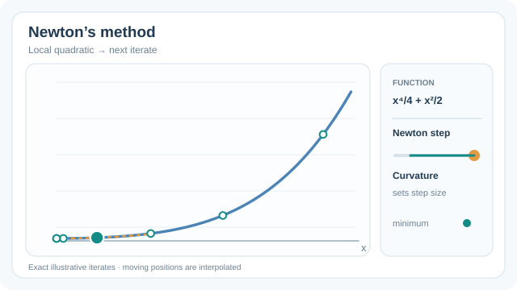
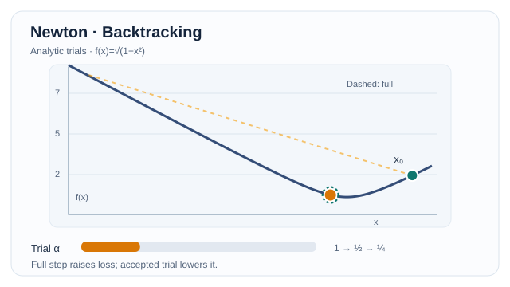

# 牛頓法

牛頓法透過反覆最小化損失的局部二次近似來求極小值。它以海森矩陣調整每一步，因此在平坦方向上走得遠，在陡峭方向上則走得謹慎。它在極小值附近收斂很快，但每一步都需要海森矩陣。本頁是[微積分與最佳化基礎](index.md)的一部分。

## 概述

梯度下降沿負梯度方向走固定大小的步。這個大小在各方向上都相同，因此在一個方向陡峭、另一個方向平坦的損失上會來回擺動，前進緩慢。牛頓法透過曲率修正這點。它在當前點擬合一個二次模型，並直接跳到該二次函數的極小值。

## 關鍵概念

- **二階模型**：\(L(\theta+\delta)\approx L(\theta)+\nabla L^\top\delta+\tfrac12\delta^\top H\delta\)，其中 \(H\) 為海森矩陣。
- **牛頓步**：使模型最小的 \(\delta\)，即 \(\delta = -H^{-1}\nabla L\)。
- **正定性**：當 \(H\) 為正定矩陣時，此步是下降步；否則可能走向鞍點或極大值。
- **二次收斂**：在海森矩陣為正定的極小值附近，誤差大致在每步平方。

## 運作方式

更新式為

\[
\theta_{k+1} = \theta_k - H_k^{-1}\nabla L(\theta_k).
\]

實務上不會直接求 \(H_k\) 的逆矩陣，而是解線性系統 \(H_k\delta = -\nabla L\)。因此每次迭代需要梯度、海森矩陣與一次線性求解。若模型有 \(n\) 個參數，海森矩陣有 \(n^2\) 個元素，對大型網路並不實際。

海森矩陣的特徵值決定其行為。特徵值大的方向較陡，牛頓步在該方向縮小移動；特徵值小的方向較平，步長則放大。因此純牛頓步可能衝過頭，或走向鞍點，這就是實務版本加入阻尼或線搜尋的原因。

邏輯斯回歸是牛頓法實用的典型例子，因為參數數量少。Bishop（2006）展示了由此得到的迭代加權最小平方更新。

## 教學動畫：曲率調整的牛頓更新

*原創連續教學動畫，CC BY-SA 4.0。GitHub 顯示靜態預覽；Wiki 網站提供可用鍵盤操作的播放／暫停按鈕，並遵循減少動態效果偏好。*

取**人工示範函數** $f(x)=x^4/4+x^2/2$，可得 $f'(x)=x^3+x$、$f''(x)=3x^2+1>0$。由 $x_0=2.2$ 開始，完整牛頓步的數值約為

$$
\begin{gathered}
2.2\to1.3722\to0.7772
\\ \to0.3339\to0.0558\to0.00034.
\end{gathered}
$$

琥珀色虛線表示前一個離散迭代點的二階泰勒近似，在圓點移往下一點時保持固定，並非整體損失函數；青綠色圓點的連續移動**只是視覺插值**，實際演算法仍在離散位置更新。上述為解析計算示意，**不是模型實測結果**。理論依據見參考文獻 Boyd 與 Vandenberghe（2004）。

[GitHub 靜態預覽](../../../assets/concept-animations/newton-curvature-steps-still.svg)

## 海森矩陣非正定時：原始牛頓步與曲率修正

[GitHub 可直接檢視的牛頓曲率修正靜態圖](../../../assets/concept-animations/newton-indefinite-curvature-still.svg)

*原創 8 秒循環教學動畫，CC BY-SA 4.0。網站沿用鍵盤可操作的播放／暫停控制，並在減少動態效果設定下顯示靜態圖。*

使用**人工解析示例** $f(x)=x^4/4-x^2/2$，從 $x_0=0.4$ 出發，梯度為 $g=-0.336$，海森值為 $H=-0.52$。**原始**牛頓更新 $x_1=x_0-g/H\approx-0.246154$ 使損失由 $-0.0736$ **增加**至約 $-0.029378$。若用 $\lambda=1$ 修正局部曲率，則 $H+\lambda=0.48$，修正後 $x_1=x_0-g/(H+\lambda)=1.1$，損失**下降**至 $-0.238975$。兩個端點都是解析計算（顯示值經四捨五入）；動畫中圓點的連續移動僅為**單步的視覺插值**，不是額外的迭代。修正海森矩陣為正定可使方向成為下降方向，但非凸問題的一次完整步長仍未必保證下降，實務上還須配合步長控制或線搜尋（Boyd 與 Vandenberghe，2004）。數值純屬教學示意，**並非模型實測**。

## 阻尼牛頓法：回溯線搜尋如何決定是否接受更新

牛頓方向即使是下降方向，**直接使用完整步長**仍可能讓真實目標函數上升。回溯線搜尋會檢查逐步縮短的候選步長，而不是只相信局部二次近似。本動畫採用人工凸函數 $f(x)=\sqrt{1+x^2}$，從 $x_0=2$ 出發。此時 $f'(2)=2/\sqrt5$、$f''(2)=5^{-3/2}$，牛頓方向為 $p=-10$。當 $\alpha=1,1/2,1/4$ 時，候選位置依序為 $-8,-3,-0.5$，目標值分別為 $\sqrt{65}\approx8.0623$、$\sqrt{10}\approx3.1623$ 與 $\sqrt{1.25}\approx1.1180$，而起點為 $\sqrt5\approx2.2361$。以 $c=10^{-4}$ 的標準 Armijo 條件檢查，前兩次不通過，$\alpha=1/4$ 才通過。虛線保留被拒絕的完整步長作比較。**移動過程是解析候選點之間的平滑視覺內插，不是額外的求解器迭代；數值也不是模型實測。** 方法依據 Boyd 與 Vandenberghe（2004；見參考文獻）。

*原創教學視覺，CC BY-SA 4.0。* MkDocs 網站沿用共用 Play／Pause 與鍵盤操作；偏好減少動態效果時顯示靜態回退圖，手機可在圖面內水平捲動。完整動畫：[SVG](../../../assets/concept-animations/newton-armijo-backtracking-motion.svg)。

[GitHub 靜態預覽](../../../assets/concept-animations/newton-armijo-backtracking-still.svg)

## 主要方法

- [梯度下降](../../optimization/index.md)：一階替代方法，每步成本較低，但接近極小值時較慢。
- 擬牛頓法（如 L-BFGS）由梯度差分近似海森矩陣，避免直接形成它。見[最佳化章節](../../optimization/index.md)。

## 與其他頁面的連結

- [微積分與最佳化基礎](index.md)提供此方法所需的泰勒展開與海森矩陣。
- [線性代數](../linear-algebra/index.md)說明海森矩陣的特徵值如何控制各方向的步長。
- 腦與認知：此方法在這裡是計算工具，而非神經處理的模型。

## 應用

- **邏輯斯回歸**：牛頓更新，常稱為迭代加權最小平方（Bishop, 2006）。
- **凸最佳化**：內點法在經障礙項修改的問題上使用牛頓步（Boyd & Vandenberghe, 2004）。
- **大規模學習**：二階方法被視為隨機梯度下降的替代方案，兩者在成本上有取捨（Bottou et al., 2018）。

## 開放問題

- 深度網路可擴展的二階方法仍是活躍的研究領域，因為在大規模下形成與求逆海森矩陣的成本過高。
- 鞍點在高維損失地形中很常見，除非經過修改，牛頓型步驟可能被吸引至其中。

## 參考文獻

### 奠基性論文

- Bottou, L., Curtis, F. E. & Nocedal, J. (2018). Optimization methods for large-scale machine learning. *SIAM Review*. arXiv:1606.04838. https://arxiv.org/abs/1606.04838 — 比較大規模學習中的二階與一階方法，包括海森資訊的成本。
- Boyd, S. & Vandenberghe, L. (2004). *Convex Optimization*. Cambridge University Press. https://web.stanford.edu/~boyd/cvxbook/ — 介紹牛頓法及其收斂分析，以及實務中使用的阻尼版本。

### 綜述與教科書

- Bishop, C. M. (2006). *Pattern Recognition and Machine Learning*. Springer. https://www.microsoft.com/en-us/research/wp-content/uploads/2006/01/Bishop-Pattern-Recognition-and-Machine-Learning-2006.pdf — 展示邏輯斯回歸的牛頓–拉弗森更新。
- Murphy, K. P. (2022). *Probabilistic Machine Learning: An Introduction*. MIT Press. https://github.com/probml/pml-book — 免費教科書；在廣義線性模型的擬合中討論牛頓法。
- Golub, G. H. & Van Loan, C. F. (2013). *Matrix Computations*, 4th ed. Johns Hopkins University Press. https://www.press.jhu.edu/books/title/10678/matrix-computations — 涵蓋每一步牛頓法所需的線性求解。
