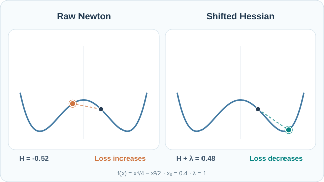

# 牛頓法

牛頓法利用局部二次模型，尋找平滑損失函數的駐點。海森矩陣正定時，模型的駐點就是其唯一極小值。步長控制與適當的局部條件，能支援可靠的最小化與快速收斂。本頁是[微積分與最佳化基礎](index.md)的一部分。[^newton]

## 概述

基本梯度下降使用更新式 $\theta_{k+1}=\theta_k-\eta_k\nabla L(\theta_k)$，其中 $\eta_k$ 為純量學習率。步長也取決於梯度大小。對條件數較差的二次函數，單一純量尺度可能造成來回擺動與緩慢前進。牛頓法則利用曲率，從局部二次模型選出方向。[^newton]

## 關鍵概念

- **二階模型**在損失的泰勒近似中使用梯度與海森矩陣。
- **牛頓方向** $p_k$ 滿足 $H_kp_k=-g_k$，其中 $g_k=\nabla L(\theta_k)$、$H_k=\nabla^2 L(\theta_k)$。
- **正定性**使非零牛頓方向成為下降方向。不定海森矩陣可能使迭代朝向鞍點或極大值。
- **阻尼**利用真實目標函數選擇步長，再縮放方向。
- **二次收斂**是一種局部速率，需要正則條件及足夠接近解的起始點。[^convergence]

## 運作方式

### 建立並求解局部模型

在目前迭代點，二次模型為

$$
m_k(p)=L(\theta_k)+g_k^\top p+\tfrac12p^\top H_kp.
$$

其駐點方程式與阻尼更新為

$$
H_kp_k=-g_k,
\qquad
\theta_{k+1}=\theta_k+\alpha_kp_k.
$$

完整牛頓步使用 $\alpha_k=1$。當 $H_k$ 正定且 $g_k\ne0$ 時，模型有唯一極小值，並且 $g_k^\top p_k=-p_k^\top H_kp_k<0$。這能保證足夠小的正步長會使目標下降。下方回溯範例則說明，完整步長仍須檢查。[^newton]

實作時直接解線性系統即可。對 $n$ 個參數，稠密海森矩陣有 $n^2$ 個元素。無海森矩陣的變體能利用海森矩陣與向量的乘積，近似求解，因此顯式稠密儲存是一項實作選擇。其成本與收斂性取決於求解精度及曲率資訊。[^large-scale]

對邏輯斯回歸，牛頓更新可寫成迭代加權最小平方（Bishop，2006）。其實用性取決於問題維度與線性求解成本。

### 利用真實損失接受步長

Armijo 回溯線搜尋從 $\alpha_k=1$ 開始，反覆乘以 $\beta\in(0,1)$，直到候選點位於定義域內，且滿足

$$
L(\theta_k+\alpha_kp_k)
\le L(\theta_k)+c\alpha_k g_k^\top p_k,
\qquad 0<c<1/2.
$$

對可微分目標函數，在定義域內部點給定下降方向後，足夠小的步長會滿足此條件。若海森矩陣不定，應先檢查 $g_k^\top p_k<0$ 是否成立。若不成立，修正曲率或改用其他方向可以提供下降方向。[^line-search]

### 衡量進展並列出收斂假設

對正定海森矩陣與精確的牛頓求解，**牛頓減量**的平方為

$$
\lambda_k^2=-g_k^\top p_k=p_k^\top H_kp_k.
$$

局部二次模型預測的改善量為 $\lambda_k^2/2$。因此可以在預測改善量小於所選容許值時停止。對非線性目標，要將此量連結到真實的剩餘目標差距，還需要額外假設。[^newton]

例如，考慮二次函數 $L(\theta)=\tfrac12\theta^\top H\theta$，其中 $H=\operatorname{diag}(2,8)$，並取 $\theta=(1,1)^\top$。此時 $g=(2,8)^\top$、$p=(-1,-1)^\top$，且 $\lambda^2=10$。預測下降量為 $5$，完整步長會抵達極小值，實際下降量也恰為 $5$。

在局部，若 $L$ 二次連續可微，海森矩陣在定義域內部的局部極小值 $\theta^\star$ 附近為 Lipschitz 連續，且 $H(\theta^\star)$ 正定，從足夠近的迭代點進行精確完整牛頓步，會滿足

$$
\|\theta_{k+1}-\theta^\star\|
\le C\|\theta_k-\theta^\star\|^2
$$

其中 $C$ 為某個有限常數。阻尼與近似求解會影響進入此區域前，以及在其中實際達到的收斂速率。[^convergence][^large-scale]

## 教學動畫：曲率調整的牛頓更新

*原創連續教學動畫，CC BY-SA 4.0。GitHub 顯示靜態預覽；Wiki 網站提供可用鍵盤操作的播放／暫停按鈕，並遵循減少動態效果偏好。*

取**人工示範函數** $f(x)=x^4/4+x^2/2$，可得 $f'(x)=x^3+x$、$f''(x)=3x^2+1>0$。由 $x_0=2.2$ 開始，完整牛頓步的數值約為

$$
\begin{gathered}
2.2\to1.3722\to0.7772
\\ \to0.3339\to0.0558\to0.00034.
\end{gathered}
$$

琥珀色虛線表示前一個離散迭代點的二階泰勒近似，在圓點移往下一點時保持固定，並非整體損失函數；青綠色圓點的連續移動**只是視覺插值**，實際演算法仍在離散位置更新。上述為解析計算示意，**不是模型實測結果**。理論依據見參考文獻 Boyd 與 Vandenberghe（2004）。

[GitHub 靜態預覽](../../../assets/concept-animations/newton-curvature-steps-still.svg)

## 海森矩陣非正定時：原始牛頓步與曲率修正

[GitHub 可直接檢視的牛頓曲率修正靜態圖](../../../assets/concept-animations/newton-indefinite-curvature-still.svg)

*原創 8 秒循環教學動畫，CC BY-SA 4.0。網站沿用鍵盤可操作的播放／暫停控制，並在減少動態效果設定下顯示靜態圖。*

使用**人工解析示例** $f(x)=x^4/4-x^2/2$，從 $x_0=0.4$ 出發，梯度為 $g=-0.336$，海森值為 $H=-0.52$。**原始**牛頓更新 $x_1=x_0-g/H\approx-0.246154$ 使損失由 $-0.0736$ **增加**至約 $-0.029378$。若用 $\lambda=1$ 修正局部曲率，則 $H+\lambda=0.48$，修正後 $x_1=x_0-g/(H+\lambda)=1.1$，損失**下降**至 $-0.238975$。兩個端點都是解析計算（顯示值經四捨五入）；動畫中圓點的連續移動僅為**單步的視覺插值**，不是額外的迭代。修正海森矩陣為正定可使方向成為下降方向，但非凸問題的一次完整步長仍未必保證下降，實務上還須配合步長控制或線搜尋（Boyd 與 Vandenberghe，2004）。數值純屬教學示意，**並非模型實測**。

## 阻尼牛頓法：回溯線搜尋如何決定是否接受更新

牛頓方向即使是下降方向，**直接使用完整步長**仍可能讓真實目標函數上升。回溯線搜尋會檢查逐步縮短的候選步長，而不是只相信局部二次近似。本動畫採用人工凸函數 $f(x)=\sqrt{1+x^2}$，從 $x_0=2$ 出發。此時 $f'(2)=2/\sqrt5$、$f''(2)=5^{-3/2}$，牛頓方向為 $p=-10$。當 $\alpha=1,1/2,1/4$ 時，候選位置依序為 $-8,-3,-0.5$，目標值分別為 $\sqrt{65}\approx8.0623$、$\sqrt{10}\approx3.1623$ 與 $\sqrt{1.25}\approx1.1180$，而起點為 $\sqrt5\approx2.2361$。以 $c=10^{-4}$ 的標準 Armijo 條件檢查，前兩次不通過，$\alpha=1/4$ 才通過。虛線保留被拒絕的完整步長作比較。**移動過程是解析候選點之間的平滑視覺內插，不是額外的求解器迭代；數值也不是模型實測。** 方法依據 Boyd 與 Vandenberghe（2004；見參考文獻）。

*原創教學視覺，CC BY-SA 4.0。* MkDocs 網站沿用共用 Play／Pause 與鍵盤操作；偏好減少動態效果時顯示靜態回退圖，手機可在圖面內水平捲動。完整動畫：[SVG](../../../assets/concept-animations/newton-armijo-backtracking-motion.svg)。

[GitHub 靜態預覽](../../../assets/concept-animations/newton-armijo-backtracking-still.svg)

## 主要方法

- [梯度下降](../../optimization/index.md)：一階替代方法，每步成本較低，但接近極小值時較慢。
- 擬牛頓法（如 L-BFGS）由梯度差分近似海森矩陣，避免直接形成它。見[最佳化章節](../../optimization/index.md)。

## 與其他頁面的連結

- [微積分與最佳化基礎](index.md)提供此方法所需的泰勒展開與海森矩陣。
- [線性代數](../linear-algebra/index.md)說明海森矩陣的特徵值如何控制各方向的步長。
- 腦與認知：此方法在這裡是計算工具，而非神經處理的模型。

## 應用

- **邏輯斯回歸**：牛頓更新，常稱為迭代加權最小平方（Bishop, 2006）。
- **凸最佳化**：內點法在經障礙項修改的問題上使用牛頓步（Boyd & Vandenberghe, 2004）。
- **大規模學習**：二階方法被視為隨機梯度下降的替代方案，兩者在成本上有取捨（Bottou et al., 2018）。

## 開放問題

- 可擴展的二階方法需要在曲率資訊、線性求解成本與每次迭代的改善量之間取得平衡。[^large-scale]
- 不定海森矩陣可能使未經修正的牛頓迭代朝向鞍點或極大值。曲率控制與步長選擇分別處理此問題的不同面向。[^large-scale]

[^newton]: Boyd 與 Vandenberghe（2004）第 9.5 節，以及修訂版講義第 9.19 至 9.24 頁，說明二次模型、下降性與牛頓減量。
[^line-search]: Boyd 與 Vandenberghe（2004）第 9.2 節與修訂版講義第 9.10 頁說明回溯線搜尋。
[^convergence]: Boyd 與 Vandenberghe（2004）第 9.5.3 節與修訂版講義第 9.25 至 9.26 頁，列出古典收斂分析中的正定性與海森矩陣 Lipschitz 條件。
[^large-scale]: Bottou 等人（2018）第 6.1 節討論無海森矩陣的近似牛頓法、求解精度與非凸曲率。

## 參考文獻

### 奠基性論文

- Bottou, L., Curtis, F. E. & Nocedal, J. (2018). Optimization methods for large-scale machine learning. *SIAM Review*. arXiv:1606.04838. https://arxiv.org/abs/1606.04838 — 比較大規模學習中的二階與一階方法，包括海森資訊的成本。
- Boyd, S. & Vandenberghe, L. (2004). *Convex Optimization*. Cambridge University Press. https://web.stanford.edu/~boyd/cvxbook/ — 介紹牛頓法及其收斂分析，以及實務中使用的阻尼版本。

### 綜述與教科書

- Bishop, C. M. (2006). *Pattern Recognition and Machine Learning*. Springer. https://www.microsoft.com/en-us/research/wp-content/uploads/2006/01/Bishop-Pattern-Recognition-and-Machine-Learning-2006.pdf — 展示邏輯斯回歸的牛頓–拉弗森更新。
- Murphy, K. P. (2022). *Probabilistic Machine Learning: An Introduction*. MIT Press. https://github.com/probml/pml-book — 免費教科書；在廣義線性模型的擬合中討論牛頓法。
- Golub, G. H. & Van Loan, C. F. (2013). *Matrix Computations*, 4th ed. Johns Hopkins University Press. https://www.press.jhu.edu/books/title/10678/matrix-computations — 涵蓋每一步牛頓法所需的線性求解。
- Boyd, S., Vandenberghe, L. & Nobel, P. (2023 revision). *Convex Optimization: Lecture Slides*, Chapter 9. https://web.stanford.edu/~boyd/cvxbook/bv_cvxslides.pdf — 以講義說明下降方法、回溯線搜尋、牛頓減量與古典收斂分析。
