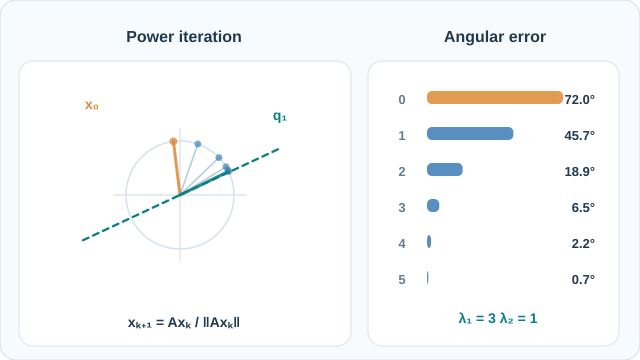
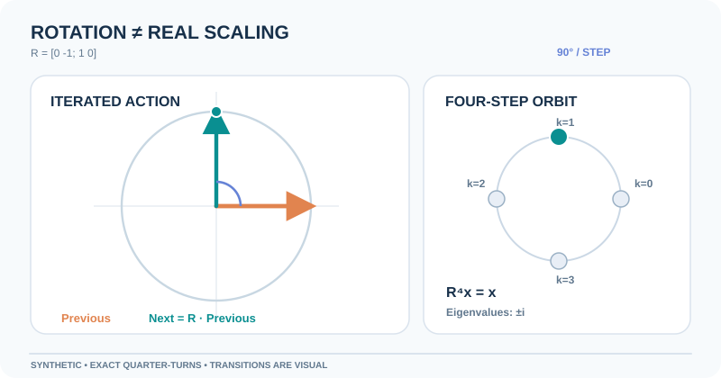

# Eigendecomposition

An eigendecomposition writes a square matrix in terms of its eigenvectors and eigenvalues. For a symmetric matrix the eigenvectors are orthogonal and the eigenvalues are real, which is why the factorisation is used for covariance matrices and the Hessians of loss functions. Part of [Linear algebra](index.md).

## Overview

An eigenvector of a square matrix \(A\) is a nonzero vector \(\mathbf{v}\) whose direction \(A\) leaves unchanged: \(A\mathbf{v} = \lambda \mathbf{v}\). The scalar \(\lambda\) is the eigenvalue, the factor by which \(A\) stretches \(\mathbf{v}\). Along an eigenvector a matrix acts as a simple scaling, so repeated application is easy to analyse: \(A^k\mathbf{v} = \lambda^k\mathbf{v}\).

## Key concepts

- **Eigenpair**: an eigenvalue together with its eigenvector.
- **Spectral theorem**: a real symmetric matrix has real eigenvalues and an orthonormal set of eigenvectors.
- **Positive semidefinite matrix**: a symmetric matrix whose eigenvalues are all non-negative. Covariance matrices are of this kind.
- **Spectral radius**: the largest absolute value of an eigenvalue. Repeated multiplication by a matrix grows or decays according to whether it is above or below one.

## How it works

For a real symmetric \(n\times n\) matrix, the spectral theorem gives

\[
A = Q\Lambda Q^\top, \qquad \Lambda = \operatorname{diag}(\lambda_1, \dots, \lambda_n),
\]

where the columns of the orthogonal matrix \(Q\) are the eigenvectors. The quadratic form then decomposes along the eigen-directions:

\[
\mathbf{x}^\top A \mathbf{x} = \sum_{i} \lambda_i \, (\mathbf{q}_i^\top \mathbf{x})^2 .
\]

So each eigenvalue is the curvature of the quadratic in its own direction. This is the reason the eigenvalues of a Hessian matter for optimisation: large eigenvalues mark steep directions and small ones mark flat directions (see [Calculus and optimisation](../calculus/index.md)).

A standard way to find the dominant eigenvector is power iteration, which repeatedly applies \(A\) and normalises the result. It converges to the eigenvector of the largest-magnitude eigenvalue when that eigenvalue is well separated from the rest (see Golub and Van Loan).

### Animated example: power iteration follows the dominant eigenvector

[GitHub-safe static power-iteration diagram](../../../assets/concept-animations/power-iteration-convergence-still.svg)

Choose the **synthetic positive-definite matrix** $A=Q\operatorname{diag}(3,1)Q^\top$ with $Q=R(25^\circ)$. Start from a unit vector $x_0$ at angle 97°, which differs from the dominant eigenvector $q_1$ by **72°**. Each iteration applies $Ax_k$ (the orange arrow briefly extends) and then normalizes it to $x_{k+1}=Ax_k/\|Ax_k\|_2$. The error consequently contracts as $\tan\delta_k=\tan(72^\circ)/3^k$: after five updates the approximate errors are **45.7°, 18.9°, 6.5°, 2.2°, and 0.7°**. The bar lengths are proportional to these angle errors, not a training loss. A row is highlighted only while the arrow holds at that normalized iterate; the highlight is hidden during the labelled apply/normalize transitions. After $x_5$, the loop resets to $x_0$.

This convergence assumes a nonzero starting component along the unique largest-magnitude eigenvector; convergence can fail or differ without that assumption. Animated transitions between exact iterates are illustrative, not extra numerical steps or empirical timing. Use the MkDocs **Play/Pause** button, or inspect the GitHub-safe static diagram. On narrow screens the figure can be horizontally scrolled. Original illustration, **CC BY-SA 4.0**.

### Animated example: a symmetric map fixes eigen-directions

[GitHub-safe static eigen-direction preview](../../../assets/concept-animations/eigen-linear-map-still.svg)

Take the **synthetic symmetric** matrix \(A=Q\operatorname{diag}(3,1)Q^\top\) with \(Q=R(35^\circ)\). For its orthonormal eigenvectors \(\mathbf q_1,\mathbf q_2\),

\[
\mathbf x(\theta)=\cos\theta\,\mathbf q_1+\sin\theta\,\mathbf q_2,\qquad
A\mathbf x(\theta)=3\cos\theta\,\mathbf q_1+\sin\theta\,\mathbf q_2.
\]

The input tip sweeps a circle while the output sweeps an ellipse. At \(\theta=0\), the \(\mathbf q_1\) component is multiplied by 3; at \(90^\circ\), the \(\mathbf q_2\) component is unchanged. In other directions, \(A\mathbf x\) is generally not collinear with \(\mathbf x\). **The panels use different drawing scales**, so compare within-panel shapes and directions rather than absolute arrow lengths across panels. The continuous angle sweep is geometry, **not an iterative solver or model training**. Original diagram, **CC BY-SA 4.0**.

### Animated counterexample: a real rotation need not have real eigenvectors

[GitHub-safe static rotation-orbit preview](../../../assets/concept-animations/eigen-rotation-no-real-still.svg)

The real rotation \(R=\begin{bmatrix}0&-1\\1&0\end{bmatrix}\) maps each nonzero vector to a perpendicular vector. The orange arrow is \(\mathbf x_{k-1}\), the teal arrow is \(\mathbf x_k=R\mathbf x_{k-1}\); the orbit marker shows the discrete state \(k\) modulo 4. After four multiplications, \(R^4\mathbf x_0=\mathbf x_0\). Since \(\mathbf x^\top R\mathbf x=0\) for any real \(\mathbf x\), and \(R\) is invertible, there is no nonzero real eigenvector. Its eigenvalues \(\pm i\) are **complex**, consistent with the spectral theorem's **symmetry** assumption. Intermediate animated orientations are *visual interpolation*, **not intermediate matrix multiplications**. Original diagram, **CC BY-SA 4.0**.

For both examples, the MkDocs player supports **Play/Pause**; GitHub displays the static SVG directly. A reduced-motion preference starts the player paused. On mobile, focus the figure region and use the arrow keys to scroll horizontally.

## Key methods

Eigendecomposition is one of the two landmark matrix factorisations of linear algebra. The other is the singular value decomposition.

- [Singular value decomposition](svd.md): works for any matrix. For a symmetric positive semidefinite matrix its singular values equal the eigenvalues, so the two factorisations agree there.

Use eigendecomposition when the matrix is square and symmetric, such as a covariance matrix or a Hessian. Use the SVD for rectangular data or weight matrices.

## Connections

- [Principal component analysis](../../paradigms/unsupervised/dimensionality-reduction/pca.md) takes the eigenvectors of the covariance matrix as its principal directions. The variance along each direction is the corresponding eigenvalue.
- [Probability and statistics](../probability-statistics/index.md) uses covariance matrices of multivariate Gaussians, which are diagonalised in this way.
- [Calculus and optimisation](../calculus/index.md) uses the Hessian and its eigenvalues to describe the local shape of a loss function.

## Applications

- **Principal component analysis**: the principal components of a dataset are eigenvectors of its covariance matrix (Bishop, 2006, covers PCA).
- **Curvature and conditioning**: the ratio of the largest to smallest Hessian eigenvalue indicates how hard a quadratic objective is to optimise by gradient descent (Boyd & Vandenberghe, 2004).
- **Stability analysis**: whether a linear dynamical system decays or grows is decided by the eigenvalues of its matrix.

## Open questions

- Computing eigendecompositions of very large matrices, such as the Hessians of large networks, is expensive, and practical methods use approximations whose accuracy is hard to guarantee.
- Non-symmetric matrices can have complex or ill-conditioned eigenvalues, which makes their eigendecompositions less reliable than symmetric ones.

## References

### Seminal papers

- Bishop, C. M. (2006). *Pattern Recognition and Machine Learning*. Springer. https://www.microsoft.com/en-us/research/wp-content/uploads/2006/01/Bishop-Pattern-Recognition-and-Machine-Learning-2006.pdf — Textbook treatment of PCA defined through the eigenvectors of the covariance matrix.

### Surveys and textbooks

- Golub, G. H. & Van Loan, C. F. (2013). *Matrix Computations*, 4th ed. Johns Hopkins University Press. https://www.press.jhu.edu/books/title/10678/matrix-computations — Covers symmetric eigenvalue problems and the power method.
- Trefethen, L. N. & Bau, D. (1997). *Numerical Linear Algebra*. SIAM. https://people.maths.ox.ac.uk/trefethen/text.html — Graduate text on eigenvalue problems and their numerical behaviour.
- Murphy, K. P. (2022). *Probabilistic Machine Learning: An Introduction*. MIT Press. https://github.com/probml/pml-book — Free online textbook that covers PCA and the covariance matrices it diagonalises.

### Lectures

- Strang, G., *18.06 Linear Algebra*, MIT. https://web.mit.edu/18.06/www/ — The course lecture list includes a lecture on eigenvalues and eigenvectors, followed by diagonalisation.

### Articles and documentation

- Boyd, S. & Vandenberghe, L. (2004). *Convex Optimization*. Cambridge University Press. https://web.stanford.edu/~boyd/cvxbook/ — Free online text; covers the second-order conditions in which Hessian eigenvalues enter, and the conditioning of quadratic problems.
