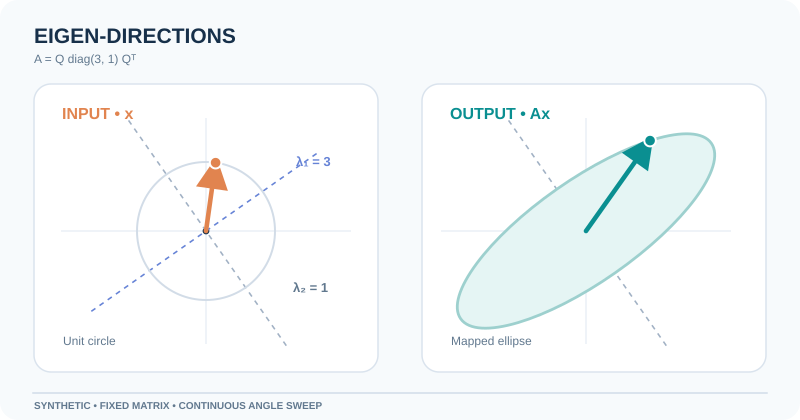
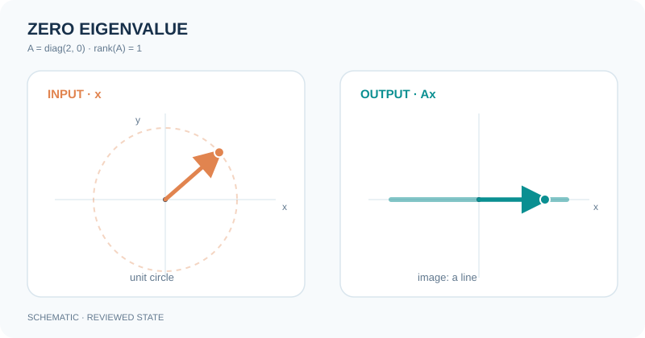
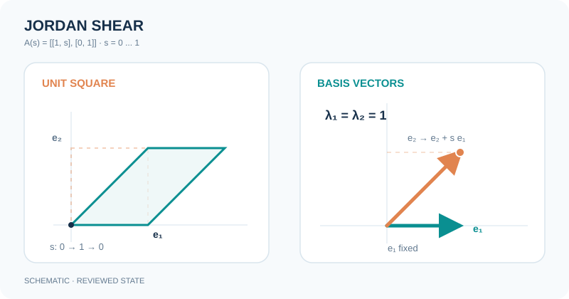
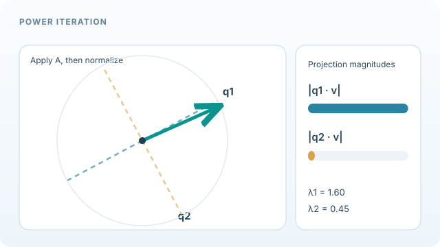

# Eigendecomposition

An eigendecomposition expresses a diagonalizable square matrix using an eigenvector basis and its eigenvalues. A real symmetric matrix always admits an orthonormal eigenvector basis with real eigenvalues, which makes the factorisation useful for covariance matrices and the Hessians of loss functions. Part of [Linear algebra](index.md).[^spectral]

## Overview

An eigenvector of a square matrix $A$ is a nonzero vector $\mathbf{v}$ satisfying $A\mathbf{v}=\lambda\mathbf{v}$. The scalar $\lambda$ is its eigenvalue. For a real eigenpair, a positive eigenvalue preserves orientation, a negative one reverses it, and a zero eigenvalue maps the vector to zero. Repeated application gives $A^k\mathbf{v}=\lambda^k\mathbf{v}$ for positive integers $k$.[^diagonalization]

## Key concepts

- **Eigenpair**: an eigenvalue together with its eigenvector.
- **Spectral theorem**: a real symmetric matrix has real eigenvalues and an orthonormal basis of eigenvectors. Within a repeated eigenspace, the basis can be chosen orthonormal.[^spectral]
- **Positive semidefinite matrix**: a symmetric matrix whose eigenvalues are all non-negative. Covariance matrices are of this kind.
- **Spectral radius** $\rho(A)=\max_i|\lambda_i|$ governs asymptotic decay of powers of a fixed matrix. The boundary case $\rho(A)=1$ requires attention to its Jordan structure.[^dynamics]

## How it works

For a real symmetric $n\times n$ matrix, the spectral theorem gives

$$
A = Q\Lambda Q^\top, \qquad \Lambda = \operatorname{diag}(\lambda_1, \dots, \lambda_n),
$$

where the columns of the orthogonal matrix $Q$ are the eigenvectors. Eigenvectors associated with distinct eigenvalues are orthogonal. Within a repeated eigenspace, different orthonormal bases give valid decompositions. For example, every nonzero vector is an eigenvector of $I$, so two arbitrarily chosen eigenvectors can have a nonzero dot product.[^spectral]

A general $n\times n$ matrix has a factorisation $A=V\Lambda V^{-1}$ exactly when it has $n$ linearly independent eigenvectors over the chosen field. Distinct eigenvalues suffice, while repeated eigenvalues can yield either a full eigenbasis or a defective matrix, as the shear example below illustrates.[^diagonalization]

The quadratic form then decomposes along the eigen-directions:

$$
\mathbf{x}^\top A \mathbf{x} = \sum_{i} \lambda_i \, (\mathbf{q}_i^\top \mathbf{x})^2 .
$$

For the objective $f(\mathbf{x})=\tfrac12\mathbf{x}^\top A\mathbf{x}$, the Hessian is $A$ and the directional second derivative along a unit eigenvector $\mathbf{q}_i$ is $\lambda_i$. For $\mathbf{x}^\top A\mathbf{x}$, the Hessian is $2A$. Positive and negative Hessian eigenvalues describe upward and downward curvature, while small absolute values indicate locally flat directions (see [Calculus and optimisation](../calculus/index.md)).[^curvature]

A standard way to find a dominant eigendirection is power iteration, which repeatedly applies $A$ and normalises the result. For a real symmetric matrix, convergence to a unique dominant direction requires a strictly largest eigenvalue magnitude and a nonzero initial projection onto that direction. A negative leading eigenvalue can alternate the sign of the iterates. The eigenvalue magnitude ratio controls the asymptotic rate (see Golub and Van Loan).

### Stability of repeated application

For a fixed finite-dimensional matrix, $A^k\to0$ for every initial vector exactly when $\rho(A)<1$. If $\rho(A)>1$, some initial states grow. When $\rho(A)=1$, powers can remain bounded or grow polynomially.[^dynamics]

For the fixed shear matrix $J=A(1)$ from the example below, direct multiplication gives

$
J=\begin{bmatrix}1&1\\0&1\end{bmatrix},
\qquad
J^k=\begin{bmatrix}1&k\\0&1\end{bmatrix}.
$

Thus $J^k e_2=(k,1)^\top$ grows even though both eigenvalues are one. In contrast, $I^k=I$ stays bounded. For a continuous-time system $\dot{x}=Ax$, decay of every trajectory requires all eigenvalues to have strictly negative real parts.[^dynamics]

### Animated example: power iteration follows the dominant eigenvector

[GitHub-safe static power-iteration diagram](../../../assets/concept-animations/power-iteration-convergence-still.svg)

Choose the **synthetic positive-definite matrix** $A=Q\operatorname{diag}(3,1)Q^\top$ with $Q=R(25^\circ)$. Start from a unit vector $x_0$ at angle 97°, which differs from the dominant eigenvector $q_1$ by **72°**. Each iteration applies $Ax_k$ (the orange arrow briefly extends) and then normalizes it to $x_{k+1}=Ax_k/\|Ax_k\|_2$. The error consequently contracts as $\tan\delta_k=\tan(72^\circ)/3^k$: after five updates the approximate errors are **45.7°, 18.9°, 6.5°, 2.2°, and 0.7°**. The bar lengths are proportional to these angle errors, not a training loss. A row is highlighted only while the arrow holds at that normalized iterate; the highlight is hidden during the labelled apply/normalize transitions. After $x_5$, the loop resets to $x_0$.

This convergence assumes a nonzero starting component along the unique largest-magnitude eigenvector; convergence can fail or differ without that assumption. Animated transitions between exact iterates are illustrative, not extra numerical steps or empirical timing. Use the MkDocs **Play/Pause** button, or inspect the GitHub-safe static diagram. On narrow screens the figure can be horizontally scrolled. Original illustration, **CC BY-SA 4.0**.

### Animated example: a symmetric map fixes eigen-directions

[GitHub-safe static eigen-direction preview](../../../assets/concept-animations/eigen-linear-map-still.svg)

Take the **synthetic symmetric** matrix $A=Q\operatorname{diag}(3,1)Q^\top$ with $Q=R(35^\circ)$. For its orthonormal eigenvectors $\mathbf q_1,\mathbf q_2$,

$$
\mathbf x(\theta)=\cos\theta\,\mathbf q_1+\sin\theta\,\mathbf q_2,\qquad
A\mathbf x(\theta)=3\cos\theta\,\mathbf q_1+\sin\theta\,\mathbf q_2.
$$

The input tip sweeps a circle while the output sweeps an ellipse. At $\theta=0$, the $\mathbf q_1$ component is multiplied by 3; at $90^\circ$, the $\mathbf q_2$ component is unchanged. In other directions, $A\mathbf x$ is generally not collinear with $\mathbf x$. **The panels use different drawing scales**, so compare within-panel shapes and directions rather than absolute arrow lengths across panels. The continuous angle sweep is geometry, **not an iterative solver or model training**. Original diagram, **CC BY-SA 4.0**.

### Animated counterexample: a real rotation need not have real eigenvectors

[GitHub-safe static rotation-orbit preview](../../../assets/concept-animations/eigen-rotation-no-real-still.svg)

The real rotation $R=\begin{bmatrix}0&-1\\1&0\end{bmatrix}$ maps each nonzero vector to a perpendicular vector. The orange arrow is $\mathbf x_{k-1}$, the teal arrow is $\mathbf x_k=R\mathbf x_{k-1}$; the orbit marker shows the discrete state $k$ modulo 4. After four multiplications, $R^4\mathbf x_0=\mathbf x_0$. Since $\mathbf x^\top R\mathbf x=0$ for any real $\mathbf x$, and $R$ is invertible, there is no nonzero real eigenvector. Its eigenvalues $\pm i$ are **complex**, consistent with the spectral theorem's **symmetry** assumption. Intermediate animated orientations are *visual interpolation*, **not intermediate matrix multiplications**. Original diagram, **CC BY-SA 4.0**.

For both examples, the MkDocs player supports **Play/Pause**; GitHub displays the static SVG directly. A reduced-motion preference starts the player paused. On mobile, focus the figure region and use the arrow keys to scroll horizontally.

### Animated example: a zero eigenvalue collapses a dimension

[GitHub-safe static projection preview](../../../assets/concept-animations/eigen-zero-eigenvalue-still.svg)

For the **synthetic singular matrix** $A=\operatorname{diag}(2,0)$, the eigenpairs are $(2,e_1)$ and $(0,e_2)$. As $x(\theta)=(\cos\theta,\sin\theta)$ sweeps the unit circle, $Ax(\theta)=(2\cos\theta,0)$ traces a horizontal line segment. At $\theta=90^\circ$, $x=e_2\neq0$ but $Ax=0$: the second eigendirection lies in the null space. Consequently $\det(A)=0$ and $\operatorname{rank}(A)=1$. The diagram uses different scale factors in its two panels; no cross-panel pixel measurement represents the eigenvalue 2. The continuous sweep is a **constructed geometric illustration, not a measured training or numerical-algorithm trajectory**. Original art, **CC BY-SA 4.0**.

### Animated counterexample: a repeated eigenvalue need not provide an eigenbasis

[GitHub-safe static Jordan shear preview](../../../assets/concept-animations/eigen-jordan-shear-still.svg)

Consider the **synthetic family** $A(s)=\begin{bmatrix}1&s\\0&1\end{bmatrix}$ with $0\le s\le1$. Both algebraic eigenvalues remain 1 throughout the animation, but $A(s)e_1=e_1$ whereas $A(s)e_2=e_2+s e_1$. For every $s>0$, solving $(A(s)-I)v=0$ forces $v_2=0$: the eigenspace is only $\operatorname{span}(e_1)$, so the $2\times2$ matrix is **not diagonalizable** despite the repeated real eigenvalue. At $s=0$ the identity matrix is a special case with a two-dimensional eigenspace. The changing shear parameter is a **family of different linear maps**, not iterations of one fixed Jordan block or empirical observations. Original art, **CC BY-SA 4.0**.

Both demonstrations reuse the MkDocs **Play/Pause** player and its reduced-motion static fallback. In GitHub the still SVG is directly readable. On narrow viewports, focus the figure and scroll horizontally with arrow keys.

### Additional example: projection magnitudes under power iteration

  

*Original geometric teaching animation, CC BY-SA 4.0.* The example applies $v_{k+1}=Av_k/\|Av_k\|_2$ to a two-dimensional symmetric matrix $A=Q\operatorname{diag}(1.60,0.45)Q^\top$, with its leading eigenvector 28 degrees above the horizontal. From an initial direction of -44 degrees, $|q_1^\top v_k|$ rises from approximately 0.309 to 0.998 after three iterations, while $|q_2^\top v_k|$ decreases. The unit-circle arc connecting discrete iterates is a visual interpolation, **not a continuous-time algorithm or a measured model trajectory**. The reverse motion only resets this looping illustration; power iteration itself does not run backwards. Convergence to a unique dominant direction requires a suitable eigenvalue magnitude gap and a nonzero starting component in that eigendirection. On the wiki website, use Play/Pause or keyboard activation; the static view remains readable on GitHub. See the numerical-linear-algebra texts in References.

## Key methods

Eigendecomposition is one of the two landmark matrix factorisations of linear algebra. The other is the singular value decomposition.

- [Singular value decomposition](svd.md): works for any matrix. For a symmetric positive semidefinite matrix its singular values equal the eigenvalues, so the two factorisations agree there.

Use eigendecomposition when the matrix is square and symmetric, such as a covariance matrix or a Hessian. Use the SVD for rectangular data or weight matrices.

## Connections

- [Principal component analysis](../../paradigms/unsupervised/dimensionality-reduction/pca.md) takes the eigenvectors of the covariance matrix as its principal directions. The variance along each direction is the corresponding eigenvalue.
- [Probability and statistics](../probability-statistics/index.md) uses covariance matrices of multivariate Gaussians, which are diagonalised in this way.
- [Calculus and optimisation](../calculus/index.md) uses the Hessian and its eigenvalues to describe the local shape of a loss function.

## Applications

- **Principal component analysis**: the principal components of a dataset are eigenvectors of its covariance matrix (Bishop, 2006, covers PCA).
- **Curvature and conditioning**: for a quadratic objective with a symmetric positive-definite Hessian $H$, its Euclidean condition number is $\kappa_2(H)=\lambda_{\max}(H)/\lambda_{\min}(H)$. This ratio affects gradient-descent convergence bounds. An indefinite Hessian also describes negative-curvature directions, and a singular Hessian has infinite condition number under the usual convention.[^curvature]
- **Stability analysis**: discrete-time iteration and continuous-time dynamics use different eigenvalue conditions, as described above.[^dynamics]

## Open questions

- Computing eigendecompositions of very large matrices, such as the Hessians of large networks, is expensive, and practical methods use approximations whose accuracy is hard to guarantee.
- Non-symmetric matrices can have complex or ill-conditioned eigenvalues, which makes their eigendecompositions less reliable than symmetric ones.

[^spectral]: MIT OpenCourseWare (2011), *Symmetric matrices and positive definiteness*, explains orthonormal eigenbases. Boyd & Vandenberghe (2004), Appendix A.5.2, gives the symmetric spectral decomposition.
[^diagonalization]: MIT OpenCourseWare (2011), *Diagonalization and powers of A*, explains the eigenbasis condition and repeated eigenvalues.
[^curvature]: Boyd & Vandenberghe (2004), Appendix A.4.3 and §9.3, explain second-order approximations and conditioning of positive-definite quadratic problems.
[^dynamics]: Boyd (2008), EE263 slides *Eigenvectors and diagonalization* and *Jordan canonical form*, give the discrete- and continuous-time stability criteria and powers of Jordan blocks.

## References

### Seminal papers

- Bishop, C. M. (2006). *Pattern Recognition and Machine Learning*. Springer. https://www.microsoft.com/en-us/research/wp-content/uploads/2006/01/Bishop-Pattern-Recognition-and-Machine-Learning-2006.pdf — Textbook treatment of PCA defined through the eigenvectors of the covariance matrix.

### Surveys and textbooks

- Golub, G. H. & Van Loan, C. F. (2013). *Matrix Computations*, 4th ed. Johns Hopkins University Press. https://www.press.jhu.edu/books/title/10678/matrix-computations — Covers symmetric eigenvalue problems and the power method.
- Trefethen, L. N. & Bau, D. (1997). *Numerical Linear Algebra*. SIAM. https://people.maths.ox.ac.uk/trefethen/text.html — Graduate text on eigenvalue problems and their numerical behaviour.
- Murphy, K. P. (2022). *Probabilistic Machine Learning: An Introduction*. MIT Press. https://github.com/probml/pml-book — Free online textbook that covers PCA and the covariance matrices it diagonalises.

### Lectures

- Strang, G., *18.06 Linear Algebra*, MIT. https://web.mit.edu/18.06/www/ — The course lecture list includes a lecture on eigenvalues and eigenvectors, followed by diagonalisation.

- MIT OpenCourseWare (2011). *Symmetric matrices and positive definiteness*. 18.06SC Linear Algebra. https://ocw.mit.edu/courses/18-06sc-linear-algebra-fall-2011/804ab1e53134741d2044d241b50a285e_MIT18_06SCF11_Ses3.1sum.pdf — Explains how real symmetric matrices admit an orthonormal eigenvector basis.
- MIT OpenCourseWare (2011). *Diagonalization and powers of A*. 18.06SC Linear Algebra. https://ocw.mit.edu/courses/18-06sc-linear-algebra-fall-2011/d05795355f5cbe35356a4a1b39658336_MIT18_06SCF11_Ses2.9sum.pdf — Covers independent eigenvectors, repeated eigenvalues and powers of a matrix.
- Boyd, S. (2008). *Introduction to Linear Dynamical Systems*. EE263, Stanford University. https://ee263.stanford.edu/archive/ — Course slides cover eigenvectors, diagonalization, Jordan structure and stability criteria.

### Articles and documentation

- Boyd, S. & Vandenberghe, L. (2004). *Convex Optimization*. Cambridge University Press. https://web.stanford.edu/~boyd/cvxbook/ — Free online text; covers the second-order conditions in which Hessian eigenvalues enter, and the conditioning of quadratic problems.
