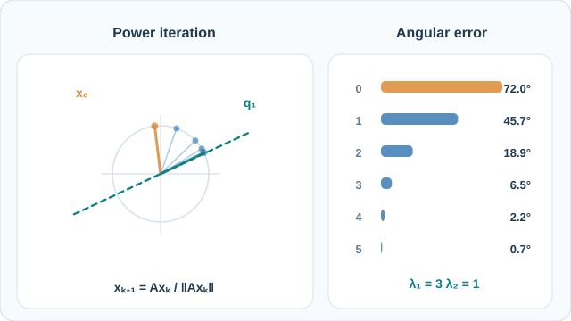
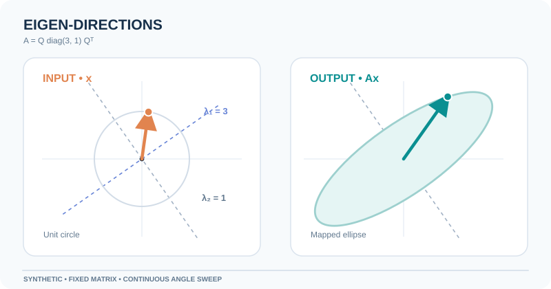
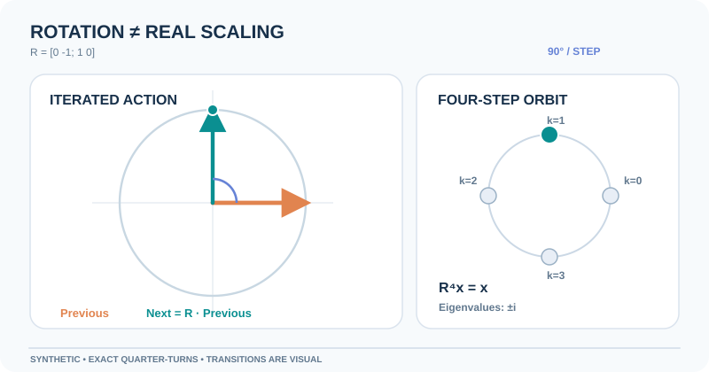
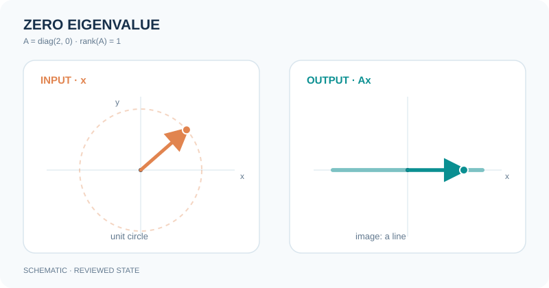
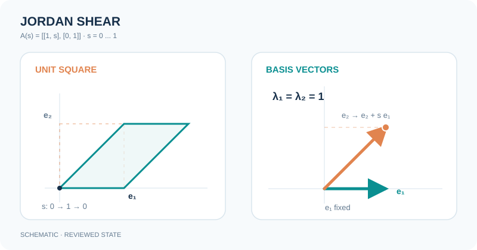
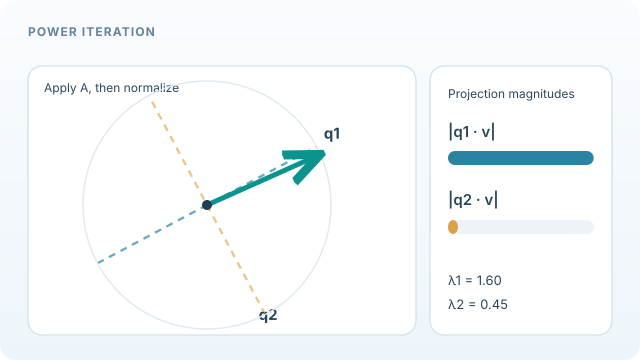

# 特徵值分解

特徵值分解利用特徵向量基底與特徵值，表示可對角化的方陣。實對稱矩陣必定具有實數特徵值，並可選取標準正交的特徵向量基底，因此此分解適合用於共變異數矩陣與損失函數的海森矩陣。本頁是[線性代數](index.md)的一部分。[^spectral]

## 概述

方陣 $A$ 的特徵向量是滿足 $A\mathbf{v}=\lambda\mathbf{v}$ 的非零向量 $\mathbf{v}$，純量 $\lambda$ 是其特徵值。對實數特徵對，正特徵值保留朝向，負特徵值使朝向反轉，零特徵值則將向量映射為零。對正整數 $k$，重複作用可得 $A^k\mathbf{v}=\lambda^k\mathbf{v}$。[^diagonalization]

## 關鍵概念

- **特徵對**：特徵值與其對應的特徵向量。
- **譜定理**：實對稱矩陣具有實數特徵值，且存在標準正交的特徵向量基底。在重複特徵值的特徵空間內，可以選取標準正交基底。[^spectral]
- **半正定矩陣**：所有特徵值皆非負的對稱矩陣。共變異數矩陣即屬此類。
- **譜半徑** $\rho(A)=\max_i|\lambda_i|$ 決定固定矩陣冪次的漸近衰減情形。在 $\rho(A)=1$ 的邊界情況，還需要考量 Jordan 結構。[^dynamics]

## 運作方式

對實對稱 $n\times n$ 矩陣，譜定理給出

$$
A = Q\Lambda Q^\top, \qquad \Lambda = \operatorname{diag}(\lambda_1, \dots, \lambda_n),
$$

其中正交矩陣 $Q$ 的各欄為特徵向量。對應不同特徵值的特徵向量彼此正交。在重複特徵值的特徵空間內，不同的標準正交基底都能給出有效分解。例如，任何非零向量都是 $I$ 的特徵向量，因此任意選取的兩個特徵向量，其內積可能非零。[^spectral]

一般的 $n\times n$ 矩陣，恰在所選數域中具有 $n$ 個線性獨立特徵向量時，才存在分解 $A=V\Lambda V^{-1}$。相異特徵值是充分條件。特徵值重複時，可能仍有完整特徵基底，也可能得到不可對角化的矩陣，下方剪切範例展示了後者。[^diagonalization]

二次型因此沿特徵方向分解：

$$
\mathbf{x}^\top A \mathbf{x} = \sum_{i} \lambda_i \, (\mathbf{q}_i^\top \mathbf{x})^2 .
$$

對目標函數 $f(\mathbf{x})=\tfrac12\mathbf{x}^\top A\mathbf{x}$，海森矩陣為 $A$，沿單位特徵向量 $\mathbf{q}_i$ 的方向二階導數為 $\lambda_i$。對 $\mathbf{x}^\top A\mathbf{x}$，海森矩陣則為 $2A$。正、負海森特徵值分別描述向上與向下的曲率，絕對值較小則代表局部較平坦的方向（見[微積分與最佳化](../calculus/index.md)）。[^curvature]

求主特徵方向的一個標準方法是冪迭代，即反覆套用 $A$ 並正規化結果。對實對稱矩陣，要收斂到唯一主方向，需要嚴格最大的特徵值絕對值，且初始向量在該方向有非零投影。若主特徵值為負，迭代向量的符號可能交替變化。特徵值絕對值的比率控制漸近收斂速度，見 Golub 與 Van Loan。

### 重複作用的穩定性

對固定的有限維矩陣，恰在 $\rho(A)<1$ 時，所有初始向量經 $A^k$ 作用都會趨近零。若 $\rho(A)>1$，則有些初始狀態會增長。當 $\rho(A)=1$ 時，矩陣冪次可能維持有界，也可能以多項式速度增長。[^dynamics]

取下方範例中的固定剪切矩陣 $J=A(1)$，直接相乘可得

$$
J=\begin{bmatrix}1&1\\0&1\end{bmatrix},
\qquad
J^k=\begin{bmatrix}1&k\\0&1\end{bmatrix}.
$$

因此，即使兩個特徵值皆為一，$J^k e_2=(k,1)^\top$ 仍會增長。$I^k=I$ 則維持有界。對連續時間系統 $\dot{x}=Ax$，所有軌跡衰減的條件是全部特徵值的實部嚴格小於零。[^dynamics]

### 動態範例：冪迭代逐步靠近主特徵向量

[GitHub 可讀的冪迭代靜態預覽](../../../assets/concept-animations/power-iteration-convergence-still.svg)

設定**人工合成的正定矩陣** $A=Q\operatorname{diag}(3,1)Q^\top$，其中 $Q=R(25^\circ)$。初始單位向量 $x_0$ 位於 97°，與主特徵向量 $q_1$ 相差 **72°**。每次先計算 $Ax_k$（橘色箭頭會暫時伸長），再依 $x_{k+1}=Ax_k/\|Ax_k\|_2$ 正規化。角度誤差遵循 $\tan\delta_k=\tan(72^\circ)/3^k$；前五次更新後，誤差依序約為 **45.7°、18.9°、6.5°、2.2°、0.7°**。右側長條的長度與這些角度誤差成正比，並非訓練損失。只有箭頭停留在正規化迭代點時，對應列才會反白；標示「套用矩陣／正規化」的過渡期間不顯示列框。到達 $x_5$ 後，循環重設為 $x_0$。

此收斂需要起始向量在唯一、絕對值最大的特徵值所對應方向具有非零分量；條件不成立時，結果可能不同。動畫中連接精確迭代點的過渡影格只是幾何示意，**不代表額外計算步驟或實測執行時間**。MkDocs 提供**播放／暫停**控制；GitHub 可直接查看靜態版本。窄螢幕可以水平捲動。原創圖像，**CC BY-SA 4.0**。

### 動態範例：對稱映射保留特徵方向

[GitHub 可讀的特徵方向靜態預覽](../../../assets/concept-animations/eigen-linear-map-still.svg)

考慮**人工合成的對稱矩陣** $A=Q\operatorname{diag}(3,1)Q^\top$，其中 $Q=R(35^\circ)$。對正交特徵向量 $\mathbf q_1,\mathbf q_2$，

$$
\mathbf x(\theta)=\cos\theta\,\mathbf q_1+\sin\theta\,\mathbf q_2,\qquad
A\mathbf x(\theta)=3\cos\theta\,\mathbf q_1+\sin\theta\,\mathbf q_2.
$$

輸入端點沿圓周移動，輸出端點則描繪橢圓。$\theta=0$ 時，$\mathbf q_1$ 分量放大三倍；$\theta=90^\circ$ 時，$\mathbf q_2$ 分量保持不變。一般方向的輸入與輸出不一定共線。**左右圖面採不同繪圖尺度**，應比較各圖內的形狀與方向，而非跨圖箭頭的絕對長度。角度掃描只是幾何示範，**不是迭代求解或模型訓練**。原創圖，**CC BY-SA 4.0**。

### 動態反例：實數旋轉矩陣未必有實特徵向量

[GitHub 可讀的旋轉軌跡靜態預覽](../../../assets/concept-animations/eigen-rotation-no-real-still.svg)

旋轉矩陣 $R=\begin{bmatrix}0&-1\\1&0\end{bmatrix}$ 將每個非零**實向量**映射到與原向量正交的方向。橘色箭頭代表 $\mathbf x_{k-1}$，青綠色箭頭代表 $\mathbf x_k=R\mathbf x_{k-1}$；右側標記顯示模 4 的離散迭代狀態。四次矩陣乘法後，$R^4\mathbf x_0=\mathbf x_0$。因為對任意實向量皆有 $\mathbf x^\top R\mathbf x=0$，而 $R$ 可逆，因此不存在非零**實**特徵向量。其特徵值 $\pm i$ 位於**複數域**，與要求矩陣**對稱**的譜定理不矛盾。兩個離散轉向之間的平滑畫面僅為*視覺插值*，**不代表額外的矩陣乘法**。原創圖，**CC BY-SA 4.0**。

兩組範例皆可在 MkDocs 使用**播放／暫停**控制；GitHub 直接顯示靜態 SVG。偏好減少動態時播放器預設暫停。手機可將焦點移到圖面區域，利用方向鍵水平捲動。

### 動態範例：零特徵值使空間維度塌縮

[GitHub 可讀的零特徵值靜態預覽](../../../assets/concept-animations/eigen-zero-eigenvalue-still.svg)

考慮**人工設定的奇異矩陣** $A=\operatorname{diag}(2,0)$，兩組特徵對為 $(2,e_1)$ 和 $(0,e_2)$。當 $x(\theta)=(\cos\theta,\sin\theta)$ 掃過單位圓時，$Ax(\theta)=(2\cos\theta,0)$ 的終點只能落在水平線段上。當 $\theta=90^\circ$，$x=e_2\neq0$，但 $Ax=0$，因此第二個特徵方向屬於零空間；同時 $\det(A)=0$ 且 $\operatorname{rank}(A)=1$。**兩面板使用不同圖面縮放**，不能直接用跨面板的像素長度推論特徵值。此連續掃描只是**人工解析式幾何示意，非模型實測或演算法的訓練軌跡**。原創圖像，**CC BY-SA 4.0**。

### 動態反例：重根不一定有足夠的特徵向量

[GitHub 可讀的 Jordan 剪切靜態預覽](../../../assets/concept-animations/eigen-jordan-shear-still.svg)

考慮**人工設定的矩陣族** $A(s)=\begin{bmatrix}1&s\\0&1\end{bmatrix}$，其中 $0\le s\le1$。整個動畫中兩個代數特徵值均為 1，但 $A(s)e_1=e_1$，而 $A(s)e_2=e_2+s e_1$。對任何 $s>0$，由 $(A(s)-I)v=0$ 可得 $v_2=0$，故特徵空間僅為 $\operatorname{span}(e_1)$，雖有重複實特徵值，**仍無法對角化**。當 $s=0$ 時矩陣是單位矩陣，此特例具有二維特徵空間。動畫展示的是**不同剪切參數對應的矩陣族**，不是反覆作用同一個 Jordan 區塊，也不是模型實測。原創圖像，**CC BY-SA 4.0**。

兩組圖在 MkDocs 沿用**播放／暫停**及減少動態時的靜態回退。GitHub 可直接看靜態 SVG；窄螢幕可聚焦圖面後以方向鍵水平捲動。

### 冪迭代動態示範

  

*原創幾何教學動畫，CC BY-SA 4.0。* 此例使用二維對稱矩陣 $A=Q\operatorname{diag}(1.60,0.45)Q^\top$，其中主特徵向量與水平軸夾角為 28 度，並反覆計算 $v_{k+1}=Av_k/\|Av_k\|_2$。初始方向為 -44 度時，$|q_1^\top v_k|$ 從約 0.309 上升至第三次迭代後約 0.998，正交方向投影則逐漸降低。離散迭代點之間的動態僅為視覺插值，**不是連續時間演算法，也不是模型實測軌跡**；動畫反向返回起點只是循環示範，並非冪迭代具有反向步驟。要收斂至唯一主方向，通常需要適當的特徵值絕對值間隔，以及初始向量在該方向有非零投影。Wiki 網站支援播放／暫停與鍵盤操作；GitHub 顯示靜態回退畫面。數值方法的依據見本頁參考文獻。

## 主要方法

特徵值分解是線性代數中兩個代表性的矩陣分解之一，另一個是奇異值分解。

- [奇異值分解](svd.md)：適用於任意矩陣。對半正定對稱矩陣，其奇異值等於特徵值，兩種分解在此一致。

方陣且對稱時（如共變異數矩陣或海森矩陣）使用特徵值分解；資料或權重矩陣為非方陣時使用奇異值分解。

## 與其他頁面的連結

- [主成分分析](../../paradigms/unsupervised/dimensionality-reduction/pca.md)以共變異數矩陣的特徵向量作為主方向，各方向上的變異數即對應的特徵值。
- [機率與統計](../probability-statistics/index.md)中多元高斯分布的共變異數矩陣，即以此方式對角化。
- [微積分與最佳化](../calculus/index.md)以海森矩陣及其特徵值描述損失函數的局部形狀。

## 應用

- **主成分分析**：資料集的主成分即其共變異數矩陣的特徵向量（Bishop, 2006 涵蓋 PCA）。
- **曲率與條件數**：對具有實對稱正定海森矩陣 $H$ 的二次目標函數，歐氏條件數為 $\kappa_2(H)=\lambda_{\max}(H)/\lambda_{\min}(H)$，此比率會影響梯度下降的收斂界限。不定海森矩陣也描述負曲率方向，而奇異海森矩陣的條件數，依通常慣例定為無限大。[^curvature]
- **穩定性分析**：離散時間迭代與連續時間動力系統使用不同的特徵值條件，見上文說明。[^dynamics]

## 開放問題

- 對非常大的矩陣（例如大型網路的海森矩陣）計算特徵值分解成本高昂，實用方法依賴近似，而其精確度難以保證。
- 非對稱矩陣的特徵值可能為複數或病態，因此其特徵值分解比對稱矩陣可靠度低。

[^spectral]: MIT OpenCourseWare（2011）〈Symmetric matrices and positive definiteness〉說明正交特徵基底。Boyd 與 Vandenberghe（2004）附錄 A.5.2 給出對稱譜分解。
[^diagonalization]: MIT OpenCourseWare（2011）〈Diagonalization and powers of A〉說明特徵基底與重複特徵值的條件。
[^curvature]: Boyd 與 Vandenberghe（2004）附錄 A.4.3 與第 9.3 節說明二階近似與正定二次問題的條件數。
[^dynamics]: Boyd（2008）EE263 的〈Eigenvectors and diagonalization〉與〈Jordan canonical form〉講義說明離散、連續時間穩定性，以及 Jordan 區塊的冪次。

## 參考文獻

### 奠基性論文

- Bishop, C. M. (2006). *Pattern Recognition and Machine Learning*. Springer. https://www.microsoft.com/en-us/research/wp-content/uploads/2006/01/Bishop-Pattern-Recognition-and-Machine-Learning-2006.pdf — 以共變異數矩陣的特徵向量定義 PCA 的教科書說明。

### 綜述與教科書

- Golub, G. H. & Van Loan, C. F. (2013). *Matrix Computations*, 4th ed. Johns Hopkins University Press. https://www.press.jhu.edu/books/title/10678/matrix-computations — 涵蓋對稱特徵值問題與冪迭代。
- Trefethen, L. N. & Bau, D. (1997). *Numerical Linear Algebra*. SIAM. https://people.maths.ox.ac.uk/trefethen/text.html — 研究所教材，涵蓋特徵值問題及其數值行為。
- Murphy, K. P. (2022). *Probabilistic Machine Learning: An Introduction*. MIT Press. https://github.com/probml/pml-book — 免費教科書；涵蓋 PCA 及其所對角化的共變異數矩陣。

### 講義

- Strang, G., *18.06 Linear Algebra*, MIT. https://web.mit.edu/18.06/www/ — 課程講次包含特徵值與特徵向量，之後是對角化。

- MIT OpenCourseWare (2011). *Symmetric matrices and positive definiteness*. 18.06SC Linear Algebra. https://ocw.mit.edu/courses/18-06sc-linear-algebra-fall-2011/804ab1e53134741d2044d241b50a285e_MIT18_06SCF11_Ses3.1sum.pdf — 說明實對稱矩陣如何選取標準正交特徵基底。
- MIT OpenCourseWare (2011). *Diagonalization and powers of A*. 18.06SC Linear Algebra. https://ocw.mit.edu/courses/18-06sc-linear-algebra-fall-2011/d05795355f5cbe35356a4a1b39658336_MIT18_06SCF11_Ses2.9sum.pdf — 說明線性獨立特徵向量、重複特徵值與矩陣冪次。
- Boyd, S. (2008). *Introduction to Linear Dynamical Systems*. EE263, Stanford University. https://ee263.stanford.edu/archive/ — 課程講義包含特徵值、對角化、Jordan 結構與穩定性條件。

### 文章與文件

- Boyd, S. & Vandenberghe, L. (2004). *Convex Optimization*. Cambridge University Press. https://web.stanford.edu/~boyd/cvxbook/ — 免費線上教材；涵蓋海森矩陣特徵值所參與的二階條件，以及二次問題的條件數。
