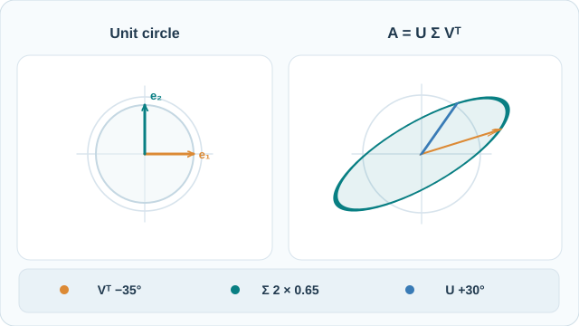

# 奇異值分解（SVD）

奇異值分解把實矩陣表示為一組秩一映射的總和。每項映射將一個輸入方向送到一個輸出方向，並以非負的奇異值縮放。保留最大幾項，即可在指定秩的限制下，對弗羅貝尼烏斯範數與譜範數同時得到最佳近似。[^svd][^approx]

## 維度與幾何意義

令 $A\in\mathbb R^{m\times n}$、$p=\min(m,n)$、$r=\operatorname{rank}(A)$。將奇異值排序為 $\sigma_1\ge\cdots\ge\sigma_p\ge0$，其中恰有 $r$ 個為正。同一個矩陣可用不同尺寸的因子表示。[^svd]

| 形式 | 因子尺寸 | 保留的奇異值 |
|---|---|---|
| 完整分解 | $U$ 為 $m\times m$、$\Sigma$ 為 $m\times n$、$V^\top$ 為 $n\times n$ | 矩形 $\Sigma$ 對角線上的全部 $p$ 個 |
| 經濟型分解 | $U_p$ 為 $m\times p$、$\Sigma_p$ 為 $p\times p$、$V_p^\top$ 為 $p\times n$ | 全部 $p$ 個，包含零值 |
| 依秩壓縮的分解 | $U_r$ 為 $m\times r$、$\Sigma_r$ 為 $r\times r$、$V_r^\top$ 為 $r\times n$ | $r$ 個正奇異值 |

在完整分解 $A=U\Sigma V^\top$ 中，$U$ 與 $V$ 是方形正交矩陣。經濟型及依秩壓縮的形式，在 $U$ 與 $V$ 中保留標準正交欄向量。由右向左讀取映射時，$V^\top$ 先將輸入表示成另一組標準正交基底的座標，$\Sigma$ 縮放並可改變座標數目，最後 $U$ 將結果映射到輸出基底。[^svd]

對於 $i\le p$，配對的奇異向量滿足 $Av_i=\sigma_i u_i$ 與 $A^\top u_i=\sigma_i v_i$。使用完整分解可得

$$
A^\top A=V(\Sigma^\top\Sigma)V^\top,
\qquad AA^\top=U(\Sigma\Sigma^\top)U^\top.
$$

右、左奇異向量因此分別來自兩個 Gram 矩陣，特徵值為奇異值的平方，並依矩陣尺寸補足所需的零。即使 $\Sigma$ 是非方陣，$\Sigma^\top\Sigma$ 與 $\Sigma\Sigma^\top$ 仍是方陣。數值計算中，LAPACK 的 xGESVD 等稠密 SVD 程序會直接把 $A$ 化為雙對角矩陣，再利用該結構求解。[^svd]

### 動態幾何示範：旋轉與奇異值縮放

[GitHub 可讀的 SVD 靜態預覽](../../../assets/concept-animations/svd-unit-circle-still.svg)

此例採用**人工設定的二維矩陣** $A=R(30^\circ)\operatorname{diag}(2,0.65)R(-35^\circ)$。先以 $V^\top$ 旋轉單位圓與標示的基底方向；旋轉不會改變圓形本身。接著 $\Sigma$ 沿兩個主軸分別縮放 **2** 與 **0.65** 倍，最後 $U$ 將橢圓再旋轉 **30°**。因此，相對於單位圓，橢圓的長、短半軸分別為 2 與 0.65。圖中的基底箭頭用來辨識第一步的旋轉，否則沒有標記的圓看起來不會改變。

動畫的中間影格是為了顯示連續幾何變化，**不是** SVD 分解器的計算或訓練過程。所有數值均為教學示意，非神經網路權重的實測結果。在 MkDocs 可使用支援鍵盤操作的**播放／暫停**按鈕；窄螢幕可聚焦並水平捲動圖像。GitHub Markdown 與減少動態效果模式會保留靜態預覽。原創圖像，**CC BY-SA 4.0**。

## 截斷與誤差

對 $0\le k<r$，保留前 $k$ 個秩一項以構成 $A_k$。Eckart–Young–Mirsky 定理指出，在秩至多為 $k$ 的矩陣中，$A_k$ 可將兩種誤差都降到最小。[^ey][^approx]

$$
A_k=\sum_{i=1}^k \sigma_i u_i v_i^\top,\qquad
\|A-A_k\|_F=\left(\sum_{i=k+1}^p \sigma_i^2\right)^{1/2},
\qquad
\|A-A_k\|_2=\sigma_{k+1}.
$$

弗羅貝尼烏斯範數是所有元素平方和的平方根。譜範數是單位長度輸入可產生的最大輸出長度。因此，前者的誤差累計所有捨棄方向，後者則量度剩餘誤差最大的方向。當 $k\ge r$ 時，近似與原矩陣相同，兩種誤差皆為零。[^approx]

### 矩形矩陣算例

考慮下列矩陣。

$$
A=\begin{pmatrix}
3&3&0&0\\
0&0&2&2\\
1&-1&0&0
\end{pmatrix}.
$$

各列互相正交，所以 $AA^\top=\operatorname{diag}(18,8,2)$。奇異值是 $3\sqrt{2}$、$2\sqrt{2}$ 和 $\sqrt{2}$。第一個左奇異向量是第一個座標向量，因此秩一近似保留第一列，將其餘列設為零。其弗羅貝尼烏斯誤差為 $\sqrt{8+2}=\sqrt{10}$，譜範數誤差為 $2\sqrt{2}$。它保留原矩陣弗羅貝尼烏斯範數平方的 $18/28=9/14$。

將 $m\times n$ 權重矩陣儲存為兩個稠密的秩 $k$ 因子，並將 $\Sigma_k$ 併入其中一個因子後，共有 $k(m+n)$ 個純量。這個數量小於 $mn$ 時，儲存量就會下降。近似定理控制的是矩陣誤差。模型品質和延遲仍取決於模型其餘部分與實作，可在實際部署的工作負載上量測。[^approx]

## 最小平方法、PCA 與調適

- **最小平方法。** Moore–Penrose 偽逆為 $A^+=V_r\Sigma_r^{-1}U_r^\top$。對右側向量 $b$，在使 $\|Ax-b\|_2$ 最小的解中，$A^+b$ 的歐幾里得範數最小。小的正奇異值取倒數後可能放大雜訊。數值秩的門檻會把部分小奇異值視為零，從而改變求解的問題。[^approx][^accuracy]
- **主成分分析。** 令 $X$ 的每列是一筆中心化觀測值，共 $m>1$ 筆。$X$ 的右奇異向量是主方向，樣本共變異數矩陣的特徵值為 $\sigma_i^2/(m-1)$，必要時補零。前 $k$ 個主成分分數為 $XV_k=U_k\Sigma_k$。詳見[主成分分析](../../paradigms/unsupervised/dimensionality-reduction/pca.md)。[^pca]
- **模型權重。** [截斷奇異值分解](../../model-compression/low-rank-and-efficient-architectures/truncated-svd/index.md)近似既有權重矩陣。[LoRA](../../model-compression/low-rank-and-efficient-architectures/lora/index.md)凍結基礎權重，學習秩至多為所選適配器秩的更新 $BA$。[^lora]

## 解讀分解因子

同時反轉一對奇異向量的符號，該秩一項會保持相同。重複的奇異值允許在共用子空間內選擇不同的標準正交基底。奇異值彼此接近時，個別計算出的向量也可能對擾動敏感。不同求解器產生的因子有差異時，可比較重建結果及相關子空間。[^accuracy]

[^svd]: 《LAPACK Users' Guide》的〈Singular Value Decomposition〉定義各因子並說明雙對角化。
[^ey]: Eckart 與 Young（1936）建立並求解最小平方意義下的低秩近似問題。
[^approx]: Benner 的《Matrix Equations and Model Reduction》第 2.1 節給出譜範數與弗羅貝尼烏斯範數下的近似結果，以及最小範數最小平方解的解釋。
[^accuracy]: 《LAPACK Users' Guide》的〈Further Details: Error Bounds for the Singular Value Decomposition〉說明數值精度與奇異值群集的向量敏感性。
[^pca]: Strang 在 MIT 18.065 第 7 講說明資料矩陣 SVD 與主成分分析的關係。
[^lora]: Hu 等人（2021）定義凍結的基礎模型與可訓練的低秩權重更新。

## 參考文獻

### 奠基性論文

- Eckart, C. & Young, G. (1936). *The Approximation of One Matrix by Another of Lower Rank*. Psychometrika 1, 211–218. https://link.springer.com/article/10.1007/BF02288367 — 建立並求解最小平方準則下的低秩矩陣近似問題。
- Hu, E. J. et al. (2021). *LoRA: Low-Rank Adaptation of Large Language Models*. https://arxiv.org/abs/2106.09685 — 提出調適時對凍結預訓練權重學習低秩更新的方法。

### 綜述與教科書

- Benner, P. *Matrix Equations and Model Reduction*, section 2.1. Max Planck Institute for Dynamics of Complex Technical Systems. https://www.mpi-magdeburg.mpg.de/2519809/MathBasics.pdf — 陳述截斷定理，並說明 SVD 與偽逆的關係。
- Golub, G. H. & Van Loan, C. F. (2013). *Matrix Computations*, 4th ed. Johns Hopkins University Press. https://www.press.jhu.edu/books/title/10678/matrix-computations — 涵蓋矩陣分解、計算演算法與數值最小平方問題。

### 講義

- Strang, G. (2018). *18.065 Matrix Methods in Data Analysis, Signal Processing, and Machine Learning*, Lecture 7. MIT OpenCourseWare. https://www.ocw.mit.edu/courses/18-065-matrix-methods-in-data-analysis-signal-processing-and-machine-learning-spring-2018/resources/lecture-7-eckart-young-the-closest-rank-k-matrix-to-a/ — 連結主成分分析與最近秩 $k$ 矩陣定理。

### 文章與文件

- *LAPACK Users' Guide*. *Singular Value Decomposition*. https://netlib.org/lapack/lug/node53.html — 說明因子慣例與 LAPACK 使用的雙對角化。
- *LAPACK Users' Guide*. *Further Details: Error Bounds for the Singular Value Decomposition*. https://netlib.org/lapack/lug/node97.html — 說明奇異值、奇異向量與子空間的數值誤差界。
