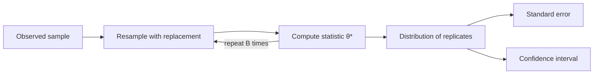

# The Bootstrap

The bootstrap estimates the uncertainty of a statistic by resampling the observed data with replacement and recomputing the statistic on each resample. It gives standard errors and confidence intervals for quantities with no convenient formula, such as a median, a ratio or the difference between two models' scores. Efron (1979) introduced it. The parent topic is [probability and statistics](../index.md).

## Overview

Suppose we have a sample $x_1,\dots,x_n$ and a statistic $\hat\theta=t(x_1,\dots,x_n)$. To see how much $\hat\theta$ would vary across samples, we would draw many new samples from the population, which we cannot do. The observed sample is the best available picture of the population, so the bootstrap treats it as the population: it draws $n$ values with replacement from the observed data, computes the statistic on that resample, and repeats this many times. The spread of the results estimates the sampling distribution of $\hat\theta$.

The method needs no formula for that distribution, which is its main advantage. Its costs are computation, since the statistic is recomputed for every resample, and reliance on the sample being representative.

## Key concepts

- **Bootstrap replicate**: the statistic $\hat\theta^*_b$ computed on the $b$-th resample, for $b=1,\dots,B$.
- **Percentile interval**: the interval between the $\alpha/2$ and $1-\alpha/2$ quantiles of the replicates, which gives an approximate $(1-\alpha)$ confidence interval.

## How it works

The algorithm has four steps: draw a resample of size $n$ with replacement; compute the statistic on it; repeat for $B$ resamples, typically a few thousand; and use the replicates. The standard error is

$$
\widehat{\mathrm{se}}=\sqrt{\frac{1}{B-1}\sum_{b=1}^{B}\big(\hat\theta^*_b-\bar\theta^*\big)^2},\qquad \bar\theta^*=\frac1B\sum_{b=1}^{B}\hat\theta^*_b,
$$

and the percentile interval is $\big[\hat\theta^*_{(\alpha/2)},\,\hat\theta^*_{(1-\alpha/2)}\big]$, the quantiles of the sorted replicates.

Each resample contains about 63% of the distinct original points,[^1] so the replicates reflect which points are present as well as the duplicates. For a mean, the bootstrap standard error approximately reproduces the usual $s/\sqrt{n}$, and it applies unchanged to a median, for which no simple formula exists.

## Results

Efron (1979) showed on a variety of estimation problems that the method gives sensible standard errors. Efron and Tibshirani (1986) extend it to confidence intervals and to regression and dependent data, with worked examples.

The bootstrap has also been used to compare learning algorithms. Dietterich (1998) compared five approximate tests for deciding whether one classifier outperforms another. He reports that two widely used tests have a high probability of false detections and should never be used, and that a paired test based on ten-fold cross-validation has a somewhat elevated false-detection rate. Agarwal and colleagues (2021) make the same point for deep reinforcement learning: with few training runs per task, point estimates of aggregate scores hide substantial uncertainty, and they recommend bootstrap confidence intervals.

## Limitations

- **Sample representativeness.** The bootstrap reflects only the variation present in the sample. Small samples give poor replicates, and extreme-value statistics such as the maximum are a known difficulty.
- **Dependence.** Resampling single points breaks the dependence in time series and clustered data, which requires block or cluster resampling.
- **Training randomness.** Resampling the data does not capture variation from random seeds or initialisations in a deep network.
- **Cost and leakage.** Each replicate may require refitting a model, and evaluation resamples must respect the split structure, or variance is understated.

## Open questions

- Valid intervals for benchmark comparisons when only a few training runs per task are affordable remain an active question.
- Variance estimates for cross-validated performance are difficult, because the folds are not independent. A practical unbiased estimator is not settled.

## Connections

- **Maximum likelihood.** The standard error of the MLE comes from its asymptotic distribution, and the bootstrap gives the same quantity without that approximation. See [maximum likelihood](../maximum-likelihood/index.md).
- **Uncertainty.** Ensembles of networks trained from different random seeds are an alternative to resampling the data; see [deep ensembles](../../../machine-learning/uncertainty-and-calibration/deep-ensembles/index.md).
- **Brain and mind.** Resampling-based tests are routine in neuroimaging, where distributional assumptions are hard to check. See [neuroimaging methods](../../../../brain-mind/neuroimaging-methods/index.md). This is a tool for analysing brain data, not a model of the brain.

## Applications

- **Standard errors without formulas.** The median, a ratio or a correlation coefficient has no simple standard error in general, and the bootstrap supplies one.
- **Model comparison.** A bootstrap interval for the difference in accuracy between two classifiers on the same test examples shows whether the difference exceeds sampling noise.

[^1]: As the sample size grows, the probability that a given original point appears in a resample tends to $1-(1-1/n)^n \to 1-e^{-1}\approx 0.632$.

## References

### Seminal papers

- Efron, B. (1979). Bootstrap methods: another look at the jackknife. *The Annals of Statistics*. https://doi.org/10.1214/aos/1176344552 — Introduces the bootstrap as a general method for estimating the sampling distribution of a statistic.
- Dietterich, T. G. (1998). Approximate statistical tests for comparing supervised classification learning algorithms. *Neural Computation*. https://doi.org/10.1162/089976698300017197 — Compares five approximate tests for classifier comparison and identifies tests with high false-detection rates.

### Surveys and textbooks

- Efron, B. & Tibshirani, R. J. (1994). *An Introduction to the Bootstrap*. Chapman & Hall/CRC. https://doi.org/10.1201/9780429246593 — Book-length introduction to bootstrap standard errors, confidence intervals and hypothesis tests.
- Efron, B. & Tibshirani, R. (1986). Bootstrap methods for standard errors, confidence intervals, and other measures of statistical accuracy. *Statistical Science*. https://doi.org/10.1214/ss/1177013815 — Review of bootstrap methods for standard errors and confidence intervals, with examples.

### Articles and documentation

- Agarwal, R. et al. (2021). Deep reinforcement learning at the edge of the statistical precipice. arXiv. https://arxiv.org/abs/2108.13264 — Argues that few-run reinforcement learning benchmarks need uncertainty estimates, and proposes bootstrap intervals and robust aggregate metrics.
