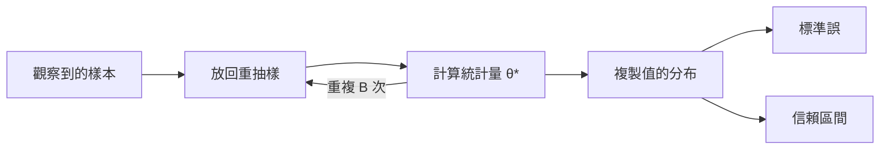

# 自助法

自助法（bootstrap）透過對觀察到的資料做放回重抽樣，並在每個重抽樣上重新計算統計量，來估計該統計量的不確定性。它能為沒有方便公式的量提供標準誤與信賴區間，例如中位數、比值，或兩個模型分數之差。此方法由 Efron（1979）提出。本頁所屬的主題是[AI 的機率與統計](../index.md)。

## 概述

設有樣本 $x_1,\dots,x_n$ 與統計量 $\hat\theta=t(x_1,\dots,x_n)$。若要知道 $\hat\theta$ 在不同樣本間會變動多少，我們會從母體中抽出許多新樣本，但這做不到。觀察到的樣本是對母體最好的描述，因此自助法把它當作母體：從觀察資料中放回地抽出 $n$ 個值，在該重抽樣上計算統計量，並重複許多次。所得結果的分散程度，即估計了 $\hat\theta$ 的抽樣分布。

這個方法不需要該分布的公式，這是它的主要優點。它的代價是計算量大，因為每個重抽樣都要重新計算統計量；而且它依賴樣本能合理代表母體。

## 核心概念

- **自助複製值**：第 $b$ 次重抽樣上算出的統計量 $\hat\theta^*_b$，$b=1,\dots,B$。
- **百分位區間**：複製值第 $\alpha/2$ 與第 $1-\alpha/2$ 分位數之間的區間，給出近似的 $(1-\alpha)$ 信賴區間。

## 運作方式

演算法有四個步驟：放回地抽出大小為 $n$ 的重抽樣；在其上計算統計量；重複 $B$ 次，通常為數千次；然後使用這些複製值。標準誤為

$$
\widehat{\mathrm{se}}=\sqrt{\frac{1}{B-1}\sum_{b=1}^{B}\big(\hat\theta^*_b-\bar\theta^*\big)^2},\qquad \bar\theta^*=\frac1B\sum_{b=1}^{B}\hat\theta^*_b,
$$

百分位區間則為 $\big[\hat\theta^*_{(\alpha/2)},\,\hat\theta^*_{(1-\alpha/2)}\big]$，即排序後複製值的分位數。

每個重抽樣大約包含 63% 的原始不同點，[^1] 因此複製值反映的，既有哪些點出現所造成的變異，也有重複點的影響。對於平均值，自助標準誤近似地重現通常的 $s/\sqrt{n}$；它同樣適用於中位數，而中位數並沒有簡單的公式。

## 結果

Efron（1979）在多種估計問題上顯示，此方法能給出合理的標準誤。Efron 與 Tibshirani（1986）把它延伸到信賴區間、迴歸與相依資料，並附上例子。

自助法也被用於比較學習演算法。Dietterich（1998）比較了五種近似的統計檢定，用以判斷一個分類器是否優於另一個。他報告，兩種常見的檢定有很高的誤判機率，「應該永遠不用」；而以十折交叉驗證為基礎的成對檢定，誤判率則略為偏高。Agarwal 等人（2021）在深度強化學習中提出相同的觀點：每個任務只有少數幾次訓練時，整體分數的點估計會隱藏相當大的不確定性，他們建議報告自助法信賴區間。

## 限制

- **樣本的代表性。** 自助法只能反映樣本中已存在的變異。樣本很小時，複製值品質很差；極值統計量（例如最大值）則是已知的困難。
- **相依性。** 逐點重抽樣會破壞時間序列與分群資料中的依賴關係，這需要區塊或群重抽樣。
- **訓練的隨機性。** 重抽資料無法捕捉深度網路中來自隨機種子或初始化的變異。
- **成本與洩漏。** 每個複製值可能需要重新擬合模型；而評估用的重抽樣必須尊重資料切分的結構，否則會低估變異。

## 開放問題

- 當每個任務只能負擔少數幾次訓練時，如何為基準比較建立有效的區間，仍是活躍的問題。
- 交叉驗證效能的變異估計很困難，因為各折並不獨立。實用的不偏估計量尚無定論。

## 關聯

- **最大概似估計。** MLE 的標準誤來自其漸近分布，而自助法不需要這個近似就能給出相同的量。參見[最大概似估計](../maximum-likelihood/index.md)。
- **不確定性。** 以不同隨機種子訓練的網路集成，是重抽樣資料之外的另一種方法；參見[深度集成](../../../machine-learning/uncertainty-and-calibration/deep-ensembles/index.md)。
- **大腦與心智。** 神經影像分析中常規地使用基於重抽樣的檢定，因為其分布假設難以檢驗。參見[神經影像方法](../../../../brain-mind/neuroimaging-methods/index.md)。這是分析腦部資料的工具，而不是大腦運作方式的模型。

## 應用

- **無公式的標準誤。** 中位數、比值或相關係數一般沒有簡單的標準誤，自助法可以提供。
- **比較模型。** 對兩個分類器在同一組測試樣本上的準確率之差，計算自助區間，可顯示該差異是否超過抽樣雜訊。

[^1]: 當樣本大小增加時，某個原始點出現在重抽樣中的機率趨近於 $1-(1-1/n)^n \to 1-e^{-1}\approx 0.632$。

## 參考文獻

### 開創性論文

- Efron, B. (1979). Bootstrap methods: another look at the jackknife. *The Annals of Statistics*. https://doi.org/10.1214/aos/1176344552 — 提出自助法，作為估計統計量抽樣分布的一般方法。
- Dietterich, T. G. (1998). Approximate statistical tests for comparing supervised classification learning algorithms. *Neural Computation*. https://doi.org/10.1162/089976698300017197 — 比較五種用於分類器比較的近似檢定，並指出誤判率高的檢定。

### 綜述與教科書

- Efron, B. & Tibshirani, R. J. (1994). *An Introduction to the Bootstrap*. Chapman & Hall/CRC. https://doi.org/10.1201/9780429246593 — 自助標準誤、信賴區間與假設檢定的專書入門。
- Efron, B. & Tibshirani, R. (1986). Bootstrap methods for standard errors, confidence intervals, and other measures of statistical accuracy. *Statistical Science*. https://doi.org/10.1214/ss/1177013815 — 回顧自助法在標準誤與信賴區間上的應用，並附例子。

### 文章與文件

- Agarwal, R. et al. (2021). Deep reinforcement learning at the edge of the statistical precipice. arXiv. https://arxiv.org/abs/2108.13264 — 主張少次執行的強化學習基準需要不確定性估計，並提出自助區間與穩健的整體指標。
