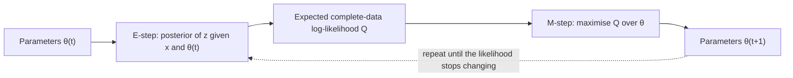

# Expectation–Maximisation (EM) Algorithm

The expectation–maximisation (EM) algorithm finds a maximum likelihood estimate when some variables are hidden. It alternates between estimating the hidden variables under the current parameters and re-estimating the parameters as if those estimates were known. It is the standard tool for fitting mixture models and many other latent-variable models. The parent topic is [probability and statistics](../index.md), and the estimator it serves is described on the [maximum likelihood](../maximum-likelihood/index.md) page.

## Overview

Many models have variables that are never observed: the component that generated each point in a mixture, the state of a hidden Markov chain, or a missing table entry. Write $x$ for the observed data, $z$ for the hidden variables and $\theta$ for the parameters. The likelihood of the observed data sums over the unobserved values,

$$
\log p(x\mid\theta)=\log\sum_z p(x,z\mid\theta).
$$

The logarithm cannot move inside the sum, so the maximiser usually has no closed form, even when the complete-data likelihood $p(x,z\mid\theta)$ is simple. Dempster, Laird and Rubin (1977) gave a general iterative method for this problem, under the name EM, and showed that each iteration does not decrease the observed-data likelihood.

## Key concepts

- **Responsibility**: the posterior $p(z\mid x,\theta^{t})$ of each hidden value under the current parameters. In a mixture, it is the probability that a point came from each component.

## How it works

Starting from parameters $\theta^{t}$, each iteration has two steps.

1. **E-step.** Compute the posterior over the hidden variables under the current parameters, and form
   $$Q(\theta\mid\theta^{t})=\mathbb{E}_{p(z\mid x,\theta^{t})}\big[\log p(x,z\mid\theta)\big].$$
2. **M-step.** Set $\theta^{t+1}=\arg\max_\theta Q(\theta\mid\theta^{t})$.

The M-step is usually easy, because $Q$ is an expectation of a complete-data log-likelihood whose maximiser often has a closed form.

**Example: Gaussian mixture.** With component weights $\pi_k$, means $\mu_k$ and covariances $\Sigma_k$, the E-step computes responsibilities $r_{ik}=p(z_i=k\mid x_i,\theta^t)$. The M-step updates each mean as a responsibility-weighted average,

$$
\mu_k=\frac{\sum_i r_{ik}\,x_i}{\sum_i r_{ik}},
$$

and updates the covariances and weights in the same way. Each point is shared between components in proportion to its responsibilities.

**Lower-bound view.** For any distribution $q(z)$ over the hidden variables, Jensen's inequality gives

$$
\log p(x\mid\theta)\ \ge\ \mathbb{E}_{q}\big[\log p(x,z\mid\theta)\big]-\mathbb{E}_{q}\big[\log q(z)\big].
$$

The right-hand side equals the likelihood when $q(z)=p(z\mid x,\theta)$. Neal and Hinton (1998) use this view to show that the E-step sets $q$ to the posterior and the M-step maximises the bound over $\theta$. The bound is the evidence lower bound (ELBO) of [variational inference](../../../paradigms/probabilistic/variational-inference/index.md), so EM is coordinate ascent on it.

## Results

Dempster, Laird and Rubin (1977) illustrate the method on missing, censored and mixture-model data, with analytical rather than benchmark evidence. Wu (1983) shows that, under conditions covering many practical models, EM converges to a stationary point of the likelihood, not necessarily a maximum. Neal and Hinton (1998) show that the same argument justifies incremental and sparse variants, which update on part of the data at each step.

## Limitations

- **Local optima.** The result depends on the initial parameters, so practitioners run EM from several starts.
- **Slow convergence.** Convergence is typically linear and can be slow.
- **Intractable E-step.** In many models the posterior over $z$ cannot be computed exactly. Variational and Monte Carlo variants approximate it, at the cost of the monotonicity guarantee.
- **Standard errors.** EM gives a point estimate, and its standard errors need extra work.

## Open questions

- Global convergence guarantees for mixtures in high dimensions are only partial.
- Variational autoencoders learn an encoder that approximates the E-step for all data at once. How much accuracy this costs compared with exact EM is still under study.

## Connections

- **Maximum likelihood.** EM is the maximum likelihood method for incomplete data; see the [maximum likelihood](../maximum-likelihood/index.md) page.
- **Variational inference.** EM is a special case of coordinate ascent on the ELBO. The [variational inference](../../../paradigms/probabilistic/variational-inference/index.md) folder develops the general case.
- **Brain and mind.** No direct link between EM and neural computation is established. The Bayesian-brain framing on the [parent page](../index.md) is the nearest idea.

## Applications

- **Clustering.** Gaussian mixture models are fitted by EM, and the responsibilities give soft cluster assignments.
- **Hidden Markov models.** The Baum–Welch algorithm for training them is an instance of EM, with the hidden states as latent variables.
- **Factor analysis.** Models that explain observed variables through a few hidden factors are fitted by EM.

## References

### Seminal papers

- Dempster, A. P., Laird, N. M. & Rubin, D. B. (1977). Maximum likelihood from incomplete data via the EM algorithm. *Journal of the Royal Statistical Society B*. https://doi.org/10.1111/j.2517-6161.1977.tb01600.x — Introduces the EM algorithm and proves that it does not decrease the observed-data likelihood.
- Wu, C. F. J. (1983). On the convergence properties of the EM algorithm. *The Annals of Statistics*. https://doi.org/10.1214/aos/1176346060 — Conditions under which EM converges to stationary points of the likelihood.
- Neal, R. M. & Hinton, G. E. (1998). A view of the EM algorithm that justifies incremental, sparse, and other variants. In *Learning in Graphical Models*. https://doi.org/10.1007/978-94-011-5014-9_12 — Presents EM as maximisation of a free-energy bound, which justifies incremental variants.
- Kingma, D. P. & Welling, M. (2013). Auto-encoding variational Bayes. arXiv. https://arxiv.org/abs/1312.6114 — Trains a latent-variable model by maximising a bound with an amortised encoder, a neural version of the E-step.

### Surveys and textbooks

- McLachlan, G. J. & Krishnan, T. (2008). *The EM Algorithm and Extensions*, 2nd ed. Wiley. https://doi.org/10.1002/9780470191613 — Book-length treatment of EM, its theory, extensions and applications.
