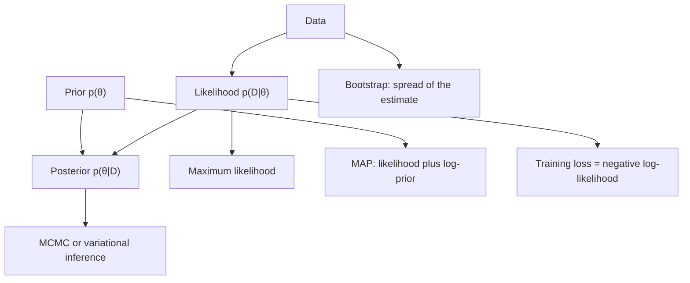

# Probability and Statistics for AI

Probability is the language in which AI systems represent uncertainty, and statistics is the set of methods for fitting a model to data and judging how far to trust the result. This page covers random variables and common distributions, Bayes' rule, expectation and variance, maximum likelihood against maximum a posteriori (MAP) estimation, estimators and confidence, and the statistical reading of a loss function.

## Overview

A learning system sees a finite sample of data and must then say something about the process that produced it. Probability gives a precise way to describe that process. A random variable assigns numbers to outcomes, and a distribution says how likely each value is. Statistics asks the reverse question. Given the data that were observed, which distribution is most plausible, how much should the estimate be trusted, and what can be expected on data not yet seen?

Most of the uncertainty mathematics in [mathematics for AI](../index.md) rests on this page. The [probabilistic methods](../../paradigms/probabilistic/index.md) folder uses these foundations to perform inference in complex models, and [information theory](../../information-theory/index.md) measures the information carried by the same distributions. This page introduces the shared vocabulary and the three estimation tools that most AI systems use in some form.

## Key concepts

- **Random variable**: a quantity $X$ whose value depends on a random outcome. A discrete variable has a probability mass function $p(x)=P(X=x)$; a continuous one has a density $p(x)$ with $\int p(x)\,dx=1$.
- **Common distributions**: the Bernoulli distribution for a binary outcome; the categorical distribution over $K$ classes, which is the output of a softmax classifier; the Gaussian for real-valued noise and as a default prior; and the Poisson for counts. - **Expectation and variance**: $\mathbb{E}[X]$ is the long-run average of $X$, and $\operatorname{Var}(X)=\mathbb{E}[(X-\mathbb{E}[X])^2]$ measures its spread. Expectation is linear, so $\mathbb{E}[aX+b]=a\,\mathbb{E}[X]+b$. A training loss is an expectation over the data distribution, estimated by an average over a mini-batch.
- **Independent and identically distributed (i.i.d.) data**: the common assumption that examples are drawn independently from one distribution. Most estimation results assume it, and most real datasets only approximately satisfy it.
- **Estimator**: a rule that maps a sample to a number, such as the sample mean as an estimate of $\mathbb{E}[X]$. Its quality is judged by its bias (does it hit the true value on average?), its variance (how much does it change from sample to sample?) and its consistency (does it converge as the sample grows?).
- **Confidence interval**: an interval computed from the data that, over repeated sampling, contains the true parameter at a stated rate. It describes the procedure, not the single interval computed from one dataset, a distinction that is often misread.

## How it works

**Bayes' rule.** Given a prior $p(\theta)$ over parameters and a likelihood $p(D\mid\theta)$ for the data, the posterior is

$$
p(\theta\mid D)=\frac{p(D\mid\theta)\,p(\theta)}{p(D)},\qquad p(D)=\int p(D\mid\theta)\,p(\theta)\,d\theta .
$$

The rule follows directly from the product rule of probability. Thomas Bayes' posthumous essay of 1763 treated the inverse problem of inferring causes from observed effects, which is why the rule carries his name. The denominator $p(D)$ is an integral over all parameter values and is usually intractable for a neural network. That single difficulty is the reason for the approximate methods in the [probabilistic methods](../../paradigms/probabilistic/index.md) folder, namely [MCMC](../../paradigms/probabilistic/mcmc/index.md) and [variational inference](../../paradigms/probabilistic/variational-inference/index.md).

**Maximum likelihood and MAP.** The likelihood of i.i.d. data is $\prod_i p(x_i\mid\theta)$. Maximum likelihood (ML) picks the parameter that makes the data most probable. Maximum a posteriori (MAP) estimation adds the prior:

$$
\hat\theta_{\mathrm{ML}}=\arg\max_\theta\sum_{i}\log p(x_i\mid\theta),\qquad
\hat\theta_{\mathrm{MAP}}=\arg\max_\theta\Big[\sum_{i}\log p(x_i\mid\theta)+\log p(\theta)\Big].
$$

MAP is therefore ML with a penalty, $\log p(\theta)$. A flat prior gives back ML. A Gaussian prior adds an $L_2$ penalty, the form used in ridge regression, and a Laplace prior adds an $L_1$ penalty, which underlies the lasso. As the data grow, the likelihood term dominates and the choice of prior matters less. The [maximum likelihood](maximum-likelihood/index.md) method page develops both estimators.

**The statistical view of a loss function.** Most training losses are negative log-likelihoods under an assumed noise model:

- Gaussian noise on a real-valued target gives squared error, $\tfrac12(y-\hat y)^2$ up to a constant.
- Laplace noise gives absolute error, $|y-\hat y|$.
- A categorical output gives cross-entropy, $-\sum_k y_k\log\hat p_k$, the negative log-likelihood of the categorical distribution.
- A regularisation term is a negative log-prior.

Minimising a loss is therefore the same as maximising a likelihood, and the choice of loss is the choice of a noise model. A wrong noise model is a misspecified likelihood, and the cost of misspecification appears in calibration, discussed in the [loss functions](../../paradigms/supervised/loss-functions-and-optimization/index.md) page and in [uncertainty and calibration](../../machine-learning/uncertainty-and-calibration/index.md).

**Estimation and confidence.** Because an estimator is a function of random data, it has a distribution of its own. Its spread is the standard error. For maximum likelihood, that distribution is approximately Gaussian in large samples, which gives standard errors and confidence intervals from the Fisher information. When no formula is available, the [bootstrap](bootstrap/index.md) estimates the same spread by resampling the data.

## Key methods

Three landmark methods carry this material into practice. Each has its own page.

| Method | Question it answers | What it assumes | Detail |
|---|---|---|---|
| [Maximum likelihood](maximum-likelihood/index.md) | Which parameter makes the observed data most probable? | A parametric model and i.i.d. data; MAP adds a prior | Fisher (1922) |
| [Expectation–maximisation](expectation-maximisation/index.md) | How to maximise a likelihood when some variables are hidden? | A latent-variable model whose complete-data likelihood is tractable | Dempster, Laird & Rubin (1977) |
| [Bootstrap](bootstrap/index.md) | How uncertain is an estimate when no formula exists? | The sample is a reasonable stand-in for the population | Efron (1979) |

Bayesian posterior inference, which the table does not cover, is treated in the [probabilistic methods](../../paradigms/probabilistic/index.md) folder.

## Connections

- **Probabilistic methods.** Bayes' rule, the posterior and its approximation by [MCMC](../../paradigms/probabilistic/mcmc/index.md) and [variational inference](../../paradigms/probabilistic/variational-inference/index.md) extend the material here. The ELBO used in variational inference is itself a likelihood-based bound.
- **Information theory.** Cross-entropy is the negative log-likelihood of a categorical model. Minimising it over a model family is equivalent to minimising the KL divergence from the data distribution, because the data entropy does not depend on the model. See [information theory](../../information-theory/index.md).
- **Calculus and optimisation.** Maximum likelihood is an optimisation problem. Its gradient is the score, and deep models find it by [gradient descent](../calculus/gradient-descent/index.md).
- **Uncertainty and calibration.** A probabilistic model is useful only if its stated probabilities match observed frequencies. Modern networks often fail this check. See [uncertainty and calibration](../../machine-learning/uncertainty-and-calibration/index.md).
- **Brain and mind.** The "Bayesian brain" hypothesis proposes that perception combines a prior with sensory likelihoods. Ernst and Banks (2002) found that people combine visual and haptic cues in proportion to their reliability, in the way a maximum-likelihood integrator would. Knill and Pouget (2004) review the idea that neural activity represents probability distributions. The idea is contested; see [cognitive science](../../../brain-mind/cognitive-science/index.md) and [NeuroAI](../../../brain-mind/neuroai/index.md).

## Applications

- **Classifier training.** Logistic regression and softmax classifiers are fitted by maximum likelihood, which is cross-entropy minimisation.
- **Model comparison.** Benchmark differences are estimates with uncertainty. Agarwal and colleagues (2021) show that reporting only point estimates in deep reinforcement learning, where each task has few training runs, can mislead, and they recommend bootstrap confidence intervals.

## Open questions

- **Choosing the model.** A likelihood is only as good as its noise model and prior. How to check that a chosen model fits the data is still a practical question.
- **Calibration.** Guo and colleagues (2017) found that modern neural networks are poorly calibrated, and that a single temperature parameter fitted on held-out data corrects much of it. Why calibration degrades with depth and width is not fully explained.
- **Uncertainty decomposition.** Kendall and Gal (2017) separate aleatoric uncertainty, noise in the data, from epistemic uncertainty, ignorance of the model. Estimating the two reliably at scale is an open problem.
- **Statistical reporting.** The American Statistical Association (Wasserstein & Lazar, 2016) warned that p-values are often misread, and Greenland and colleagues (2016) list common misinterpretations of p-values and confidence intervals. Good reporting practice in AI research is still unsettled.
- **Human inference.** Whether people reason in a Bayesian or resource-rational way is debated (Lieder & Griffiths, 2019).

## References

### Seminal papers

- Bayes, T. (1763). An essay towards solving a problem in the doctrine of chances. *Philosophical Transactions of the Royal Society of London*. https://doi.org/10.1098/rstl.1763.0053 — Posthumous essay on inverse probability, the origin of the rule that bears Bayes' name.
- Fisher, R. A. (1922). On the mathematical foundations of theoretical statistics. *Philosophical Transactions of the Royal Society A*. https://doi.org/10.1098/rsta.1922.0009 — Lays out the foundations of estimation, including maximum likelihood and its properties.
- Ernst, M. O. & Banks, M. S. (2002). Humans integrate visual and haptic information in a statistically optimal fashion. *Nature*. https://doi.org/10.1038/415429a — Shows that people weight vision and touch by their reliability, close to a maximum-likelihood combination.
- Knill, D. C. & Pouget, A. (2004). The Bayesian brain: the role of uncertainty in neural coding and computation. *Trends in Neurosciences*. https://doi.org/10.1016/j.tins.2004.10.007 — Reviews the proposal that neural computation represents and combines probability distributions.
- Gneiting, T. & Raftery, A. E. (2007). Strictly proper scoring rules, prediction, and estimation. *Journal of the American Statistical Association*. https://doi.org/10.1198/016214506000001437 — Formalises proper scoring rules, which reward forecasters for reporting their true beliefs, including the log score behind cross-entropy.
- Kendall, A. & Gal, Y. (2017). What uncertainties do we need in Bayesian deep learning for computer vision? arXiv. https://arxiv.org/abs/1703.04977 — Separates aleatoric (data) and epistemic (model) uncertainty in neural networks for vision.
- Guo, C. et al. (2017). On calibration of modern neural networks. arXiv. https://arxiv.org/abs/1706.04599 — Shows that modern networks are poorly calibrated and that temperature scaling corrects much of it.

### Surveys and textbooks

- Wasserman, L. (2004). *All of Statistics*. Springer. https://doi.org/10.1007/978-0-387-21736-9 — Compact graduate text on probability, estimation, confidence intervals and hypothesis testing.
- Hastie, T., Tibshirani, R. & Friedman, J. (2009). *The Elements of Statistical Learning*. Springer. https://doi.org/10.1007/978-0-387-84858-7 — Statistical view of supervised learning, covering regression, classification, regularisation and model assessment.
- Efron, B. & Hastie, T. (2016). *Computer Age Statistical Inference*. Cambridge University Press. https://doi.org/10.1017/CBO9781316576533 — Connects classical likelihood methods with modern computation, including the bootstrap and regularised regression.
- Ghahramani, Z. (2015). Probabilistic machine learning and artificial intelligence. *Nature*. https://doi.org/10.1038/nature14541 — Review arguing that probability theory is the consistent framework for learning and decision-making in AI.

### Articles and documentation

- Wasserstein, R. L. & Lazar, N. A. (2016). The ASA statement on p-values: context, process, and purpose. *The American Statistician*. https://doi.org/10.1080/00031305.2016.1154108 — Statement by the American Statistical Association on the use and misuse of p-values.
- Greenland, S. et al. (2016). Statistical tests, P values, confidence intervals, and power: a guide to misinterpretations. *European Journal of Epidemiology*. https://doi.org/10.1007/s10654-016-0149-3 — Catalogues common misreadings of p-values and confidence intervals.
- Lieder, F. & Griffiths, T. L. (2019). Resource-rational analysis: understanding human cognition as the optimal use of limited computational resources. *Behavioral and Brain Sciences*. https://doi.org/10.1017/S0140525X1900061X — Argues that human inference approximates optimal reasoning under limited computation.
