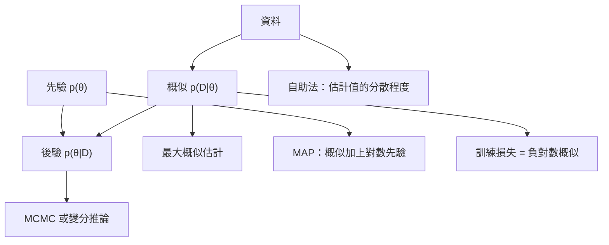

# AI 的機率與統計

機率是 AI 系統表示不確定性的語言，統計則是把模型擬合到資料上、並判斷結果可信程度的方法。本頁涵蓋隨機變數與常見分布、貝氏定理、期望值與變異數、最大概似估計與最大後驗（MAP）估計的比較、估計量與信賴區間，以及損失函數的統計觀點。

## 概述

學習系統看到的只是有限的資料樣本，之後卻必須對產生這些資料的過程做出判斷。機率提供精確描述這個過程的方式：隨機變數把數值指派給各種結果，分布則說明每個數值出現的可能性有多大。統計問的則是反方向的問題：給定已觀察到的資料，哪個分布最合理？估計值應有多可信？對於尚未見過的資料，我們能預期什麼？

[AI 的數學基礎](../index.md)中與不確定性有關的數學，大多以本頁為基礎。[機率方法](../../probabilistic/index.md)章節用這些基礎在複雜模型中進行推論，而[資訊理論](../../information-theory/index.md)則用同樣的分布來衡量資訊量。本頁介紹共通的詞彙，以及大多數 AI 系統都會以某種形式使用的三種估計工具。

## 核心概念

- **隨機變數**：其數值取決於隨機結果的量，記為 $X$。離散變數有機率質量函數 $p(x)=P(X=x)$；連續變數有密度函數 $p(x)$，且 $\int p(x)\,dx=1$。
- **常見分布**：伯努利分布用於二元結果；類別分布用於 $K$ 個類別，也就是分類器 softmax 的輸出；高斯分布用於實數值雜訊，也常作為預設先驗；泊松分布用於計數。
- **期望值與變異數**：$\mathbb{E}[X]$ 是 $X$ 的長期平均值，$\operatorname{Var}(X)=\mathbb{E}[(X-\mathbb{E}[X])^2]$ 衡量其分散程度。期望值是線性的，因此 $\mathbb{E}[aX+b]=a\,\mathbb{E}[X]+b$。訓練損失是對資料分布取期望值，實務上以小批次的平均值來估計。
- **獨立同分布（i.i.d.）資料**：常見假設是訓練樣本彼此獨立，且來自同一個分布。多數估計結果都建立在這個假設上，而多數真實資料集只能近似地滿足它。
- **估計量**：把樣本對映到一個數值的規則，例如以樣本平均值估計 $\mathbb{E}[X]$。估計量的好壞看三點：偏誤（平均而言是否會落在真值上）、變異（隨樣本不同會變動多少），以及一致性（樣本變大時是否收斂）。
- **信賴區間**：由資料算出的區間，在重複抽樣時會以既定比例包含真實參數。它描述的是程序，而不是某次由單一資料集算出的那個區間；這個區別常被誤解。

## 運作方式

**貝氏定理。** 給定參數的先驗 $p(\theta)$ 與資料的概似 $p(D\mid\theta)$，後驗為

$$
p(\theta\mid D)=\frac{p(D\mid\theta)\,p(\theta)}{p(D)},\qquad p(D)=\int p(D\mid\theta)\,p(\theta)\,d\theta .
$$

此式直接來自機率的乘法律。托馬斯·貝氏（Thomas Bayes）在 1763 年的遺稿中處理了由結果反推原因的逆機率問題，這條定理因此以他為名。分母 $p(D)$ 是對所有參數值的積分，對於神經網路通常無法算出，因此才需要[機率方法](../../probabilistic/index.md)章節中的近似方法，也就是 [MCMC](../../probabilistic/mcmc/index.md) 與[變分推論](../../probabilistic/variational-inference/index.md)。

**最大概似與 MAP。** 獨立同分布資料的概似為 $\prod_i p(x_i\mid\theta)$。最大概似（ML）估計選出使資料最可能出現的參數。最大後驗（MAP）估計再加上先驗：

$$
\hat\theta_{\mathrm{ML}}=\arg\max_\theta\sum_{i}\log p(x_i\mid\theta),\qquad
\hat\theta_{\mathrm{MAP}}=\arg\max_\theta\Big[\sum_{i}\log p(x_i\mid\theta)+\log p(\theta)\Big].
$$

因此 MAP 就是帶有懲罰項 $\log p(\theta)$ 的 ML。平坦先驗會還原為 ML。高斯先驗加上 $L_2$ 懲罰，即脊迴歸（ridge regression）所用的形式；拉普拉斯先驗則加上 $L_1$ 懲罰，是套索（lasso）的基礎。資料越多，概似項越占主導，先驗的選擇影響也越小。[最大概似估計](maximum-likelihood/index.md)方法頁會詳細推導這兩種估計量。

**損失函數的統計觀點。** 多數訓練損失都是某個假設雜訊模型下的負對數概似：

- 實數目標上的高斯雜訊給出平方誤差，$\tfrac12(y-\hat y)^2$（差一個常數）。
- 拉普拉斯雜訊給出絕對誤差，$|y-\hat y|$。
- 類別輸出給出交叉熵 $-\sum_k y_k\log\hat p_k$，也就是類別分布的負對數概似。
- 正規化項就是負的對數先驗。

因此，最小化損失等同於最大化概似，而選擇損失函數就是選擇雜訊模型。雜訊模型選錯，就是概似設定有誤，其代價會反映在校準上；這點在[損失函數](../../paradigms/supervised/loss-functions-and-optimization/index.md)頁與[不確定性與校準](../../machine-learning/uncertainty-and-calibration/index.md)中都有討論。

**估計與信心。** 估計量是隨機資料的函數，因此它本身也有分布，其分散程度稱為標準誤。對於最大概似估計，在大樣本下該分布近似為高斯分布，由費雪資訊可以得到標準誤與信賴區間。若沒有現成公式，[自助法](bootstrap/index.md)會透過重抽樣來估計同樣的分散程度。

## 關鍵方法

三個代表性方法把這些材料帶入實務，每個方法都有自己的頁面。

| 方法 | 回答的問題 | 所作假設 | 詳情 |
|---|---|---|---|
| [最大概似估計](maximum-likelihood/index.md) | 哪個參數會使觀察到的資料最可能出現？ | 參數模型與獨立同分布資料；MAP 再加上先驗 | Fisher (1922) |
| [期望最大化演算法](expectation-maximisation/index.md) | 某些變數未被觀察到時，如何最大化概似？ | 潛在變數模型，且完整資料的概似可以計算 | Dempster, Laird & Rubin (1977) |
| [自助法](bootstrap/index.md) | 沒有公式時，估計值有多不確定？ | 樣本能合理代表母體 | Efron (1979) |

表中未涵蓋的貝氏後驗推論，則由[機率方法](../../probabilistic/index.md)章節處理。

## 關聯

- **機率方法。** 貝氏定理、後驗分布，以及透過 [MCMC](../../probabilistic/mcmc/index.md) 與[變分推論](../../probabilistic/variational-inference/index.md)所做的近似，都是本頁內容的延伸。變分推論所用的 ELBO 本身就是一個以概似為基礎的下界。
- **資訊理論。** 交叉熵就是類別模型的負對數概似。在某個模型族中最小化交叉熵，等同於最小化模型與資料分布之間的 KL 散度，因為資料的熵與模型無關。參見[資訊理論](../../information-theory/index.md)。
- **微積分與最佳化。** 最大概似估計是一個最佳化問題。其梯度就是分數函數（score），而深度模型是以[梯度下降](../calculus/gradient-descent/index.md)來求得它。
- **不確定性與校準。** 機率模型只有在它宣稱的機率與觀察到的頻率一致時才有用。現代神經網路常常無法通過這項檢驗。參見[不確定性與校準](../../machine-learning/uncertainty-and-calibration/index.md)。
- **大腦與心智。** 「貝氏大腦」假說認為，知覺是把先驗與感官概似結合起來。Ernst 與 Banks（2002）發現，人們結合視覺與觸覺線索時，權重依可靠度而定，與最大概似整合器的做法一致。Knill 與 Pouget（2004）則回顧了神經活動表示並結合機率分布的觀點。這個想法仍有爭議，參見[認知科學](../../../brain-mind/cognitive-science/index.md)與 [NeuroAI](../../../brain-mind/neuroai/index.md)。

## 應用

- **分類器訓練。** 邏輯斯迴歸與 softmax 分類器以最大概似估計擬合，等同於最小化交叉熵。
- **模型比較。** 基準測試的差異是帶有不確定性的估計值。Agarwal 等人（2021）指出，在深度強化學習中，每個任務只跑少數幾次訓練時，只報告點估計可能會誤導讀者；他們建議報告自助法信賴區間。

## 開放問題

- **選擇模型。** 概似的好壞取決於雜訊模型與先驗。如何檢查所選模型是否符合資料，仍是實務上的問題。
- **校準。** Guo 等人（2017）發現現代神經網路校準不佳，而以保留資料擬合的單一溫度參數可以修正大部分問題。為何校準會隨深度與寬度惡化，目前尚無完整解釋。
- **不確定性分解。** Kendall 與 Gal（2017）把偶然不確定性（資料中的雜訊）與認知不確定性（對模型的無知）分開。大規模可靠地估計這兩者，仍是未解問題。
- **統計結果的報告。** 美國統計學會（Wasserstein & Lazar, 2016）警告 p 值常被誤讀；Greenland 等人（2016）列舉了 p 值與信賴區間的常見誤解。AI 研究中的良好報告做法尚未定案。
- **人類推論。** 人是否以貝氏或資源理性的方式推理，仍有爭議（Lieder & Griffiths, 2019）。

## 參考文獻

### 開創性論文

- Bayes, T. (1763). An essay towards solving a problem in the doctrine of chances. *Philosophical Transactions of the Royal Society of London*. https://doi.org/10.1098/rstl.1763.0053 — 逆機率問題的遺稿，貝氏定理的起源。
- Fisher, R. A. (1922). On the mathematical foundations of theoretical statistics. *Philosophical Transactions of the Royal Society A*. https://doi.org/10.1098/rsta.1922.0009 — 估計的理論基礎，包括最大概似及其性質。
- Ernst, M. O. & Banks, M. S. (2002). Humans integrate visual and haptic information in a statistically optimal fashion. *Nature*. https://doi.org/10.1038/415429a — 顯示人們依可靠度權衡視覺與觸覺，接近最大概似整合。
- Knill, D. C. & Pouget, A. (2004). The Bayesian brain: the role of uncertainty in neural coding and computation. *Trends in Neurosciences*. https://doi.org/10.1016/j.tins.2004.10.007 — 回顧神經計算表示並結合機率分布的假說。
- Gneiting, T. & Raftery, A. E. (2007). Strictly proper scoring rules, prediction, and estimation. *Journal of the American Statistical Association*. https://doi.org/10.1198/016214506000001437 — 形式化嚴格適當評分規則，包括交叉熵背後的對數分數。
- Kendall, A. & Gal, Y. (2017). What uncertainties do we need in Bayesian deep learning for computer vision? arXiv. https://arxiv.org/abs/1703.04977 — 區分神經網路視覺任務中的偶然不確定性（資料）與認知不確定性（模型）。
- Guo, C. et al. (2017). On calibration of modern neural networks. arXiv. https://arxiv.org/abs/1706.04599 — 顯示現代神經網路校準不佳，溫度縮放可修正大部分問題。

### 綜述與教科書

- Wasserman, L. (2004). *All of Statistics*. Springer. https://doi.org/10.1007/978-0-387-21736-9 — 研究所程度的教科書，涵蓋機率、估計、信賴區間與假設檢定。
- Hastie, T., Tibshirani, R. & Friedman, J. (2009). *The Elements of Statistical Learning*. Springer. https://doi.org/10.1007/978-0-387-84858-7 — 監督式學習的統計觀點，涵蓋迴歸、分類、正規化與模型評估。
- Efron, B. & Hastie, T. (2016). *Computer Age Statistical Inference*. Cambridge University Press. https://doi.org/10.1017/CBO9781316576533 — 結合經典概似方法與現代計算，包括自助法與正規化迴歸。
- Ghahramani, Z. (2015). Probabilistic machine learning and artificial intelligence. *Nature*. https://doi.org/10.1038/nature14541 — 主張機率論是 AI 學習與決策的一致框架的綜述。

### 文章與文件

- Wasserstein, R. L. & Lazar, N. A. (2016). The ASA statement on p-values: context, process, and purpose. *The American Statistician*. https://doi.org/10.1080/00031305.2016.1154108 — 美國統計學會關於 p 值使用與誤用的聲明。
- Greenland, S. et al. (2016). Statistical tests, P values, confidence intervals, and power: a guide to misinterpretations. *European Journal of Epidemiology*. https://doi.org/10.1007/s10654-016-0149-3 — 整理 p 值與信賴區間的常見誤讀。
- Lieder, F. & Griffiths, T. L. (2019). Resource-rational analysis: understanding human cognition as the optimal use of limited computational resources. *Behavioral and Brain Sciences*. https://doi.org/10.1017/S0140525X1900061X — 主張人類認知是在有限計算資源下的最優運用。
