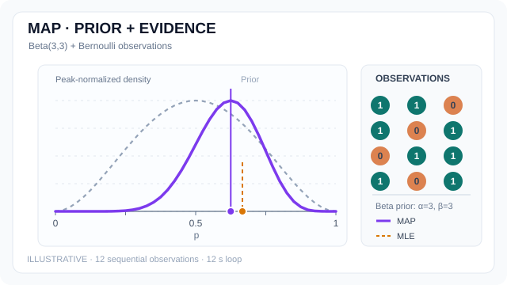

# Maximum a Posteriori Estimation

Maximum a posteriori (MAP) estimation selects a mode of the posterior distribution. It maximises posterior probability mass for a discrete parameter and posterior density in the chosen coordinates for a continuous parameter.[^murphy][^jermyn]

## Overview

In [Bayesian inference](../../paradigms/probabilistic/index.md), Bayes' rule gives $p(\theta\mid D)=p(D\mid\theta)p(\theta)/p(D)$ for parameter $\theta$ and data $D$. The denominator $p(D)$ normalises the posterior and is constant with respect to $\theta$. The likelihood describes how well each parameter value explains the data, and the prior supplies a weight for that value before seeing the data.[^murphy]

## Key concepts

- **Posterior mode** is a maximiser of posterior mass or density. For a continuous parameter with a density, probability is assigned to regions by integrating the density.
- **Posterior mean** averages parameter values over the posterior. Under squared-error loss it minimises posterior expected loss. It agrees with the mode for a nondegenerate Gaussian posterior, and the two can differ for a skewed posterior.[^gelman][^bishop]

## How it works

Where the posterior is positive, taking logarithms preserves its maximisers. Dropping the constant log normaliser gives the MAP objective.[^murphy]

$$
\hat{\theta}_{\mathrm{MAP}}
\in \operatorname*{arg\,max}_{\theta}
\left[\log p(D\mid\theta) + \log p(\theta)\right].
$$

The equivalent minimisation adds the negative log-prior to the negative log-likelihood. With a positive constant prior on the same parameter domain, the MAP and [maximum likelihood](maximum-likelihood.md) objectives have the same maximisers. A uniform prior on a restricted domain instead gives the maximum likelihood solution constrained to that domain.[^murphy]

### Worked example: estimating a success probability

Let $\theta\in[0,1]$ be the success probability of independent Bernoulli trials, with $k$ successes in $n$ trials. Under a $\operatorname{Beta}(\alpha,\beta)$ prior, the likelihood multiplies the prior density by $\theta^k(1-\theta)^{n-k}$ up to a constant. The posterior is $\operatorname{Beta}(a,b)$ with $a=\alpha+k$ and $b=\beta+n-k$.[^murphy][^gelman]

For $a,b>1$, differentiating $(a-1)\log\theta+(b-1)\log(1-\theta)$ gives the interior mode. The mean follows from the beta distribution.[^gelman]

$$
\hat{\theta}_{\mathrm{MAP}}=\frac{a-1}{a+b-2},
\qquad
\mathbb{E}[\theta\mid D]=\frac{a}{a+b}.
$$

For a $\operatorname{Beta}(3,3)$ prior and two successes in two trials, the posterior is $\operatorname{Beta}(5,3)$. The MLE is $1$, the MAP estimate is $2/3$, and the posterior mean is $5/8$. The posterior predictive probability of success on the next trial is also $5/8$, since averaging the Bernoulli success probability over the posterior gives its mean.[^gelman] The interior-mode formula assumes both shape parameters exceed one. Other shapes can peak at a boundary or have no unique mode.

### Animated example: prior and successive posterior modes

{: .concept-motion-wide tabindex="0" data-motion-src="../../../../assets/concept-animations/map-beta-posterior-motion.svg" data-still-src="../../../../assets/concept-animations/map-beta-posterior-still.svg" width="640" height="360" }

*Original 12-second teaching animation (CC BY-SA 4.0).* This **separate illustrative sequence** uses the same 12 observations as the [MLE animation](maximum-likelihood.md) and a fixed $\operatorname{Beta}(3,3)$ prior, also used in the two-success worked example above. With $s_n$ successes in $n$ observations, the posterior is $\operatorname{Beta}(3+s_n,3+n-s_n)$, whose interior mode is $\hat p_{\mathrm{MAP}}=(s_n+2)/(n+4)$. The dashed grey curve is the prior; purple is the posterior, and the amber marker is the MLE $s_n/n$. **Prior and posterior curves are each scaled to peak 1**, so their relative heights do not compare probability masses. At $n=2,s_n=2$, MAP is $2/3$ and MLE is $1$, matching the calculation above. At $n=12,s_n=8$, MAP is $10/16=0.625$ versus MLE $8/12\approx0.667$. The sample sequence is constructed for teaching, **not a measured result**. MkDocs has Play/Pause and a reduced-motion fallback; GitHub shows the [static preview](../../../assets/concept-animations/map-beta-posterior-still.svg).

### Connection to ridge and lasso

For linear regression with response vector $\mathbf{y}$, design matrix $X$, coefficient vector $\mathbf{w}$, and independent Gaussian errors of fixed variance $\sigma^2$, the MAP objective has the following form up to an additive constant.[^bishop]

$$
\frac{1}{2\sigma^2}\|\mathbf{y}-X\mathbf{w}\|_2^2-\log p(\mathbf{w}).
$$

A zero-mean isotropic Gaussian prior with variance $\tau^2$ per coefficient gives ridge regression. Independent zero-centred Laplace priors of scale $b_0$ give lasso regression. With the data term written as half the sum of squared residuals, the respective penalty terms are $\tfrac{\sigma^2}{2\tau^2}\|\mathbf{w}\|_2^2$ and $\tfrac{\sigma^2}{b_0}\|\mathbf{w}\|_1$. Averaging the squared-error term over the observations requires rescaling the penalty by the same factor to preserve the MAP solution.[^bishop][^lasso]

### Dependence on parameterisation

Under a smooth one-to-one change of variable $\phi=g(\theta)$ with a differentiable inverse, a continuous density transforms as $p_{\phi}(\phi\mid D)=p_{\theta}(\theta\mid D)\left|d\theta/d\phi\right|$. The derivative factor can move the maximum even though corresponding intervals still have the same probability.[^jermyn]

For the $\operatorname{Beta}(5,3)$ example, use the log odds $\phi=\log(\theta/(1-\theta))$. Then $d\theta/d\phi=\theta(1-\theta)$. The log-odds density is proportional to $\theta^5(1-\theta)^3$, whose mode maps back to $\theta=5/8$. Maximising the density in $\theta$ gives $2/3$.

## Connections

- [Maximum likelihood estimation](maximum-likelihood.md) uses the likelihood alone. MAP uses the likelihood and prior together.
- [Variational inference](../../paradigms/probabilistic/variational-inference/index.md) and [Markov chain Monte Carlo](../../paradigms/probabilistic/mcmc/index.md) provide ways to approximate posterior quantities such as credible intervals and predictive probabilities.[^gelman][^murphy]

## Applications

MAP gives a point estimate for [regularised fitting](../../optimization/regularisation-and-weight-decay.md) when the training objective is a negative log-likelihood plus a penalty derived from a prior. In a small-data problem, a prior can shift the estimate substantially, as in the success-probability example.[^murphy][^bishop]

## Limitations

- A posterior can have several modes, and a numerical optimiser can return a local maximum. A single mode provides neither posterior spread nor the relative probability mass around competing modes.[^gelman]
- Ordinary continuous MAP depends on the reference measure used to express density. Report the parameterisation when comparing point estimates.[^jermyn]

[^murphy]: Murphy, [*Probabilistic Machine Learning: An Introduction*](https://probml.github.io/pml-book/book1.html), §§4.5–4.6.
[^gelman]: Gelman et al., [*Bayesian Data Analysis*](https://sites.stat.columbia.edu/gelman/book/), §§2.1, 2.4 and 9.1, and Appendix A.
[^bishop]: Bishop, [*Pattern Recognition and Machine Learning*](https://www.microsoft.com/en-us/research/people/cmbishop/prml-book/), §§1.2.5 and 3.3.1.
[^lasso]: Park and Casella, [*The Bayesian Lasso*](https://people.eecs.berkeley.edu/~jordan/sail/readings/park-casella.pdf), §1.
[^jermyn]: Jermyn, [*Invariant Bayesian Estimation on Manifolds*](https://arxiv.org/abs/math/0506296), §2.

## References

### Seminal papers

- Jermyn, I. H. (2005). *Invariant Bayesian Estimation on Manifolds*. Annals of Statistics. https://arxiv.org/abs/math/0506296 — Derives the change-of-density effect and discusses how a reference measure defines a mode.
- Park, T. & Casella, G. (2008). *The Bayesian Lasso*. Journal of the American Statistical Association. https://people.eecs.berkeley.edu/~jordan/sail/readings/park-casella.pdf — Explains the Laplace prior interpretation of the lasso and develops posterior sampling.

### Surveys and textbooks

- Bishop, C. M. (2006). *Pattern Recognition and Machine Learning*. Springer. https://www.microsoft.com/en-us/research/people/cmbishop/prml-book/ — Derives the quadratic penalty for Gaussian-prior regression and gives the full Gaussian posterior.
- Murphy, K. P. (2022). *Probabilistic Machine Learning: An Introduction*. MIT Press. https://probml.github.io/pml-book/book1.html — Introduces regularisation through MAP and derives the beta-binomial update.
- Gelman, A., Carlin, J. B., Stern, H. S., Dunson, D. B., Vehtari, A. & Rubin, D. B. (2013). *Bayesian Data Analysis*, 3rd ed. CRC Press. https://sites.stat.columbia.edu/gelman/book/ — Develops binomial inference, posterior prediction, point summaries and Bayesian decision analysis.
