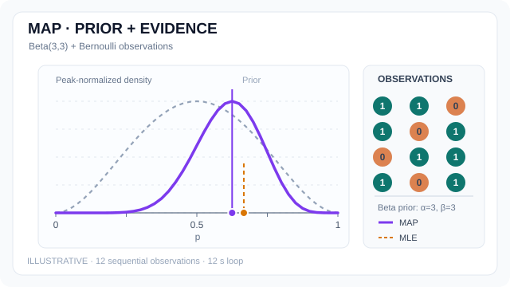

# 最大後驗估計

最大後驗估計（MAP）選取後驗分布的一個眾數。對離散參數，它找出後驗機率質量最大的值。對連續參數，它在選定的座標下找出後驗機率密度最大的值。[^murphy][^jermyn]

## 概述

在[貝氏推論](../../paradigms/probabilistic/index.zh-TW.md)中，貝氏定理給出參數 $\theta$ 在觀測資料 $D$ 後的分布 $p(\theta\mid D)=p(D\mid\theta)p(\theta)/p(D)$。分母 $p(D)$ 使後驗分布的總機率為一，且不隨 $\theta$ 改變。概似衡量每個參數值解釋資料的程度，先驗則給出觀測資料之前各參數值的權重。[^murphy]

## 關鍵概念

- **後驗眾數**是使後驗機率質量或密度達到最大的值。對具有密度的連續參數，將密度在某個區域積分即可得到該區域的機率。
- **後驗平均數**是依照後驗分布對參數值取平均。在平方誤差損失下，這個估計值使後驗期望損失最小。非退化的高斯後驗中，平均數與眾數相同。後驗分布偏斜時，兩者可能不同。[^gelman][^bishop]

## 運作方式

後驗為正時，取對數會保留使後驗達到最大的參數值。省去不隨參數改變的對數正規化常數，即得 MAP 目標。[^murphy]

$$
\hat{\theta}_{\mathrm{MAP}}
\in \operatorname*{arg\,max}_{\theta}
\left[\log p(D\mid\theta) + \log p(\theta)\right].
$$

等價的最小化問題是在負對數概似上加上負對數先驗。若先驗在相同的參數範圍內為正的常數，MAP 與[最大概似估計](maximum-likelihood.zh-TW.md)有相同的最大值位置。若先驗只在受限範圍內均勻分布，MAP 對應於該範圍內的最大概似解。[^murphy]

### 算例：估計成功機率

設 $\theta\in[0,1]$ 為獨立伯努利試驗的成功機率，$n$ 次試驗中觀測到 $k$ 次成功。給定 $\operatorname{Beta}(\alpha,\beta)$ 先驗，概似使先驗密度乘上與 $\theta^k(1-\theta)^{n-k}$ 成比例的因子。後驗為 $\operatorname{Beta}(a,b)$，其中 $a=\alpha+k$、$b=\beta+n-k$。[^murphy][^gelman]

當 $a,b>1$ 時，對 $(a-1)\log\theta+(b-1)\log(1-\theta)$ 微分可求得位於區間內部的眾數。平均數則由貝他分布得出。[^gelman]

$$
\hat{\theta}_{\mathrm{MAP}}=\frac{a-1}{a+b-2},
\qquad
\mathbb{E}[\theta\mid D]=\frac{a}{a+b}.
$$

若先驗為 $\operatorname{Beta}(3,3)$，兩次試驗都成功，後驗便是 $\operatorname{Beta}(5,3)$。最大概似估計值為 $1$，MAP 估計值為 $2/3$，後驗平均數為 $5/8$。下一次試驗成功的後驗預測機率也是 $5/8$，因為依後驗分布對伯努利成功機率取平均，就會得到後驗平均數。[^gelman] 內部眾數的公式假設兩個形狀參數皆大於一。其他情況可能在邊界達到最大值，也可能沒有唯一眾數。

### 動態示例：先驗與逐次更新的後驗眾數

{: .concept-motion-wide tabindex="0" data-motion-src="../../../../assets/concept-animations/map-beta-posterior-motion.svg" data-still-src="../../../../assets/concept-animations/map-beta-posterior-still.svg" width="640" height="360" }

*原創 12 秒教學動畫（CC BY-SA 4.0）。* 此**獨立示意序列**沿用[最大概似動畫](maximum-likelihood.zh-TW.md)的 12 筆觀測，並使用上方兩次成功算例相同的 (operatorname{Beta}(3,3)) 先驗。前 (n) 次試驗有 (s_n) 次成功時，後驗為 (operatorname{Beta}(3+s_n,3+n-s_n))，其內部眾數為 (hat p_{mathrm{MAP}}=(s_n+2)/(n+4))。灰色虛線是先驗，紫色是後驗，橘色虛線標記為 MLE (s_n/n)。**先驗與每個後驗曲線都各自把峰值正規化為 1**，高度不可直接比較機率質量。當 (n=2,s_n=2) 時，MAP 為 (2/3)、MLE 為 (1)，與上方算例一致；當 (n=12,s_n=8) 時，MAP 為 (10/16=0.625)，而 MLE 約為 (0.667)。這是**人工構造的觀測資料，並非模型實測結果**。MkDocs 可播放／暫停，並支援減少動態效果的靜態回退；GitHub 顯示[靜態預覽](../../../assets/concept-animations/map-beta-posterior-still.svg)。

### 與嶺迴歸及套索迴歸的關係

在線性迴歸中，設反應向量為 $\mathbf{y}$，設計矩陣為 $X$，係數向量為 $\mathbf{w}$，誤差相互獨立且服從變異數固定為 $\sigma^2$ 的高斯分布。略去加法常數後，MAP 的最小化目標如下。[^bishop]

$$
\frac{1}{2\sigma^2}\|\mathbf{y}-X\mathbf{w}\|_2^2-\log p(\mathbf{w}).
$$

若採用以零為中心、每個係數的變異數皆為 $\tau^2$ 的各向同性高斯先驗，便得到嶺迴歸。若各係數採用彼此獨立、中心為零且尺度為 $b_0$ 的拉普拉斯先驗，便得到套索迴歸。把資料項寫成殘差平方和的一半時，兩者的懲罰項分別為 $\tfrac{\sigma^2}{2\tau^2}\|\mathbf{w}\|_2^2$ 與 $\tfrac{\sigma^2}{b_0}\|\mathbf{w}\|_1$。若將資料項改為按觀測筆數取平均，懲罰項也須按相同比例縮放，才能保留相同的 MAP 解。[^bishop][^lasso]

### 參數表示法的影響

以具有可微反函數的平滑一對一變換 $\phi=g(\theta)$ 改寫參數後，連續密度變為 $p_{\phi}(\phi\mid D)=p_{\theta}(\theta\mid D)\left|d\theta/d\phi\right|$。對應區間的機率相同，但這個導數因子仍可能改變密度的最大值位置。[^jermyn]

延續 $\operatorname{Beta}(5,3)$ 的算例，改用對數勝算 $\phi=\log(\theta/(1-\theta))$，則 $d\theta/d\phi=\theta(1-\theta)$。對數勝算的密度與 $\theta^5(1-\theta)^3$ 成比例，其眾數換回原尺度後為 $\theta=5/8$。直接在 $\theta$ 尺度最大化密度則得到 $2/3$。

## 與其他頁面的連結

- [最大概似估計](maximum-likelihood.zh-TW.md)只用概似。MAP 同時使用概似與先驗。
- [變分推論](../../paradigms/probabilistic/variational-inference/index.zh-TW.md)與[馬可夫鏈蒙地卡羅](../../paradigms/probabilistic/mcmc/index.zh-TW.md)可用來近似可信區間與預測機率等後驗量。[^gelman][^murphy]

## 應用

若訓練目標由負對數概似與源自先驗的懲罰項組成，MAP 就能為[正規化模型擬合](../../optimization/regularisation-and-weight-decay.zh-TW.md)提供點估計。資料量少時，先驗可能明顯改變估計值，正如成功機率的算例所示。[^murphy][^bishop]

## 限制

- 後驗分布可能有多個眾數，數值最佳化也可能只找到局部最大值。單一眾數無法表達後驗分布的分散程度，也無法表達各眾數附近的相對機率質量。[^gelman]
- 一般連續參數的 MAP 取決於定義密度的基準測度。比較點估計時，應說明所採用的參數表示法。[^jermyn]

[^murphy]: Murphy，[*Probabilistic Machine Learning: An Introduction*](https://probml.github.io/pml-book/book1.html)，第 4.5 至 4.6 節。
[^gelman]: Gelman 等人，[*Bayesian Data Analysis*](https://sites.stat.columbia.edu/gelman/book/)，第 2.1、2.4、9.1 節與附錄 A。
[^bishop]: Bishop，[*Pattern Recognition and Machine Learning*](https://www.microsoft.com/en-us/research/people/cmbishop/prml-book/)，第 1.2.5 與 3.3.1 節。
[^lasso]: Park 與 Casella，[*The Bayesian Lasso*](https://people.eecs.berkeley.edu/~jordan/sail/readings/park-casella.pdf)，第 1 節。
[^jermyn]: Jermyn，[*Invariant Bayesian Estimation on Manifolds*](https://arxiv.org/abs/math/0506296)，第 2 節。

## 參考文獻

### 奠基性論文

- Jermyn, I. H.（2005）。*Invariant Bayesian Estimation on Manifolds*。Annals of Statistics。https://arxiv.org/abs/math/0506296 — 推導變數轉換對密度的影響，並討論基準測度如何定義眾數。
- Park, T. 與 Casella, G.（2008）。*The Bayesian Lasso*。Journal of the American Statistical Association。https://people.eecs.berkeley.edu/~jordan/sail/readings/park-casella.pdf — 說明套索迴歸與拉普拉斯先驗的關係，並推導後驗取樣方法。

### 綜述與教科書

- Bishop, C. M.（2006）。*Pattern Recognition and Machine Learning*。Springer。https://www.microsoft.com/en-us/research/people/cmbishop/prml-book/ — 推導高斯先驗迴歸的平方懲罰項與完整高斯後驗。
- Murphy, K. P.（2022）。*Probabilistic Machine Learning: An Introduction*。MIT Press。https://probml.github.io/pml-book/book1.html — 從 MAP 引介正規化，並推導貝他先驗搭配二項概似的更新。
- Gelman, A.、Carlin, J. B.、Stern, H. S.、Dunson, D. B.、Vehtari, A. 與 Rubin, D. B.（2013）。*Bayesian Data Analysis*，第 3 版。CRC Press。https://sites.stat.columbia.edu/gelman/book/ — 說明二項模型的推論、後驗預測、點摘要與貝氏決策分析。
