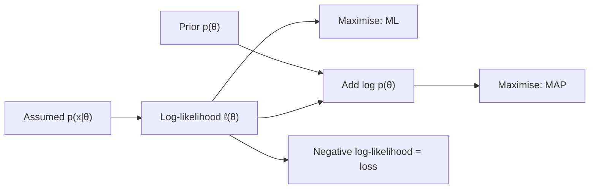

# Maximum Likelihood and MAP Estimation

Maximum likelihood estimation chooses the parameters under which the observed data are most probable. It is the standard way to fit a parametric model, and it is the statistical reason many training losses take their form. Maximum a posteriori (MAP) estimation adds a prior. The surrounding problem is set out on the [probability and statistics](../index.md) page.

## Overview

Suppose data $D=\{x_1,\dots,x_n\}$ are drawn independently from $p(x\mid\theta)$ with unknown parameter $\theta$. The likelihood $L(\theta)=\prod_i p(x_i\mid\theta)$ is the probability of the data, viewed as a function of $\theta$. Maximum likelihood (ML) takes the $\theta$ that maximises it. Fisher (1922) made this principle the foundation of estimation. MAP instead maximises the posterior under a prior $p(\theta)$; ML is MAP with a flat prior.

## Key concepts

- **Log-likelihood**: $\ell(\theta)=\sum_i\log p(x_i\mid\theta)$, whose maximiser is the same as that of the likelihood.
- **Fisher information**: $I(\theta)=-\mathbb{E}[\nabla^2_\theta\ell]$, the expected curvature of the log-likelihood.
- **Asymptotic normality**: under regularity conditions the MLE converges to the true value, and for large $n$ its distribution is approximately Gaussian with covariance $I(\theta)^{-1}/n$. This gives standard errors and confidence intervals.

## How it works

Write the log-likelihood, differentiate it, and solve for the zero of the gradient, numerically if no closed form exists. For a Gaussian with known variance, the derivative vanishes at the sample mean $\hat\mu=\frac1n\sum_i x_i$. For $k$ heads in $n$ coin tosses, the MLE of the heads probability is $k/n$.

$$
\hat\theta_{\mathrm{ML}}=\arg\max_\theta\sum_{i=1}^n\log p(x_i\mid\theta),\qquad
\hat\theta_{\mathrm{MAP}}=\arg\max_\theta\Big[\sum_{i=1}^n\log p(x_i\mid\theta)+\log p(\theta)\Big].
$$

MAP differs from ML only by the log-prior. For linear regression with Gaussian noise of variance $\sigma^2$ and a Gaussian prior $\mathcal N(0,\tau^2 I)$ on the weights, the MAP estimate is ridge regression with penalty $\lambda=\sigma^2/\tau^2$. A Laplace prior gives the $L_1$ penalty of the lasso. MAP returns the posterior mode and not its spread, which is why [MCMC](../../../probabilistic/mcmc/index.md) and [variational inference](../../../probabilistic/variational-inference/index.md) are used when uncertainty matters.

**The loss view.** The negative log-likelihood of an assumed noise model is a loss. Gaussian noise gives squared error, and a categorical output gives cross-entropy, $-\sum_k y_k\log\hat p_k$. Training a classifier by cross-entropy is therefore maximum likelihood for its softmax parameters. Gneiting and Raftery (2007) classify the log score as a proper scoring rule.

## Results

Fisher's results are analytical, with no benchmark. The regularised estimators have an empirical record. Hoerl and Kennard (1970) introduced ridge regression for nonorthogonal predictors, where least squares is unstable. Tibshirani (1996) reported that simulation studies showed the lasso combines some favourable properties of subset selection and ridge regression.

## Limitations

- **Overfitting.** With few observations relative to parameters, the MLE fits noise. A prior or an explicit penalty helps.
- **Misspecification.** If the assumed family is wrong, the MLE converges to the member closest to the truth in KL divergence, not to the truth itself.
- **Point estimates.** Standard errors rely on large-sample approximations, which can fail for small samples. Multimodal likelihoods, such as those of mixtures, make the result depend on the starting point.
- **MAP is not fully Bayesian.** It ignores the rest of the posterior distribution.

## Open questions

- Deep networks have far more parameters than data points, yet maximum likelihood training generalises. Whether the optimiser's implicit regularisation explains this is not settled.
- Whether probabilities from likelihood-trained networks are calibrated is an active question; see [uncertainty and calibration](../../../machine-learning/uncertainty-and-calibration/index.md).

## Connections

- **Expectation–maximisation.** When variables are hidden, the [EM algorithm](../expectation-maximisation/index.md) finds a local maximum iteratively.
- **Bootstrap.** The [bootstrap](../bootstrap/index.md) gives the MLE's standard errors without the asymptotic approximation.
- **Calculus and information theory.** The score is a gradient, found by [gradient descent](../../calculus/gradient-descent/index.md). Cross-entropy is the information-theoretic form of the likelihood; see [information theory](../../../information-theory/index.md).
- **Brain and mind.** Ernst and Banks (2002) found that people combine sensory cues in a way consistent with a maximum-likelihood integrator. See [cognitive science](../../../../brain-mind/cognitive-science/index.md).

## Applications

- **Classifiers.** Logistic regression and softmax classifiers are fitted by maximum likelihood, equivalently by minimising cross-entropy.
- **Language models** maximise the likelihood of each next token.

## References

### Seminal papers

- Fisher, R. A. (1922). On the mathematical foundations of theoretical statistics. *Philosophical Transactions of the Royal Society A*. https://doi.org/10.1098/rsta.1922.0009 — Foundations of estimation, including maximum likelihood, consistency, efficiency and sufficiency.
- Hoerl, A. E. & Kennard, R. W. (1970). Ridge regression: biased estimation for nonorthogonal problems. *Technometrics*. https://doi.org/10.1080/00401706.1970.10488634 — Adds an $L_2$ penalty to least squares to stabilise estimates when predictors are correlated.
- Tibshirani, R. (1996). Regression shrinkage and selection via the lasso. *Journal of the Royal Statistical Society B*. https://doi.org/10.1111/j.2517-6161.1996.tb02080.x — Introduces the $L_1$-constrained estimator that sets some coefficients exactly to zero.

### Surveys and textbooks

- Wasserman, L. (2004). *All of Statistics*. Springer. https://doi.org/10.1007/978-0-387-21736-9 — Graduate text covering maximum likelihood, its asymptotic theory and confidence intervals.
- Hastie, T., Tibshirani, R. & Friedman, J. (2009). *The Elements of Statistical Learning*. Springer. https://doi.org/10.1007/978-0-387-84858-7 — Likelihood-based classification and regularised regression, with penalty terms read as priors.
- Efron, B. & Hastie, T. (2016). *Computer Age Statistical Inference*. Cambridge University Press. https://doi.org/10.1017/CBO9781316576533 — Modern treatment of likelihood methods and their computation.

### Articles and documentation

- Gneiting, T. & Raftery, A. E. (2007). Strictly proper scoring rules, prediction, and estimation. *Journal of the American Statistical Association*. https://doi.org/10.1198/016214506000001437 — Proper scoring rules, including the log score that corresponds to the likelihood.
