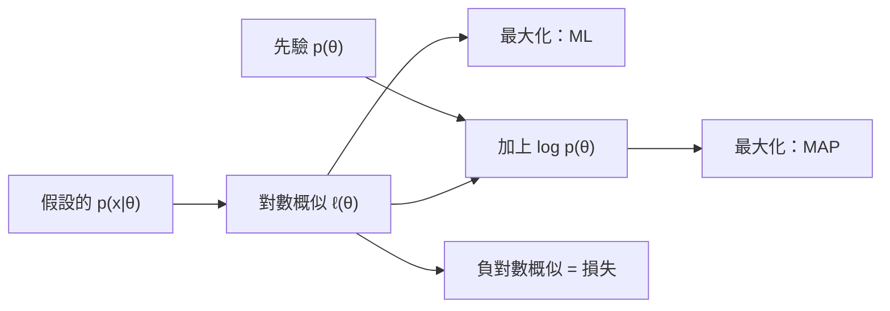

# 最大概似與 MAP 估計

最大概似估計選出讓觀察到的資料最可能出現的參數。它是擬合參數模型的標準方法，也是許多訓練損失具有現有形式的統計原因。最大後驗（MAP）估計則加入一個先驗。周圍的問題設定見[AI 的機率與統計](../index.md)一頁。

## 概述

假設資料 $D=\{x_1,\dots,x_n\}$ 獨立地抽自 $p(x\mid\theta)$，其中參數 $\theta$ 未知。概似 $L(\theta)=\prod_i p(x_i\mid\theta)$ 把資料的機率看作 $\theta$ 的函數。最大概似（ML）估計取使它最大的 $\theta$。費雪（Fisher, 1922）讓這個原則成為估計的基礎。MAP 則改為在先驗 $p(\theta)$ 下最大化後驗；ML 就是先驗為平坦時的 MAP。

## 核心概念

- **對數概似**：$\ell(\theta)=\sum_i\log p(x_i\mid\theta)$，其最大值點與概似相同。
- **費雪資訊**：$I(\theta)=-\mathbb{E}[\nabla^2_\theta\ell]$，即對數概似的期望曲率。
- **漸近常態性**：在正則條件下，MLE 收斂到真值；當 $n$ 很大時，其分布近似為協方差為 $I(\theta)^{-1}/n$ 的高斯分布。這提供了標準誤與信賴區間。

## 運作方式

寫出對數概似、對參數微分，然後解出梯度的零點，若無閉式解則用數值方法。對已知變異數的高斯分布，對數概似的導數在樣本平均值 $\hat\mu=\frac1n\sum_i x_i$ 處為零。對於 $n$ 次投擲中出現 $k$ 次正面的硬幣，正面機率的 MLE 為 $k/n$。

$$
\hat\theta_{\mathrm{ML}}=\arg\max_\theta\sum_{i=1}^n\log p(x_i\mid\theta),\qquad
\hat\theta_{\mathrm{MAP}}=\arg\max_\theta\Big[\sum_{i=1}^n\log p(x_i\mid\theta)+\log p(\theta)\Big].
$$

MAP 與 ML 的差別只在對數先驗。若雜訊為變異數 $\sigma^2$ 的高斯分布，權重先驗為 $\mathcal N(0,\tau^2 I)$，則線性迴歸的 MAP 估計就是脊迴歸，懲罰係數 $\lambda=\sigma^2/\tau^2$。拉普拉斯先驗則給出套索的 $L_1$ 懲罰。MAP 回傳的是後驗的眾數，而非其分散程度，因此當不確定性很重要時，會改用 [MCMC](../../../probabilistic/mcmc/index.md) 與[變分推論](../../../probabilistic/variational-inference/index.md)。

**損失的觀點。** 對假設的雜訊模型取負對數概似，就得到損失。高斯雜訊給出平方誤差；類別輸出給出交叉熵 $-\sum_k y_k\log\hat p_k$。因此，以交叉熵訓練分類器，就是對其 softmax 參數做最大概似估計。Gneiting 與 Raftery（2007）把對數分數歸類為嚴格適當評分規則。

## 結果

費雪的結果是分析性的，沒有基準測試。正則化的估計量則有實證紀錄。Hoerl 與 Kennard（1970）為非正交預測變數提出脊迴歸，這類情況下最小平方法並不穩定。Tibshirani（1996）報告模擬研究顯示，套索兼具子集選取與脊迴歸的部分優良性質。

## 限制

- **過擬合。** 當觀察值相對於參數很少時，MLE 會擬合雜訊。先驗或明確的懲罰項有所幫助。
- **誤設定。** 若假設的模型族有誤，MLE 收斂到該模型族中在 KL 散度上最接近真實分布的成員，而非真實分布本身。
- **點估計。** 標準誤依賴大樣本近似，在樣本小時可能失效。多峰概似（例如混合模型的概似）會使結果取決於起點。
- **MAP 並非完整的貝氏方法。** 它忽略了後驗分布的其餘部分。

## 開放問題

- 深度網路的參數遠多於資料點，但以最大概似訓練後仍能泛化。最佳化器的隱含正規化是否可以解釋這點，目前尚無定論。
- 以概似訓練的網路所產生的機率是否經過校準，仍是活躍的研究問題；參見[不確定性與校準](../../../machine-learning/uncertainty-and-calibration/index.md)。

## 關聯

- **期望最大化。** 當有隱藏變數時，[EM 演算法](../expectation-maximisation/index.md)會以迭代方式找到局部最大值。
- **自助法。** [自助法](../bootstrap/index.md)不需要漸近近似，也能給出 MLE 的標準誤。
- **微積分與資訊理論。** 分數函數就是梯度，可以用[梯度下降](../../calculus/gradient-descent/index.md)求得。交叉熵則是概似的資訊理論形式；參見[資訊理論](../../../information-theory/index.md)。
- **大腦與心智。** Ernst 與 Banks（2002）發現，人們結合感官線索的方式與最大概似整合器一致。參見[認知科學](../../../../brain-mind/cognitive-science/index.md)。

## 應用

- **分類器。** 邏輯斯迴歸與 softmax 分類器以最大概似估計擬合，等同於最小化交叉熵。
- **語言模型**最大化每個下一個 token 的概似。

## 參考文獻

### 開創性論文

- Fisher, R. A. (1922). On the mathematical foundations of theoretical statistics. *Philosophical Transactions of the Royal Society A*. https://doi.org/10.1098/rsta.1922.0009 — 估計的理論基礎，包括最大概似、一致性、效率與充分性。
- Hoerl, A. E. & Kennard, R. W. (1970). Ridge regression: biased estimation for nonorthogonal problems. *Technometrics*. https://doi.org/10.1080/00401706.1970.10488634 — 在最小平方法中加入 $L_2$ 懲罰，以便在預測變數相關時穩定估計。
- Tibshirani, R. (1996). Regression shrinkage and selection via the lasso. *Journal of the Royal Statistical Society B*. https://doi.org/10.1111/j.2517-6161.1996.tb02080.x — 提出以 $L_1$ 約束的估計量，可將部分係數精確設為零。

### 綜述與教科書

- Wasserman, L. (2004). *All of Statistics*. Springer. https://doi.org/10.1007/978-0-387-21736-9 — 研究所教科書，涵蓋最大概似、其漸近理論與信賴區間。
- Hastie, T., Tibshirani, R. & Friedman, J. (2009). *The Elements of Statistical Learning*. Springer. https://doi.org/10.1007/978-0-387-84858-7 — 以概似為基礎的分類與正規化迴歸，並把懲罰項視為先驗。
- Efron, B. & Hastie, T. (2016). *Computer Age Statistical Inference*. Cambridge University Press. https://doi.org/10.1017/CBO9781316576533 — 現代的概似方法及其計算的完整討論。

### 文章與文件

- Gneiting, T. & Raftery, A. E. (2007). Strictly proper scoring rules, prediction, and estimation. *Journal of the American Statistical Association*. https://doi.org/10.1198/016214506000001437 — 嚴格適當評分規則，包括對應於概似的對數分數。
