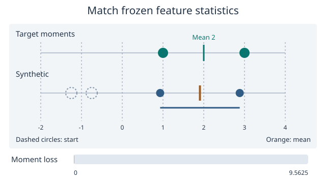

# Data-Free Knowledge Distillation

Data-free distillation compresses a teacher without access to its training data. The student is trained on synthetic inputs generated from the teacher, which makes distillation possible when the data are private, too large to share, or no longer available.

## Overview

The standard distillation recipe assumes that the student can be trained on real inputs. In many practical cases this is not so: a model may be released without its training set, or the data may be protected. Data-free methods synthesise inputs that the teacher finds representative, usually by optimising random noise so that the teacher's internal statistics match what it would have seen on real data. The student is then distilled on these synthetic samples in the usual way. Other approaches avoid synthesis altogether and instead ask the model's publisher to release a small amount of metadata alongside the trained weights, as Lopes et al. (2017) proposed.

## Key concepts

- **Synthetic samples.** Inputs generated from the teacher, not drawn from a dataset.
- **Teacher statistics.** Quantities such as batch-normalisation running means and variances, which summarise the training distribution and can guide synthesis.
- **Surrogate data.** Samples that approximate the training data for the purpose of distillation, without reproducing any real example.
- **Coverage.** Whether the synthetic samples span the regions of input space where the student must perform well.

### A toy feature-statistics optimisation

DeepInversion keeps a teacher fixed while optimising synthetic inputs against stored batch-normalisation feature statistics, with additional class and image-prior objectives.[^deepinversion] To isolate the role of feature matching, suppose a frozen identity feature map has target mean $2$ and variance $1$. Parameterise two synthetic activations as $(m-s,m+s)$ with $s>0$: their population mean is $m$ and their population standard deviation is $s$. Minimise the illustrative objective

$
L(m,s)=(m-2)^2+(s-1)^2.
$

This standard-deviation loss and two-parameter identity map are a teaching simplification, not the paper's multi-layer variance regulariser. Starting with $m_0=-1$ and $s_0=1/4$, gradient descent with learning rate $1/4$ gives

$
m_k=2-3/2^k,\qquad s_k=1-(3/4)/2^k,\qquad L_k=\frac{153}{16\cdot4^k}.
$

| Step | Mean | Standard deviation | Loss |
| ---: | ---: | ---: | ---: |
| 0 | -1 | 0.25 | 9.5625 |
| 1 | 0.5 | 0.625 | 2.390625 |
| 2 | 1.25 | 0.8125 | 0.59765625 |
| 5 | 1.90625 | 0.9765625 | 0.00933837890625 |

The green points represent one possible pair with the target statistics, not recovered training samples. Blue points show the synthetic activations, the orange marker is their mean, and the blue segment spans both values. Keyframes correspond to exact gradient-descent iterates; intermediate motion and loss-bar widths are interpolated for readability. The reset is not an optimisation step. The teacher is never updated. Matching a few moments does not identify a distribution or establish privacy; many distributions share the same moments. These values are schematic, not model measurements.

*Original 12-second teaching animation (CC BY-SA 4.0).* Use the site's Play/Pause button; scroll horizontally on narrow screens. GitHub provides the [static fallback](../../../../assets/concept-animations/data-free-moment-descent-still.svg) and [full SVG animation](../../../../assets/concept-animations/data-free-moment-descent-motion.svg).

## Key methods

The two methods below share the goal of distilling without training data, but they obtain their substitute inputs differently.

- [Zero-shot knowledge distillation (Nayak et al., 2019)](zero-shot-kd/index.md): synthesises "data impressions" from the teacher, with no data or metadata from the original training set.
- [Sequence-level knowledge distillation (Kim & Rush, 2016)](../llm-distillation/sequence-level/index.md): uses the teacher's own outputs on source sentences. It is only partly data-free, because the source side of the dataset is still real, and it is listed here because it removes the need for the target side.

Zero-shot distillation uses no real inputs at all. Sequence-level distillation keeps the real inputs but replaces the reference targets with the teacher's outputs.

## Trade-offs

- **Privacy and access versus cost.** Data-free methods remove the need for data, but synthesis adds compute, and the surrogate data may miss important regions of the input space.
- **Fidelity.** Synthetic data may reproduce the teacher's errors, and the student cannot exceed the teacher's knowledge.
- **Licensing.** Using a model's outputs to train another model may be restricted by its terms of use, which vary by provider.

## More variants and open issues

- **Open issue:** how to synthesise data for language models, where discrete tokens are harder to optimise than continuous images.
- **Open issue:** how much of the teacher's data-dependent behaviour can be recovered from synthetic samples.
- **Variant:** [LLM distillation](../llm-distillation/index.md), where the teacher generates the training data for the student.

## Connections

Data-free distillation touches privacy, which is discussed in the [ethics](../../../../society/ethics/index.md) and [governance](../../../../society/governance/index.md) pages, and the training pipelines in [training and fine-tuning](../../../../engineering/training/index.md). Synthesising inputs from a trained network loosely resembles the way the brain replays patterns during rest, a parallel discussed in [memory and learning](../../../../brain-mind/memory-learning/index.md).

## References

### Seminal papers

- Nayak, G. K., Mopuri, K. R., Shaj, V., Babu, R. V. & Chakraborty, A. (2019). *Zero-Shot Knowledge Distillation in Deep Networks*. arXiv:1905.08114. https://arxiv.org/abs/1905.08114 — Synthesises "data impressions" from the teacher and trains the student on them; the abstract reports generalisation competitive with distillation on the real training data across several benchmarks.
- Lopes, R. G., Fenu, S. & Starner, T. (2017). *Data-Free Knowledge Distillation for Deep Neural Networks*. arXiv:1710.07535. https://arxiv.org/abs/1710.07535 — Replaces the training set with small metadata released with a pretrained model, and examines the trade-offs of different metadata choices.
- Kim, Y. & Rush, A. M. (2016). *Sequence-Level Knowledge Distillation*. arXiv:1606.07947. https://arxiv.org/abs/1606.07947 — Trains on the teacher's own sequence outputs; the abstract reports a student about 10 times faster than its teacher with little loss in quality.
- Hinton, G., Vinyals, O. & Dean, J. (2015). *Distilling the Knowledge in a Neural Network*. arXiv:1503.02531. https://arxiv.org/abs/1503.02531 — The standard distillation objective, which assumes a training set that data-free methods replace.

- Yin, H., et al. (2020). *Dreaming to Distill: Data-free Knowledge Transfer via DeepInversion*. CVPR. https://arxiv.org/abs/1912.08795 — Uses frozen teacher batch-normalisation statistics to guide synthetic input optimisation.

[^deepinversion]: Yin et al. (2020), Section 3.2, [DeepInversion](https://arxiv.org/abs/1912.08795).

### Surveys and textbooks

- Gou, J., Yu, B., Maybank, S. J. & Tao, D. (2021). *Knowledge Distillation: A Survey*. International Journal of Computer Vision, 129(6). https://doi.org/10.1007/s11263-021-01453-z — Surveys distillation settings, including those without data.

### Lectures and videos

(none checked for this page)

### Articles and documentation

- Sanh, V., Debut, L., Chaumond, J. & Wolf, T. (2019). *DistilBERT, a Distilled Version of BERT: Smaller, Faster, Cheaper and Lighter*. arXiv:1910.01108. https://arxiv.org/abs/1910.01108 — Distils BERT into a model about 40% smaller that keeps 97% of its language understanding, a standard reference for language-model distillation.
