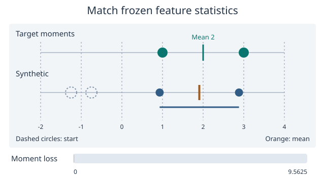
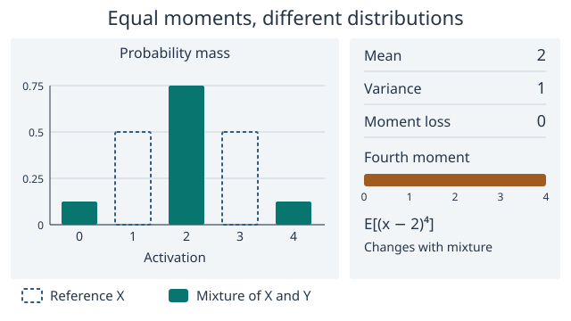

# 無資料知識蒸餾

無資料蒸餾（data-free distillation）在無法取得教師模型訓練資料的情況下壓縮教師。學生改在由教師生成的合成輸入上訓練，因此當資料具私密性、規模過大難以分享，或已不復存在時，蒸餾仍然可以進行。

## 概觀

標準的蒸餾流程假設學生可以在真實輸入上訓練。在許多實際情況中並非如此：模型可能在發布時沒有附上訓練集，或資料受到保護。無資料方法會合成教師認為具代表性的輸入，通常的做法是從隨機雜訊開始最佳化，使教師的內部統計量符合它在真實資料上會看到的結果。接著學生就以這些合成樣本照常進行蒸餾。另一類方法則完全不做合成，而是由模型發布者在釋出訓練權重時附上少量中繼資料，Lopes 等人（2017）即提出這種做法。

## 關鍵概念

- **合成樣本（synthetic samples）。** 由教師生成的輸入，而不是取自資料集。
- **教師統計量（teacher statistics）。** 例如批次正規化的移動平均與變異數，它們摘要了訓練分布，可用來引導合成。
- **替代資料（surrogate data）。** 近似訓練資料、用於蒸餾的樣本，並不重現任何真實樣本。
- **覆蓋範圍（coverage）。** 合成樣本是否涵蓋學生必須表現良好的輸入空間區域。

### 特徵統計量最佳化的人工算例

DeepInversion 固定教師模型，利用已儲存的批次正規化特徵統計量最佳化合成輸入，並搭配分類與影像先驗目標。[^deepinversion] 為了單獨觀察特徵匹配，假設固定的恆等特徵映射之目標平均值為 $2$、變異數為 $1$。將兩個合成激活值參數化為 $(m-s,m+s)$，其中 $s>0$；其母體平均值為 $m$、母體標準差為 $s$。最小化人工目標：

$$
L(m,s)=(m-2)^2+(s-1)^2.
$$

此標準差損失及雙參數恆等映射是教學簡化，並非原論文的多層變異數正規化項。從 $m_0=-1$ 與 $s_0=1/4$ 開始，使用學習率 $1/4$ 執行梯度下降，可得

$$
m_k=2-3/2^k,\qquad s_k=1-(3/4)/2^k,\qquad L_k=\frac{153}{16\cdot4^k}.
$$

| 步數 | 平均值 | 標準差 | 損失 |
| ---: | ---: | ---: | ---: |
| 0 | -1 | 0.25 | 9.5625 |
| 1 | 0.5 | 0.625 | 2.390625 |
| 2 | 1.25 | 0.8125 | 0.59765625 |
| 5 | 1.90625 | 0.9765625 | 0.00933837890625 |

綠點只是符合目標統計量的其中一組可能數值，而非重建的訓練樣本。藍點代表合成激活值，橘色標記代表平均值，藍色線段跨越兩個數值。合成特徵值在精確的梯度下降迭代結果之間採插值移動，以利理解。對數圖上的綠色標記與橘色線性損失長條只在每次更新完成時改變，顯示上一個已完成迭代的損失，而不是插值損失。由於 $L_k/L_0=4^{-k}$，對數圖的縱軸為 $\log_2(L_k/L_0)=-2k$；即使線性長條接近零，仍能看出收斂進程。循環重設不是最佳化步驟。教師模型始終不更新。僅匹配少量統計矩無法唯一識別分布，也不能保證隱私，因為不同分布可能有相同的統計矩。數值皆為人工示意，並非模型實測結果。

*原創 12 秒教學動畫（CC BY-SA 4.0）。* 網站可使用播放／暫停按鈕，小螢幕可水平捲動。GitHub 可直接開啟[靜態預覽](../../../../assets/concept-animations/data-free-moment-descent-still.svg)或[完整 SVG 動畫](../../../../assets/concept-animations/data-free-moment-descent-motion.svg)。

### 相同統計量，不同分布

前述雙特徵值算例刻意限制了分布形式。為了解平均值與變異數匹配為何無法還原一般分布，考慮兩個假想的純量特徵分布：

| 特徵值分布 | 機率 | 平均值 | 母體變異數 | 四階中心動差 |
| --- | --- | ---: | ---: | ---: |
| $X\in\{1,3\}$ | $(1/2,1/2)$ | 2 | 1 | 1 |
| $Y\in\{0,2,4\}$ | $(1/8,3/4,1/8)$ | 2 | 1 | 4 |

兩者在上述簡化目標的統計量匹配損失都是零，但支撐集與四階中心動差不同。例如非線性特徵 $(x-2)^4$ 在第一個分布的期望值為 1，在第二個分布則為 4。因此，即使兩個純量統計量完全一致，也不能保證後續非線性運算產生相同的反應。這是人工計算示例，並非對特定合成方法的覆蓋率或隱私保證做出實測主張。

*原創 12 秒教學動畫（CC BY-SA 4.0）。* 網站可使用播放／暫停按鈕，小螢幕可水平捲動。GitHub 可直接開啟[靜態預覽](../../../../assets/concept-animations/data-free-equal-moments-still.svg)或[完整 SVG 動畫](../../../../assets/concept-animations/data-free-equal-moments-motion.svg)。

動畫將此反例推廣至整個混合分布 $P_t=(1-t)P_X+tP_Y$，其中 $0\le t\le1$。激活值 0 至 4 的機率依序為 $(t/8,(1-t)/2,3t/4,(1-t)/2,t/8)$。所有混合分布的平均值皆為 2、變異數皆為 1，簡化統計量匹配損失皆為零，而四階中心動差為 $1+3t$。虛線框標示固定參考分布 $X$，青綠色長條顯示目前的機率質量，橘色長條則顯示非線性運算的期望值。這是機率混合，不是最佳化軌跡或實測特徵分布。

## 主要方法

以下兩個方法的目標都是在沒有訓練資料的情況下蒸餾，但取得替代輸入的方式不同。

- [零樣本知識蒸餾（Nayak 等人，2019）](zero-shot-kd/index.zh-TW.md)：從教師合成「資料印象（data impressions）」，不使用原始訓練集的資料或中繼資料。
- [序列層級知識蒸餾（Kim 與 Rush，2016）](../llm-distillation/sequence-level/index.zh-TW.md)：使用教師對原始來源句子的輸出。它只是部分無資料，因為資料集的來源端仍是真實的；列在此處是因為它省去了目標端的需求。

零樣本蒸餾完全不使用真實輸入。序列層級蒸餾保留真實輸入，但以教師的輸出取代參考目標。

## 取捨

- **隱私與取得性 vs. 成本。** 無資料方法免除了對資料的需求，但合成需要計算，而且替代資料可能遺漏輸入空間中的重要區域。
- **忠實度。** 合成資料可能重現教師的錯誤，學生也無法超越教師所知。
- **授權。** 以某模型的輸出訓練另一個模型，可能受其使用條款限制，各供應商的規定不同。

## 更多變體與未解問題

- **未解問題：**如何為語言模型合成資料。離散的詞元比連續的影像更難最佳化。
- **未解問題：**從合成樣本中能恢復教師多少依賴資料的行為。
- **變體：**[大型語言模型蒸餾](../llm-distillation/index.zh-TW.md)，由教師為學生生成訓練資料。

## 關聯

無資料蒸餾與隱私議題相關，相關討論見[倫理](../../../../society/ethics/index.zh-TW.md)與[治理](../../../../society/governance/index.zh-TW.md)頁面，也與[訓練與微調](../../../../engineering/training/index.zh-TW.md)的流程有關。從訓練好的網路合成輸入，隱約類似大腦在休息時重播模式的方式，相關討論見[記憶與學習](../../../../brain-mind/memory-learning/index.zh-TW.md)。

[^deepinversion]: Yin 等人（2020），第 3.2 節，[DeepInversion](https://arxiv.org/abs/1912.08795)。

## 參考文獻

### 開創性論文

- Nayak, G. K., Mopuri, K. R., Shaj, V., Babu, R. V. & Chakraborty, A. (2019). *Zero-Shot Knowledge Distillation in Deep Networks*. arXiv:1905.08114. https://arxiv.org/abs/1905.08114 — 從教師合成「資料印象」並以此訓練學生；摘要報告在多個基準上的泛化表現與使用真實訓練資料的蒸餾相當。
- Lopes, R. G., Fenu, S. & Starner, T. (2017). *Data-Free Knowledge Distillation for Deep Neural Networks*. arXiv:1710.07535. https://arxiv.org/abs/1710.07535 — 以隨預訓練模型釋出的少量中繼資料取代訓練集，並探討不同中繼資料選擇的取捨。
- Kim, Y. & Rush, A. M. (2016). *Sequence-Level Knowledge Distillation*. arXiv:1606.07947. https://arxiv.org/abs/1606.07947 — 在教師自身的序列輸出上訓練；摘要報告學生的速度約為教師的 10 倍，品質損失很小。
- Hinton, G., Vinyals, O. & Dean, J. (2015). *Distilling the Knowledge in a Neural Network*. arXiv:1503.02531. https://arxiv.org/abs/1503.02531 — 標準的蒸餾目標，假設有訓練集，而無資料方法即是取代它。

- Yin, H., et al. (2020). *Dreaming to Distill: Data-free Knowledge Transfer via DeepInversion*. CVPR. https://arxiv.org/abs/1912.08795 — 利用固定教師的批次正規化統計量引導合成輸入的最佳化。

### 綜述與教科書

- Gou, J., Yu, B., Maybank, S. J. & Tao, D. (2021). *Knowledge Distillation: A Survey*. International Journal of Computer Vision, 129(6). https://doi.org/10.1007/s11263-021-01453-z — 回顧蒸餾的各種設定，包括沒有資料的情況。

### 講座與影片

（本頁未查核）

### 文章與文件

- Sanh, V., Debut, L., Chaumond, J. & Wolf, T. (2019). *DistilBERT, a Distilled Version of BERT: Smaller, Faster, Cheaper and Lighter*. arXiv:1910.01108. https://arxiv.org/abs/1910.01108 — 將 BERT 蒸餾為約小 40% 的模型，同時保留 97% 的語言理解能力；是語言模型蒸餾的標準參考。
