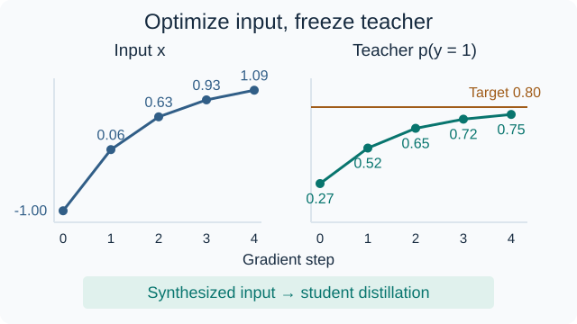

# Zero-Shot Knowledge Distillation

Zero-shot knowledge distillation (ZSKD) trains a student network without any original training data. Nayak et al. (2019) craft surrogate inputs, called Data Impressions, from the teacher's parameters alone, and distil the student on them. It is a [data-free](../index.md) method. On MNIST, the authors report accuracy close to distillation on the real training images.

## Problem

Distillation normally needs the training data, or meta-data extracted from it. For a released model, that data may be unavailable, private or too large to share. The paper asks whether a student can learn from the teacher's parameters alone.

## Core idea

The method uses only the teacher network, in three steps:

1. **Class similarity.** Read each class's similarity to the others from the weights between the final softmax layer and the layer before it. This gives a normalised class similarity matrix $C$, whose row $c_k$ gives the similarity of class $k$ to every class, including itself.
2. **Dirichlet sampling.** For each class $k$, model the teacher's softmax outputs as a Dirichlet distribution whose concentration is $\beta\, c_k$, where $\beta$ scales the spread. Sample target softmax vectors from it. Because the concentration comes from the class similarities, the samples respect the structure the teacher learned.
3. **Crafting Data Impressions.** Start from random noise and iteratively optimise an input so that the teacher's softmax output on it matches a sampled vector.

The student is then trained with the usual distillation objective on these Data Impressions, with no original data.

## Equation or algorithm

For each sampled target $\bm{y}$ of class $k$, the input $\bar{x}$ is optimised over several iterations to minimise

$$
\min_{\bar{x}}\; H\!\left(\bm{y},\; T(\bar{x};\theta_T)\right)
$$

where $H$ is the cross-entropy and $T(\bar{x};\theta_T)$ is the teacher's softmax output. The student $S$ then minimises the distillation loss between its softmax output and the teacher's on the Data Impressions.

*Original 12-second teaching animation (CC BY-SA 4.0).* The sampled target is held fixed during input synthesis. MkDocs provides keyboard-accessible Play/Pause; GitHub shows the [static fallback](../../../../../assets/concept-animations/zskd-input-optimization-still.svg). [Full SVG animation](../../../../../assets/concept-animations/zskd-input-optimization-motion.svg). [Original paper](https://arxiv.org/abs/1905.08114).

For a minimal binary example of the input-synthesis phase, hold the teacher fixed at $T(x)=\sigma(x)$, and use a hypothetical sampled target $(0.8,0.2)$ ordered as classes 1 and 0. With the soft binary cross-entropy $H(0.8,T(x))$, the derivative with respect to **the input** is $\sigma(x)-0.8$. Starting at $x_0=-1$, gradient descent with step size 2 gives

$
x_{k+1}=x_k+2(0.8-\sigma(x_k)).
$

After four steps $x_4\approx1.0932$ and $T(x_4)\approx0.7490$; the exact scalar minimizer is $\log(4)\approx1.3863$. The teacher parameters do not change. The target is a fixed illustrative probability vector, not an actual Dirichlet draw; the animation does not simulate the class-similarity extraction or student optimization. The finite step size and probabilities are not measurements from a trained network. A Data Impression is a surrogate input, not a guaranteed reconstruction of original training data.

The scalar example also has a monotone convergence guarantee: the update map $F(x)=x+2(0.8-\sigma(x))$ satisfies $F'(x)=1-2\sigma(x)(1-\sigma(x))\in[1/2,1)$ for finite $x$. It is strictly increasing, with the fixed point $x^*=\log 4$. Starting below (above) that point gives $x<F(x)<x^*$ ($x^*<F(x)<x$), hence the iterates approach it without crossing. This is a property of this scalar teacher and step size, not of arbitrary nonlinear networks.

Matching a soft target does not identify a unique input in general. For the illustrative teacher $T(x_1,x_2)=\sigma(x_1+x_2)$, all pairs satisfying $x_1+x_2=\log 4$ minimize the same cross-entropy. The input gradient is parallel to $(1,1)$, so unconstrained gradient descent preserves $x_1-x_2$ while adjusting the sum. Distinct initial inputs can converge to different Data Impressions with identical teacher predictions.

## Results

On MNIST, the teacher is a LeNet-5 with 61,706 parameters and the student is LeNet-5-Half with 35,820. The paper's Table 1 reports the following test accuracies.

| Method | Data used | Accuracy (%) |
|---|---|---|
| Teacher, cross-entropy | Full training set | 99.34 |
| Student, cross-entropy | Full training set | 98.92 |
| Student, distillation (Hinton et al., 2015) | 60,000 original images | 99.25 |
| Earlier few-data method | 200 original images | 86.70 |
| Earlier data-free method | Meta-data from the training set | 92.47 |
| ZSKD (this method) | 24,000 Data Impressions, no original data | 98.77 |

The paper also reports results on Fashion-MNIST and CIFAR-10. On Fashion-MNIST, ZSKD performs close to classical distillation, and it outperforms the few-data baseline by a large margin.

## Limitations

- Each Data Impression needs an iterative optimisation, so synthesis is costly.
- Quality depends on how well the teacher's softmax outputs and class similarities describe the data it was trained on.
- Results are close to, not equal to, distillation on real data. On MNIST the gap is 99.25 against 98.77.
- The evaluated benchmarks are image classification. Discrete inputs such as tokens are not covered.

## Key methods

- [Hinton distillation](../../response-based/hinton-distillation/index.md) is the standard soft-target objective that needs training data. ZSKD keeps the objective and replaces the data.
- [Sequence-level distillation](../../llm-distillation/sequence-level/index.md) is a partial data-free approach for sequence models, which still uses source sentences.

## Open issues and related variants

- **Language models.** Discrete tokens are harder to optimise than continuous images, so synthesis for language is an open problem.
- **Related:** [sequence-level distillation](../../llm-distillation/sequence-level/index.md) still relies on source sentences, so it is only partly data-free.

## Connections

Data-free distillation touches privacy, discussed in [ethics](../../../../../society/ethics/index.md) and [governance](../../../../../society/governance/index.md). The training pipelines it sits in are described under [training](../../../../../engineering/training/index.md).

## References

### Seminal papers

- Nayak, G. K., Mopuri, K. R., Shaj, V., Babu, R. V. & Chakraborty, A. (2019). *Zero-Shot Knowledge Distillation in Deep Networks*. arXiv:1905.08114. https://arxiv.org/abs/1905.08114 — Distils a network from synthetic Data Impressions crafted from the teacher alone.
- Hinton, G., Vinyals, O. & Dean, J. (2015). *Distilling the Knowledge in a Neural Network*. arXiv:1503.02531. https://arxiv.org/abs/1503.02531 — The standard soft-target distillation objective, which ZSKD keeps while replacing the data.
- Kim, Y. & Rush, A. M. (2016). *Sequence-Level Knowledge Distillation*. arXiv:1606.07947. https://arxiv.org/abs/1606.07947 — A partial data-free approach for translation models, which still uses source sentences.
- Sanh, V., et al. (2019). *DistilBERT, a Distilled Version of BERT: Smaller, Faster, Cheaper and Lighter*. arXiv:1910.01108. https://arxiv.org/abs/1910.01108 — A distilled language model trained on real data, for contrast with synthetic-data methods.

### Surveys and textbooks

- Gou, J., et al. (2021). *Knowledge Distillation: A Survey*. International Journal of Computer Vision. https://doi.org/10.1007/s11263-021-01453-z — Surveys distillation settings, including those without data.
