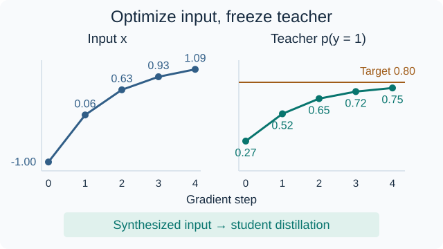

# 零樣本知識蒸餾

零樣本知識蒸餾（ZSKD）在完全沒有原始訓練資料的情況下訓練學生網路。Nayak 等人（2019）只從教師的參數製作替代輸入，稱為 Data Impressions，並在其上蒸餾學生。它是一種[無資料](../index.zh-TW.md)方法。在 MNIST 上，作者回報其準確率接近使用真實訓練影像的蒸餾。

## 問題

蒸餾通常需要訓練資料，或由訓練資料提取的元資料。對於已釋出的模型，這些資料可能取得不到、是私密的，或太大而無法分享。論文探討學生能否只靠教師的參數學習。

## 核心想法

此方法只使用教師網路，分為三個步驟：

1. **類別相似度。** 從最後的 softmax 層與其前一層之間的權重，讀出各類別與其他類別的相似度。這會得到一個經正規化的類別相似度矩陣 $C$，其列 $c_k$ 給出類別 $k$ 與每個類別（包括自己）的相似度。
2. **Dirichlet 抽樣。** 對每個類別 $k$，把教師的 softmax 輸出建模為 Dirichlet 分佈，其集中參數為 $\beta\, c_k$，其中 $\beta$ 控制分散程度。從中抽取目標 softmax 向量。由於集中參數來自類別相似度，抽出的樣本會保有教師所學到的結構。
3. **製作 Data Impressions。** 從隨機雜訊開始，反覆最佳化一個輸入，使教師對它的 softmax 輸出符合某個抽出的向量。

接著學生以一般的蒸餾目標，在這些 Data Impressions 上訓練，不使用任何原始資料。

## 方程式或演算法

對於類別 $k$ 的每個抽樣目標 $\bm{y}$，輸入 $\bar{x}$ 經數次迭代最佳化，以最小化

$$
\min_{\bar{x}}\; H\!\left(\bm{y},\; T(\bar{x};\theta_T)\right)
$$

其中 $H$ 為交叉熵，$T(\bar{x};\theta_T)$ 為教師的 softmax 輸出。學生 $S$ 接著在 Data Impressions 上最小化它與教師 softmax 輸出之間的蒸餾損失。

*原創 12 秒教學動畫（CC BY-SA 4.0）。* 在合成輸入期間固定抽出的目標。 網站支援鍵盤操作播放／暫停；GitHub 顯示[靜態回退圖](../../../../../assets/concept-animations/zskd-input-optimization-still.svg)。[完整 SVG 動畫](../../../../../assets/concept-animations/zskd-input-optimization-motion.svg)。[原始論文](https://arxiv.org/abs/1905.08114)。

以二元分類的純量算例展示輸入合成階段：固定教師 $T(x)=\sigma(x)$，假設抽出的目標為 $(0.8,0.2)$，依序對應類別 1 與 0。軟目標二元交叉熵 $H(0.8,T(x))$ 對**輸入**的導數為 $\sigma(x)-0.8$。由 $x_0=-1$ 出發，使用步長 2 進行梯度下降：

$
x_{k+1}=x_k+2(0.8-\sigma(x_k)).
$

四步後 $x_4\approx1.0932$、$T(x_4)\approx0.7490$；純量問題的精確最小值位置為 $\log(4)\approx1.3863$。教師參數不更新。此目標是人工設定的機率向量，並非實際 Dirichlet 抽樣；動畫未模擬類別相似度提取或學生最佳化。步長與機率不是模型實測值。Data Impression 是替代輸入，不保證重建原始訓練資料。

## 結果

在 MNIST 上，教師為參數量 61,706 的 LeNet-5，學生為參數量 35,820 的 LeNet-5-Half。論文表 1 回報的測試準確率如下。

| 方法 | 使用的資料 | 準確率（%） |
|---|---|---|
| 教師，交叉熵 | 完整訓練集 | 99.34 |
| 學生，交叉熵 | 完整訓練集 | 98.92 |
| 學生，蒸餾（Hinton 等人，2015） | 60,000 張原始影像 | 99.25 |
| 早期少量資料方法 | 200 張原始影像 | 86.70 |
| 早期無資料方法 | 訓練集的元資料 | 92.47 |
| ZSKD（本方法） | 24,000 個 Data Impressions，無原始資料 | 98.77 |

論文也回報 Fashion-MNIST 與 CIFAR-10 的結果。在 Fashion-MNIST 上，ZSKD 的表現接近傳統蒸餾，並大幅勝過少量資料的基線。

## 限制

- 每個 Data Impression 都需要迭代最佳化，因此合成成本高。
- 品質取決於教師的 softmax 輸出與類別相似度，能否刻畫其訓練資料。
- 結果接近、但不等同於使用真實資料的蒸餾。在 MNIST 上差距為 99.25 對 98.77。
- 評估的基準是影像分類，未涵蓋 token 等離散輸入。

## 關鍵方法

- [Hinton 蒸餾](../../response-based/hinton-distillation/index.zh-TW.md)是需要訓練資料的標準軟目標方法。ZSKD 保留此目標，並以合成資料取代真實資料。
- [序列層級蒸餾](../../llm-distillation/sequence-level/index.zh-TW.md)是序列模型的部分無資料方法，仍使用來源句子。

## 開放問題與相關變體

- **語言模型。** 離散的 token 比連續的影像更難最佳化，因此為語言合成樣本仍是開放問題。
- **相關：** [序列層級蒸餾](../../llm-distillation/sequence-level/index.zh-TW.md)仍依賴來源句子，因此只是部分無資料。

## 相關連結

無資料蒸餾涉及隱私，這在[倫理](../../../../../society/ethics/index.zh-TW.md)與[治理](../../../../../society/governance/index.zh-TW.md)頁討論。

## 參考文獻

### 開創性論文

- Nayak, G. K., Mopuri, K. R., Shaj, V., Babu, R. V. & Chakraborty, A. (2019). *Zero-Shot Knowledge Distillation in Deep Networks*. arXiv:1905.08114. https://arxiv.org/abs/1905.08114 — 以教師單獨製作的合成 Data Impressions 蒸餾網路。
- Hinton, G., Vinyals, O. & Dean, J. (2015). *Distilling the Knowledge in a Neural Network*. arXiv:1503.02531. https://arxiv.org/abs/1503.02531 — 標準的軟目標蒸餾方法，ZSKD 保留此目標，並替換了資料。
- Kim, Y. & Rush, A. M. (2016). *Sequence-Level Knowledge Distillation*. arXiv:1606.07947. https://arxiv.org/abs/1606.07947 — 翻譯模型的部分無資料方法，仍使用來源句子。
- Sanh, V., et al. (2019). *DistilBERT, a Distilled Version of BERT: Smaller, Faster, Cheaper and Lighter*. arXiv:1910.01108. https://arxiv.org/abs/1910.01108 — 使用真實資料訓練的蒸餾語言模型，與合成資料方法對照。

### 綜述與教科書

- Gou, J., et al. (2021). *Knowledge Distillation: A Survey*. International Journal of Computer Vision. https://doi.org/10.1007/s11263-021-01453-z — 綜述蒸餾設定，包括沒有資料的情況。
