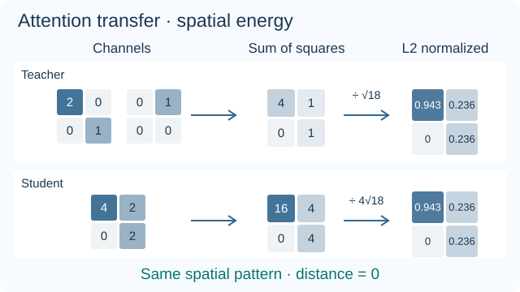

# 注意力轉移

注意力轉移訓練學生卷積網路去匹配教師的空間注意力圖。注意力圖摘要網路在哪裡反應，而不是匹配完整的特徵張量。Zagoruyko 與 Komodakis（2016）表明，這個較便宜的目標能在多個資料集與架構上改善學生 CNN。它是[特徵式](../index.zh-TW.md)方法，以部分資訊換取較簡單的目標。

## 問題

匹配完整激活值會迫使學生複製教師特徵的每個通道，包括學生可能沒有能力表示的特徵。需要一個較便宜、仍能承載教師結構的目標。

## 核心想法

匹配教師的注意力圖。注意力圖是某一層激活值的空間摘要，因此學生學到的是在哪裡反應，而不需要複製每個通道。論文定義兩種圖：以激活值計算的激活式圖，以及以輸出對激活值的梯度計算的梯度式圖。論文回報，激活式的形式效果較好，勝過匹配完整激活值。

## 方程式或演算法

對於具有 $C$ 個通道、激活張量為 $A$ 的層，激活式映射是把絕對激活值以冪次 $p > 1$ 沿通道加總，每個樣本得到一張空間圖：

$$
F^{p}_{\text{sum}}(A) = \sum_{i=1}^{C} |A_i|^{p}
$$

學生的損失在一般任務損失之外加上一個懲罰項。對每一對被匹配的層 $j$，學生與教師的圖先展平並做 $\ell_2$ 正規化，再進行比較：

$$
\mathcal{L}_{AT} = \mathcal{L}(W_S, x) + \frac{\beta}{2} \sum_{j \in \mathcal{I}} \left\| \frac{Q_S^{j}}{\lVert Q_S^{j} \rVert_2} - \frac{Q_T^{j}}{\lVert Q_T^{j} \rVert_2} \right\|_p
$$

其中 $Q^j$ 是第 $j$ 層的向量化注意力圖，$\mathcal{I}$ 是被匹配的層集合，$\beta$ 是懲罰的權重，$p$ 是範數類型，論文設為 2。正規化使比較不受圖的整體尺度影響。

### 動態解讀: 空間能量的正規化

[GitHub 靜態預覽](../../../../../assets/concept-animations/attention-transfer-spatial-energy-still.svg) · [完整 12 秒動畫](../../../../../assets/concept-animations/attention-transfer-spatial-energy-motion.svg)

對冪次為 2 的激活式映射，使用展平後的 $2\times2$ 教師通道 $(2,0,0,1)$、$(0,1,0,0)$，以及學生的單一通道 $(4,2,0,2)$。教師第一個通道貢獻 $(4,0,0,1)$，第二個通道再加入 $(0,1,0,0)$。原始空間圖為 $Q_T=(4,1,0,1)$ 與 $Q_S=(16,4,0,4)=4Q_T$。

教師的範數為 $\sqrt{18}$，學生的範數為 $4\sqrt{18}$。各自除以自身範數後，皆得到向量 $(4,1,0,1)/\sqrt{18}$，約為 $(0.943,0.236,0,0.236)$。即使通道數與原始幅度不同，注意力圖的距離仍為零。這說明匹配空間能量不必複製完整特徵張量。映射的冪次與比較範數是不同的選擇，本例皆採用 2。全零圖需要明確的數值保護（例如在分母加入 epsilon）。通道欄的熱圖深淺依各組特徵的尺度呈現，原始能量欄則共用尺度。這是示意前向計算，並非實測激活值或模擬訓練軌跡。參見參考文獻 Zagoruyko 與 Komodakis。[^at-motion]

MkDocs 網站可用播放／暫停（Enter 或空白鍵）檢視變化；GitHub 與偏好減少動態效果的讀者可檢視完整靜態結果。原創動畫，**CC BY-SA 4.0**。

[^at-motion]: Zagoruyko 與 Komodakis（2016）. https://arxiv.org/abs/1612.03928 — 原始方法。

### 正規化比較的幾何意義

動畫的外框標示目前正在累積平方激活值的通道。箭頭上的兩個除數是完成聚合後的原始圖範數，而非個別通道的範數。

對非零空間圖 $q$ 與 $r$，令 $u=q/\|q\|_2$、$v=r/\|r\|_2$。展開平方距離可得

$
\|u-v\|_2^2=2-2u^\top v.
$

因此非零圖的距離為零，若且唯若兩者互為正純量倍數。動畫中的 $Q_S=4Q_T$；若將學生的第三個激活值由 0 改為 2，原始圖變成 $(16,4,4,4)$，餘弦相似度變為 $\sqrt{18/19}$。此時平方距離為 $2-2\sqrt{18/19}$，約為 0.05334；L2 距離（非平方）約為 0.2310。這些是推導出的示意數值；若對零圖使用含 epsilon 的穩定化正規化，上述等式不能直接套用。

## 結果

在 CIFAR-10 上，論文的表 1 回報五次執行的測試誤差中位數。注意力轉移降低了表中每一組學生與教師配對的誤差，包括教師比學生更深的配對。下表列出其中三組。

| 學生（教師） | 單獨訓練學生（%） | 加入注意力轉移（%） | 教師（%） |
|---|---|---|---|
| WRN-16-1（WRN-16-2） | 8.77 | 7.93 | 6.31 |
| WRN-16-1（WRN-40-1） | 8.77 | 8.25 | 6.58 |
| WRN-16-2（WRN-40-2） | 6.31 | 5.85 | 5.23 |

論文也回報，在每一組配對中，激活式轉移都優於匹配完整激活值，而且與標準蒸餾損失合併使用時還能進一步改善。

在 ImageNet 上，以 ResNet-34 為教師、透過注意力轉移訓練的 ResNet-18，其 top-1 驗證誤差為 29.3%，未使用轉移時為 30.4%；教師為 26.1%。在遷移學習中，論文的表 4 回報，經 ImageNet 預訓練的 ResNet-18 在 CUB 鳥類資料集上的誤差，從 28.5% 降到 27.0%；在 MIT Scenes 上則從 28.2% 降到 27.1%。在 Scenes 上它與知識蒸餾表現相當，在 CUB 上則更好。論文指出，其 ImageNet 的注意力損失只施加在兩組殘差區塊上，而且超參數未經調校。

## 限制

- 注意力圖只存在於架構具有空間結構的地方，因此此方法是為卷積網路開發的。
- 摘要會丟棄完整特徵匹配所保留的通道資訊。
- 懲罰權重 $\beta$ 與被匹配的層的選擇，是學生表現所依賴的額外設定。

## 關鍵方法

- [FitNets](../fitnets/index.zh-TW.md)透過學得的回歸器匹配完整的中間特徵。它承載的資訊比注意力轉移多，成本也較高。
- [Hinton 蒸餾](../../response-based/hinton-distillation/index.zh-TW.md)是注意力轉移加入其懲罰項的輸出層級目標。

## 開放問題與相關變體

- **Transformer。** 注意力圖對 Transformer 而言是自然的目標，但在那裡轉移的效果如何，仍需研究。
- **其他中間目標。** 保留相似度的蒸餾（Tung 與 Mori，2019）匹配另一種中間摘要，在相同任務上與注意力圖比較，仍是開放問題。

## 相關連結

注意力圖是網路在看哪裡的空間摘要，這使此方法與[Transformer](../../../../../theory/models/transformer/index.zh-TW.md)中的注意力機制相連。對反應位置的關注，在[神經科學](../../../../../brain-mind/neuroscience/index.zh-TW.md)中也有對應的研究，不過此方法是工程手段，並未對神經機制作任何主張。

## 參考文獻

### 開創性論文

- Zagoruyko, S. & Komodakis, N. (2016). *Paying More Attention to Attention: Improving the Performance of Convolutional Neural Networks via Attention Transfer*. arXiv:1612.03928. https://arxiv.org/abs/1612.03928 — 匹配教師與學生之間基於激活值的空間注意力圖，以改善較小的 CNN。
- Romero, A., et al. (2014). *FitNets: Hints for Thin Deep Nets*. arXiv:1412.6550. https://arxiv.org/abs/1412.6550 — 完整特徵提示，是注意力轉移所簡化的替代方案。
- Hinton, G., Vinyals, O. & Dean, J. (2015). *Distilling the Knowledge in a Neural Network*. arXiv:1503.02531. https://arxiv.org/abs/1503.02531 — 注意力轉移所加入的輸出損失。
- Tung, F. & Mori, G. (2019). *Similarity-Preserving Knowledge Distillation*. arXiv:1907.09682. https://arxiv.org/abs/1907.09682 — 提出另一種中間目標，供與注意力圖比較。

### 綜述與教科書

- Gou, J., et al. (2021). *Knowledge Distillation: A Survey*. International Journal of Computer Vision. https://doi.org/10.1007/s11263-021-01453-z — 綜述蒸餾，包括特徵式目標。
