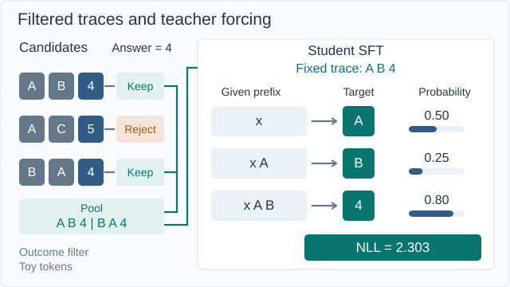

# DeepSeek-R1 Distillation

DeepSeek-R1 distillation transfers the reasoning of a large model into smaller models by fine-tuning them on the large model's reasoning traces. The DeepSeek-AI report argues that the reasoning patterns found in large models can be systematically harnessed to strengthen smaller ones. It reports that distilling those patterns works better than running large-scale reinforcement learning on the small models directly. It is a [language-model](../index.md) distillation method, and a form of [sequence-level distillation](../sequence-level/index.md) for long reasoning outputs.

## Problem

Strong multi-step reasoning was thought to need very large models. A small model trained with reinforcement learning from scratch can reason less well than a large one, and it is unclear whether the small model can learn the same behaviour more cheaply.

## Core idea

Train a large model with reinforcement learning until it reasons well, then use its reasoning traces as supervised training data for smaller models. The small models learn to write the same kind of step-by-step solutions, without running reinforcement learning themselves.

## Equation or algorithm

The large model produces reasoning traces and answers for a set of prompts, which are filtered for quality. The paper fine-tunes the base models on the resulting 800k samples for 2 to 3 epochs. The base models are open models such as Qwen, as listed in the paper's distillation table. The objective is the ordinary next-token loss, so the step is supervised learning and needs no reward model at the small scale.

*Original 12-second teaching animation (CC BY-SA 4.0).* A simplified reasoning-data example checks the final answer 4: traces (A,B,4) and (B,A,4) enter the accepted pool, while (A,C,5) is rejected. A, B and C are symbolic tokens, not actual reasoning steps. The example picks the first accepted trace for supervised training, rather than sampling a new trace from the student. Correct final answers alone do not establish faithful intermediate reasoning. The real dataset also contains non-reasoning examples and additional quality filters; see Appendix B.3.3 and F of the [report](https://arxiv.org/html/2501.12948v2).

For a prompt $x$ and fixed selected response $y$, the illustrative response-only negative log likelihood is

$
L=-\sum_{t=1}^{|y|}\log p_\theta(y_t\mid x,y_{<t}).
$

With conditional target-token probabilities $(0.50,0.25,0.80)$ for the three successive tokens, the summed loss is $-\log(0.50\cdot0.25\cdot0.80)=\log 10\approx2.303$ nats (mean $0.768$ per token). Bar growth reveals these fixed probabilities; it is not a training trajectory. All values are artificial, not model measurements. This is teacher forcing on a selected sequence, not matching the teacher's full vocabulary logits, and not a student RL update. The report's distilled models use SFT without a subsequent RL stage.

Use the keyboard-accessible Play/Pause on MkDocs; GitHub provides a [static fallback](../../../../../assets/concept-animations/r1-trace-filter-sft-still.svg) and the [full SVG animation](../../../../../assets/concept-animations/r1-trace-filter-sft-motion.svg).

### Fixed prefixes under teacher forcing

The revised animation exposes the conditioning context explicitly: $x$ denotes the prompt, not a response token. For the selected fixed response $(A,B,4)$:

| Given context | Target | Conditional probability |
|---|---|---:|
| $x$ | A | 0.50 |
| $x,A$ | B | 0.25 |
| $x,A,B$ | 4 | 0.80 |

The next context uses the recorded target token even if the student's highest-probability prediction is different. The three displayed rows are a conceptual factorization, not necessarily three separate forward passes: a causal Transformer can compute all three losses in parallel using shifted targets and causal attention. The prompt is context only in this response-only loss example; real training pipelines can choose different masking and normalization conventions.

### Token averaging versus sequence averaging

For a batch of $N$ nonempty responses with unmasked token counts $n_i$ and summed NLLs $S_i$, two possible objectives are

$
L_{\mathrm{token}}=\frac{\sum_i S_i}{\sum_i n_i},\qquad
L_{\mathrm{sequence}}=\frac{1}{N}\sum_i\frac{S_i}{n_i}.
$

Suppose two artificial responses have 3 and 9 unmasked tokens, with respective mean NLLs 1 and 2 nats. The token mean is $(3+18)/12=1.75$, whereas the sequence mean is $(1+2)/2=1.5$. The longer response contributes 75% of the token-mean objective's total coefficient mass, but 50% of the sequence-mean objective's mass. These are objective coefficients, not necessarily gradient norms. Padding and masked prompt tokens are excluded from $n_i$. This illustrates alternative reductions, not a claim about the exact reduction used for the reported R1 models.

## Results

The paper compares a distilled 32B model against a 32B base model trained with large-scale reinforcement learning, which the authors call Qwen2.5-32B-Zero. On the benchmarks in its Table 16, the distilled model scores higher on every one:

| Benchmark | Qwen2.5-32B-Zero (RL) | DeepSeek-R1-Distill-Qwen-32B |
|---|---|---|
| AIME 2024, pass@1 | 47.0 | 72.6 |
| AIME 2024, cons@64 | 60.0 | 83.3 |
| MATH, pass@1 | 91.6 | 94.3 |
| GPQA Diamond, pass@1 | 55.0 | 62.1 |
| LiveCodeBench, pass@1 | 40.2 | 57.2 |

The authors draw two conclusions from this table. Distilling a stronger model into a smaller one yields good results, while a small model that relies on large-scale reinforcement learning may need far more compute and still fall short of distillation. They also note that pushing beyond this level may still need stronger base models and larger-scale reinforcement learning.

## Limitations

- The student's reasoning is bounded by the teacher's, and the training data are long traces, which are expensive to generate.
- The main comparison is at 32B, and the paper does not isolate every factor in it, so the gap at other sizes and on other tasks should be checked against the paper's other tables.
- Benchmark numbers come from the authors' own evaluation.

## Key methods

- [Sequence-level distillation](../sequence-level/index.md) (Kim and Rush, 2016) trains the student on the teacher's output sequences, which is the same basic idea applied to translation.
- [MiniLLM](../minillm/index.md) trains the student on its own samples rather than on fixed traces, which reduces the mismatch between training and generation.

## Open issues and related variants

- **Faithfulness.** Whether a student's reasoning follows the teacher's steps, or only imitates their form, is open.
- **Generalisation.** Reasoning learned on mathematics and code may not transfer to other domains.
- **Cost of traces.** Generating long reasoning traces at scale is a practical bottleneck that the paper does not fully quantify.

## Connections

The idea that reasoning can be taught by imitation connects to the [language model](../../../../../theory/models/llm/index.md) page, where chain-of-thought behaviour is discussed. The cost of producing traces is a [training](../../../../../engineering/training/index.md) concern.

## References

### Seminal papers

- DeepSeek-AI (2025). *DeepSeek-R1: Incentivizing Reasoning Capability in LLMs via Reinforcement Learning*. arXiv:2501.12948. https://arxiv.org/abs/2501.12948 — Reports that reasoning patterns from a large model can be harnessed to enhance smaller models, and gives the distillation comparison in Table 16.
- Kim, Y. & Rush, A. M. (2016). *Sequence-Level Knowledge Distillation*. arXiv:1606.07947. https://arxiv.org/abs/1606.07947 — The earlier method that trains the student on the teacher's output sequences.
- Gu, Y., Dong, L., Wei, F. & Huang, M. (2023). *MiniLLM: On-Policy Distillation of Large Language Models*. arXiv:2306.08543. https://arxiv.org/abs/2306.08543 — On-policy distillation, the alternative that trains on the student's own samples.
- Hinton, G., Vinyals, O. & Dean, J. (2015). *Distilling the Knowledge in a Neural Network*. arXiv:1503.02531. https://arxiv.org/abs/1503.02531 — The original distillation objective, which reasoning distillation extends to text.

### Surveys and textbooks

- Gou, J., et al. (2021). *Knowledge Distillation: A Survey*. International Journal of Computer Vision. https://doi.org/10.1007/s11263-021-01453-z — Surveys distillation, the background for training smaller models on a teacher's outputs.
