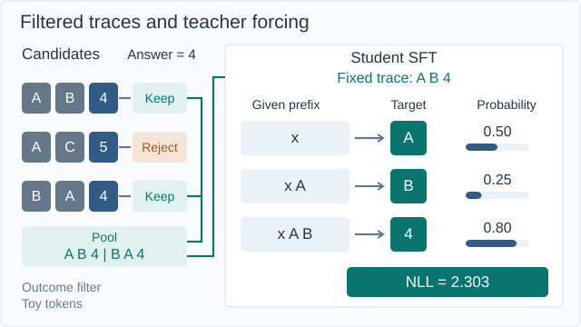

# DeepSeek-R1 蒸餾

DeepSeek-R1 蒸餾，是透過在大型模型的推理軌跡上微調小模型，把大型模型的推理能力轉移到較小的模型中。DeepSeek-AI 的報告主張，大型模型中發現的推理模式可以被系統性地用來增強小型模型。報告也指出，蒸餾這些模式的效果優於直接對小模型進行大規模強化學習。它是[語言模型蒸餾](../index.zh-TW.md)的一種方法，對很長的推理輸出而言，也是一種[序列層級蒸餾](../sequence-level/index.zh-TW.md)。

## 問題

強的多步推理一直被認為需要非常大的模型。小型模型若從頭以強化學習訓練，推理能力可能不如大型模型；而小模型能否以更低的成本學會同樣的行為，尚不清楚。

## 核心想法

先以強化學習訓練大型模型，直到它推理得很好，然後把它的推理軌跡當作較小模型的監督式訓練資料。小模型學會寫出同類的逐步解答，而不需要自己執行強化學習。

## 公式或演算法

大型模型針對一組提示生成推理軌跡與答案，並經過品質篩選。論文以產生的 80 萬筆樣本，對基礎模型微調 2 到 3 個週期。基礎模型為 Qwen 等開放模型，列於論文的蒸餾表中。目標是一般的下一個 token 損失，因此這一步是監督式學習，在小模型規模上不需要獎勵模型。

*原創 12 秒教學動畫（CC BY-SA 4.0）。* 簡化推理資料篩選：以最終答案 4 為條件，將軌跡 (A,B,4) 與 (B,A,4) 納入保留集合，淘汰 (A,C,5)。A、B、C 是符號化 token，並非實際推理步驟。算例取第一條保留軌跡進行監督式訓練，而非由學生重新取樣軌跡。最終答案正確不代表中間推理必然忠實。真實資料集也包括非推理樣本與額外品質篩選，參見[報告](https://arxiv.org/html/2501.12948v2)附錄 B.3.3 與 F。

給定提示 $x$ 與固定選取的回答 $y$，示意的僅回答 token 負對數似然為

$
L=-\sum_{t=1}^{|y|}\log p_\theta(y_t\mid x,y_{<t}).
$

假設三個依序出現的目標 token 條件機率為 $(0.50,0.25,0.80)$，損失總和為 $-\log(0.50\cdot0.25\cdot0.80)=\log 10\approx2.303$ nats（每 token 平均 $0.768$）。長條逐步揭露固定機率，並非訓練軌跡；所有數值皆為人工示意，非模型實測。此處是對選取序列進行 teacher forcing，不是匹配教師完整詞彙表 logits，也不是學生的強化學習更新。報告中的蒸餾模型採 SFT，沒有後續 RL 階段。

MkDocs 可使用鍵盤操作播放／暫停；GitHub 提供 [靜態回退圖](../../../../../assets/concept-animations/r1-trace-filter-sft-still.svg)，亦可開啟 [完整 SVG 動畫](../../../../../assets/concept-animations/r1-trace-filter-sft-motion.svg)。

### Teacher forcing 的固定前綴

新版動畫明確呈現條件上下文：$x$ 代表提示，而非回答 token。對選定的固定回答 $(A,B,4)$：

| 給定上下文 | 目標 | 條件機率 |
|---|---|---:|
| $x$ | A | 0.50 |
| $x,A$ | B | 0.25 |
| $x,A,B$ | 4 | 0.80 |

即使學生機率最高的預測不同，下一個上下文仍使用已記錄的目標 token。三列是概念上的機率分解，不必分別執行三次前向傳播：因果 Transformer 可透過位移目標與因果注意力平行計算三個損失。在本例的僅回答損失中，提示只作為上下文；實際訓練流程可採用不同的遮罩與正規化方式。

### Token 平均與序列平均

假設批次包含 $N$ 筆非空回答，第 $i$ 筆未被遮罩的 token 數為 $n_i$，NLL 總和為 $S_i$，兩種可能的目標函數為

$
L_{\mathrm{token}}=\frac{\sum_i S_i}{\sum_i n_i},\qquad
L_{\mathrm{sequence}}=\frac{1}{N}\sum_i\frac{S_i}{n_i}.
$

假設兩筆人工示意回答分別有 3 與 9 個未被遮罩的 token，每 token 平均 NLL 分別為 1 與 2 nats。Token 平均為 $(3+18)/12=1.75$，序列平均則為 $(1+2)/2=1.5$。較長的回答占 token 平均目標總係數權重的 75%，但在序列平均中僅占 50%。這是目標函數係數，而非梯度範數的必然比例。Padding 與被遮罩的提示 token 不計入 $n_i$。此例比較不同損失彙總方式，並非宣稱 R1 報告中的模型採用其中一種特定實作。

## 結果

論文把蒸餾後的 32B 模型，與以大規模強化學習訓練的 32B 基礎模型（作者稱之為 Qwen2.5-32B-Zero）作比較。在其表 16 的基準上，蒸餾模型在每一項都得分較高：

| 基準 | Qwen2.5-32B-Zero（強化學習） | DeepSeek-R1-Distill-Qwen-32B |
|---|---|---|
| AIME 2024，pass@1 | 47.0 | 72.6 |
| AIME 2024，cons@64 | 60.0 | 83.3 |
| MATH，pass@1 | 91.6 | 94.3 |
| GPQA Diamond，pass@1 | 55.0 | 62.1 |
| LiveCodeBench，pass@1 | 40.2 | 57.2 |

作者從此表得出兩點結論：把較強模型蒸餾到較小的模型可得良好結果，而依賴大規模強化學習的小模型可能需要多得多的運算，甚至仍達不到蒸餾的表現。作者也指出，要超越此水準，可能仍需要更強的基礎模型與更大規模的強化學習。

## 限制

- 學生的推理受限於教師的推理，而訓練資料是很長的推理軌跡，生成成本高。
- 主要比較是在 32B 規模上，論文並未隔離比較中的每個因素，因此其他規模與任務上的差距，應對照論文的其他表格檢查。
- 基準數字來自作者自己的評估。

## 關鍵方法

- [序列層級蒸餾](../sequence-level/index.zh-TW.md)（Kim 與 Rush，2016）在教師的輸出序列上訓練學生，與此處是同樣的基本想法，只是應用於翻譯。
- [MiniLLM](../minillm/index.zh-TW.md)在學生自己的樣本上訓練，而不是固定的軌跡，從而減少訓練與生成之間的不一致。

## 開放問題與相關變體

- **忠實度。** 學生的推理是遵循教師的步驟，還是只模仿其形式，仍是開放問題。
- **推廣性。** 在數學與程式碼上學到的推理，可能無法轉移到其他領域。
- **軌跡成本。** 大規模生成很長的推理軌跡，是實務上的瓶頸，論文並未完全量化。

## 相關連結

「推理可以透過模仿來教」的想法，與[大型語言模型](../../../../../theory/models/llm/index.zh-TW.md)頁中思維鏈行為的討論相關。生成軌跡的成本，則是[訓練](../../../../../engineering/training/index.zh-TW.md)的考量。

## 參考文獻

### 開創性論文

- DeepSeek-AI (2025). *DeepSeek-R1: Incentivizing Reasoning Capability in LLMs via Reinforcement Learning*. arXiv:2501.12948. https://arxiv.org/abs/2501.12948 — 指出大型模型的推理模式能用來增強小型模型，並在表 16 給出蒸餾的比較。
- Kim, Y. & Rush, A. M. (2016). *Sequence-Level Knowledge Distillation*. arXiv:1606.07947. https://arxiv.org/abs/1606.07947 — 較早的方法，在教師的輸出序列上訓練學生。
- Gu, Y., Dong, L., Wei, F. & Huang, M. (2023). *MiniLLM: On-Policy Distillation of Large Language Models*. arXiv:2306.08543. https://arxiv.org/abs/2306.08543 — 同策略蒸餾，是改在學生自己樣本上訓練的替代方案。
- Hinton, G., Vinyals, O. & Dean, J. (2015). *Distilling the Knowledge in a Neural Network*. arXiv:1503.02531. https://arxiv.org/abs/1503.02531 — 原始的蒸餾目標，推理蒸餾將它延伸到文字。

### 綜述與教科書

- Gou, J., et al. (2021). *Knowledge Distillation: A Survey*. International Journal of Computer Vision. https://doi.org/10.1007/s11263-021-01453-z — 綜述蒸餾，作為用教師輸出訓練小模型的背景。
