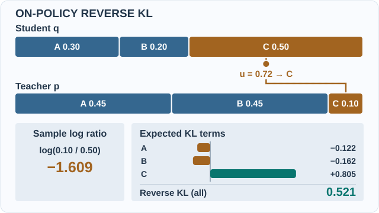

# MiniLLM

MiniLLM distils a large language model by training the student on its own generated text, scored by the teacher, rather than on the teacher's text alone. Gu et al. (2023) replace the usual forward KL divergence with a reverse KL, which stops the student from putting probability on regions the teacher finds unlikely. The paper reports that the method scales from 120 million to 13 billion parameters across model families. It is an [on-policy](../index.md) method within [language-model distillation](../index.md), and the closest relative of [sequence-level distillation](../sequence-level/index.md).

## Problem

Standard distillation of a language model trains the student on sequences that the teacher produces, or on the teacher's distribution over them. At generation time, however, the student produces its own sequences. Early errors then compound, because the student reaches states it never saw during training. The forward KL used in standard distillation also encourages the student to spread probability over every mode of the teacher, including those it cannot match well.

## Core idea

Sample responses from the student, and ask the teacher how likely it finds each one. Train the student on its own samples with a reverse KL, which is mode-seeking: the student concentrates on outputs the teacher finds likely, rather than covering all of the teacher's distribution. The paper illustrates the difference with a toy fit of a Gaussian mixture by a single Gaussian. The forward KL spreads the single Gaussian over the empty space between the modes, and the reverse KL locks onto one mode.

## Equation or algorithm

Write $p$ for the teacher's distribution and $q_\theta$ for the student's. Standard distillation minimises the forward KL, $\mathrm{KL}(p \Vert q_\theta)$. MiniLLM instead minimises the reverse KL, $\mathrm{KL}(q_\theta \Vert p)$, estimated on the student's own samples. Since sampling is not differentiable, the gradient is estimated with a policy-gradient style method. The paper adds three techniques to stabilise and accelerate training:

1. **Single-step decomposition**, which reduces the variance of the gradient estimate.
2. **Teacher-mixed sampling**, which mixes teacher samples into the student's sampling to limit reward hacking.
3. **Length normalisation**, which removes the bias towards short or long responses.

### Worked example: sample source and reverse KL

For a fixed prompt, consider a finite toy response space with teacher probabilities $p=(0.45,0.45,0.10)$ and student probabilities $q=(0.30,0.20,0.50)$ for complete responses A, B and C. An illustrative uniform draw $u=0.72$ lies in C's student cumulative interval $[0.5,1)$, so the sampled response is C. The same response is then scored by the teacher, not sampled a second time from it. The moving dot illustrates inverse-CDF selection rather than a token-by-token generation.

For this sample the log-ratio reward is $\log(p(C)/q(C))=\log(0.1/0.5)\approx-1.609$. The population objective is $D_{\mathrm{KL}}(q\Vert p)=\sum_y q(y)\log(q(y)/p(y))\approx0.521$ nats. Thus the expected log-ratio reward under $q$ is the negative reverse KL; one sampled reward is not the full divergence. A negative log ratio identifies a response to which the student assigns more probability than the teacher. This is a sequence-level toy objective, not a depiction of the full MiniLLM policy-gradient estimator, importance weighting, teacher-mixed sampling, or parameter updates. Both distributions have strictly positive support in this example.

*Original 12-second teaching animation (CC BY-SA 4.0). The probabilities and scores are illustrative, not measured model outputs. MkDocs provides keyboard-accessible Play/Pause and a reduced-motion fallback; GitHub shows the static result. [Original paper](https://arxiv.org/abs/2306.08543).*

[Static preview](../../../../../assets/concept-animations/minillm-on-policy-score-still.svg) · [Full SVG animation](../../../../../assets/concept-animations/minillm-on-policy-score-motion.svg).

## Results

The paper applies the method to generative language models from 120 million to 13 billion parameters in the instruction-following setting, with five datasets evaluated by Rouge-L. The teachers include GPT-2 and GPT-J 6B, with students such as GPT-2 760M and OPT 1.3B. The abstract states that the method scales well across model families. The paper reports that MiniLLM consistently outperforms standard distillation baselines on all datasets, and that it yields lower exposure bias, better calibration and higher quality on long responses.

## Limitations

- The policy-gradient style update is more complex and costlier than supervised distillation, and it needs the teacher to score the student's samples during training.
- The stability of the optimisation over long generations is a practical concern, which is why the paper adds variance reduction and length normalisation.
- The evaluation is on instruction-following tasks with Rouge-L scoring, which measures overlap with reference responses rather than reasoning quality.

## Key methods

- [Sequence-level distillation](../sequence-level/index.md) (Kim and Rush, 2016) trains the student on the teacher's output sequences by minimising the forward KL. MiniLLM keeps the sequence view but changes both the divergence and the sample source.
- [Hinton distillation](../../response-based/hinton-distillation/index.md) is the soft-target objective with the forward KL that this method replaces.
- [DeepSeek-R1 distillation](../deepseek-r1/index.md) trains smaller models on a stronger model's reasoning traces, a fixed-data approach that avoids on-policy sampling.

## Open issues and related variants

- **Choice of divergence.** Reverse KL is mode-seeking, and forward KL is mode-covering. Which divergence suits a given task, and whether a mix of the two is better, is not settled.
- **Cost of on-policy sampling.** Generating samples from the student during training is expensive, and cheaper schemes that reuse samples are an open area.
- **Related:** [sequence-level distillation](../sequence-level/index.md) trains on the teacher's outputs, which avoids the on-policy cost but suffers the mismatch that MiniLLM addresses.

## Connections

On-policy training is a reinforcement-learning idea, which links the method to the [training](../../../../../engineering/training/index.md) pipeline and to the [language model](../../../../../theory/models/llm/index.md) page, where post-training with feedback is discussed.

## References

### Seminal papers

- Gu, Y., Dong, L., Wei, F. & Huang, M. (2023). *MiniLLM: On-Policy Distillation of Large Language Models*. arXiv:2306.08543. https://arxiv.org/abs/2306.08543 — Trains the student on its own samples with reverse KL, scalable from 120 million to 13 billion parameters.
- Kim, Y. & Rush, A. M. (2016). *Sequence-Level Knowledge Distillation*. arXiv:1606.07947. https://arxiv.org/abs/1606.07947 — The teacher-output method that MiniLLM improves on, which minimises the forward KL.
- Hinton, G., Vinyals, O. & Dean, J. (2015). *Distilling the Knowledge in a Neural Network*. arXiv:1503.02531. https://arxiv.org/abs/1503.02531 — The forward-KL soft-target objective that the method replaces with reverse KL.
- DeepSeek-AI (2025). *DeepSeek-R1: Incentivizing Reasoning Capability in LLMs via Reinforcement Learning*. arXiv:2501.12948. https://arxiv.org/abs/2501.12948 — A later large-scale use of a stronger model's reasoning traces to train smaller models.

### Surveys and textbooks

- Gou, J., et al. (2021). *Knowledge Distillation: A Survey*. International Journal of Computer Vision. https://doi.org/10.1007/s11263-021-01453-z — Surveys distillation and the divergences used to match the teacher.
