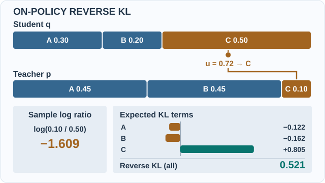

# MiniLLM

MiniLLM 透過讓學生在自己生成的文字上訓練（由教師評分），來蒸餾大型語言模型，而不是只在教師的文字上訓練。Gu 等人（2023）以反向 KL 取代常用的前向 KL 散度，使學生不會把機率放在教師認為不太可能的區域。論文報告此方法可以擴展到 1.2 億至 130 億參數的不同模型家族。它是[語言模型蒸餾](../index.zh-TW.md)中的[同策略](../index.zh-TW.md)方法，也是[序列層級蒸餾](../sequence-level/index.zh-TW.md)最接近的親戚。

## 問題

標準的語言模型蒸餾，是在教師產生的序列或教師對這些序列的分布上訓練學生。然而在生成時，學生產生的是它自己的序列。早期的錯誤因此會累積，因為學生會進入訓練時從未見過的狀態。標準蒸餾所用的前向 KL 也會促使學生把機率分散到教師的每一個模式上，包括它難以匹配的模式。

## 核心想法

從學生取樣回應，並請教師評估學生的每個回應有多可能。在學生自己的樣本上，以反向 KL 訓練學生。反向 KL 是模式尋求的：學生集中在教師認為可能的輸出上，而不是覆蓋教師分布的全部。論文以一個玩具實驗說明兩者的差別：用單一高斯去擬合高斯混合。前向 KL 會把單一高斯攤在各模式之間的空白區域，反向 KL 則鎖定其中一個模式。

## 公式或演算法

令 $p$ 為教師的分布，$q_\theta$ 為學生的分布。標準蒸餾最小化前向 KL，即 $\mathrm{KL}(p \Vert q_\theta)$。MiniLLM 則最小化反向 KL，即 $\mathrm{KL}(q_\theta \Vert p)$，並在學生自己的樣本上估計。由於抽樣本身不可微分，梯度以策略梯度式的方法估計。論文另外加入三項技巧，使訓練穩定並加速：

1. **單步分解**，降低梯度估計的變異。
2. **教師混合抽樣**，在學生的抽樣中混入教師的樣本，以限制獎勵駭客行為。
3. **長度正規化**，消除對過短或過長回應的偏差。

### 算例：抽樣來源與反向 KL

固定提示詞後，假設完整回應 A、B、C 構成有限的示意空間，教師機率為 $p=(0.45,0.45,0.10)$，學生機率為 $q=(0.30,0.20,0.50)$。示意均勻抽樣值 $u=0.72$ 落在 C 的學生累積機率區間 $[0.5,1)$，因此抽到回應 C。接著由教師評估同一個回應，而非再從教師抽樣。移動的圓點表示反累積分布抽樣，而非逐 token 生成。

此樣本的對數比值獎勵為 $\log(p(C)/q(C))=\log(0.1/0.5)\approx-1.609$。母體目標為 $D_{\mathrm{KL}}(q\Vert p)=\sum_y q(y)\log(q(y)/p(y))\approx0.521$ nats。因此，在 $q$ 下對數比值獎勵的期望值是反向 KL 的負值；單一抽樣獎勵並非完整散度。負的對數比值表示學生對此回應分配的機率高於教師。這是序列層級的示意目標，並未模擬完整 MiniLLM 策略梯度估計器、重要性加權、教師混合抽樣或參數更新。本例兩個分布在所有候選上均有正機率。

*原創 12 秒教學動畫（CC BY-SA 4.0）。機率與分數皆為示意值，並非模型實測輸出。MkDocs 提供可用鍵盤操作的播放／暫停及減少動態效果的回退畫面；GitHub 顯示靜態結果。[原始論文](https://arxiv.org/abs/2306.08543)。*

[靜態預覽](../../../../../assets/concept-animations/minillm-on-policy-score-still.svg) · [完整 SVG 動畫](../../../../../assets/concept-animations/minillm-on-policy-score-motion.svg).

## 結果

論文在指令遵循的設定中，把此方法應用於 1.2 億至 130 億參數的生成式語言模型，並以 Rouge-L 在五個資料集上評估。教師包括 GPT-2 與 GPT-J 6B，學生包括 GPT-2 760M 與 OPT 1.3B 等。摘要指出此方法在不同模型家族上擴展良好。論文回報，MiniLLM 在所有資料集上一致地勝過標準蒸餾基線，並且暴露偏差較低、校準較好，長回應的品質也較高。

## 限制

- 策略梯度式的更新比監督式蒸餾更複雜、成本更高，而且需要教師在訓練期間為學生的樣本評分。
- 長序列生成時的最佳化穩定性，是實務上的一個疑慮，這也是論文加入變異降低與長度正規化的原因。
- 評估使用 Rouge-L 在指令遵循任務上進行，它衡量的是與參考回應的重疊，而非推理品質。

## 關鍵方法

- [序列層級蒸餾](../sequence-level/index.zh-TW.md)（Kim 與 Rush，2016）以前向 KL 在教師的輸出序列上訓練學生。MiniLLM 保留序列的觀點，但同時改變了散度與樣本來源。
- [Hinton 蒸餾](../../response-based/hinton-distillation/index.zh-TW.md)是以前向 KL 為基礎的軟目標，此方法以反向 KL 取代它。
- [DeepSeek-R1 蒸餾](../deepseek-r1/index.zh-TW.md)在較強模型的推理軌跡上訓練小模型，屬於固定資料的方法，避開了同策略抽樣。

## 開放問題與相關變體

- **散度的選擇。** 反向 KL 是模式尋求的，前向 KL 則是模式覆蓋的。哪一種散度適合特定任務，或兩者混合是否更好，尚無定論。
- **同策略抽樣的成本。** 訓練時從學生生成樣本，成本很高；重複使用樣本的較便宜方案，是開放的研究領域。
- **相關：** [序列層級蒸餾](../sequence-level/index.zh-TW.md)在教師的輸出上訓練，避開了同策略的成本，但也承受了 MiniLLM 所處理的不一致。

## 相關連結

同策略訓練是強化學習的概念，因此此方法與[訓練](../../../../../engineering/training/index.zh-TW.md)流程相連，也與[大型語言模型](../../../../../theory/models/llm/index.zh-TW.md)頁中以回饋進行後訓練的討論相關。

## 參考文獻

### 開創性論文

- Gu, Y., Dong, L., Wei, F. & Huang, M. (2023). *MiniLLM: On-Policy Distillation of Large Language Models*. arXiv:2306.08543. https://arxiv.org/abs/2306.08543 — 在學生自己的樣本上以反向 KL 訓練，可擴展到 1.2 億至 130 億參數。
- Kim, Y. & Rush, A. M. (2016). *Sequence-Level Knowledge Distillation*. arXiv:1606.07947. https://arxiv.org/abs/1606.07947 — MiniLLM 所改進的教師輸出方法，以前向 KL 最小化。
- Hinton, G., Vinyals, O. & Dean, J. (2015). *Distilling the Knowledge in a Neural Network*. arXiv:1503.02531. https://arxiv.org/abs/1503.02531 — 以前向 KL 為基礎的軟目標，此方法以反向 KL 取代它。
- DeepSeek-AI (2025). *DeepSeek-R1: Incentivizing Reasoning Capability in LLMs via Reinforcement Learning*. arXiv:2501.12948. https://arxiv.org/abs/2501.12948 — 後來大規模使用較強模型的推理軌跡來訓練小模型的例子。

### 綜述與教科書

- Gou, J., et al. (2021). *Knowledge Distillation: A Survey*. International Journal of Computer Vision. https://doi.org/10.1007/s11263-021-01453-z — 綜述蒸餾，以及用來匹配教師的各種散度。
