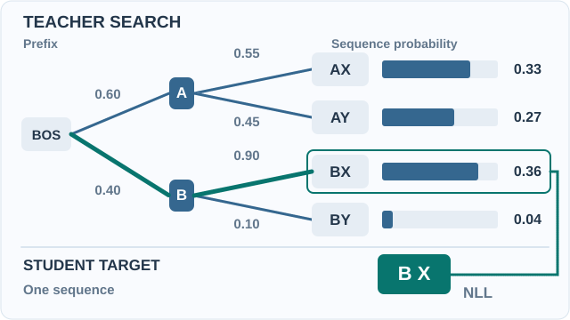

# Sequence-Level Knowledge Distillation

Sequence-level knowledge distillation trains a student sequence model on the output sequences of a teacher, rather than on the teacher's probability at each word. Kim and Rush introduced it for neural machine translation, where the teacher's distribution over a large vocabulary is too costly to store and use at every step. The student is trained with ordinary supervised learning on the teacher's best translations, and the paper reports a student about 10 times faster than its teacher with little loss in performance. It is the [language-model](../index.md) form of [knowledge distillation](../../index.md).

## Problem

Word-level distillation matches the teacher's full distribution over the vocabulary at each step. For translation this means storing and comparing a distribution over tens of thousands of words for every position in a sentence, and the student must also be run with beam search at test time, which is slow.

## Core idea

Replace the distribution over sequences with its mode, which is approximated by the teacher's beam search output. For each source sentence, the teacher produces its highest-scoring translation, and the student is trained to produce that translation. The student then sees one target sequence per source, which is cheap to store and matches how the student is used at inference.

## Equation or algorithm

Let \(Q(y \mid x)\) be the teacher's distribution over target sequences \(y\) for a source \(x\), and \(P_\theta\) the student's. The sequence-level objective applies the cross-entropy to the teacher distribution, which is intractable over all sequences. Kim and Rush approximate it by the teacher's beam search output \(\hat{y}\):

\[
\mathcal{L}_{\text{SeqKD}} \approx -\sum_{(x, \hat{y})} \log P_\theta(\hat{y} \mid x)
\]

In practice the student is trained with standard maximum likelihood on the pairs \((x, \hat{y})\). The paper also studies a sequence-level interpolation, which trains on teacher outputs that are nearer to the reference translation, and weight pruning applied after distillation.

### Worked example: from search to a single target

Suppose all complete sequences have two tokens (and termination is certain). The teacher assigns $Q(A\mid x)=0.6$ and $Q(B\mid x)=0.4$, followed by $Q(X\mid A,x)=0.55$ and $Q(X\mid B,x)=0.9$; the remaining probability goes to $Y$. The four joint probabilities are $0.33,0.27,0.36,0.04$ for AX, AY, BX and BY. Greedy decoding selects AX, while a width-two beam that retains both prefixes finds BX. Here the search is exact because all four complete candidates are evaluated; real beam search is only approximate.

The selected sequence supplies a hard target for student maximum likelihood: $-\log P_\theta(B\mid x)-\log P_\theta(X\mid B,x)$ (plus an EOS term when termination is modelled). The other teacher probabilities are not directly matched by this single-target objective. The drawn branches indicate probability factorisation and search, not gradient updates.

*Original 12-second teaching animation (CC BY-SA 4.0). All probabilities are schematic, not measured model outputs. MkDocs provides keyboard-accessible Play/Pause and a reduced-motion fallback; GitHub displays the static result. [Original paper](https://arxiv.org/abs/1606.07947).*

[Static preview](../../../../../assets/concept-animations/seqkd-beam-mode-still.svg) · [Full SVG animation](../../../../../assets/concept-animations/seqkd-beam-mode-motion.svg).

## Results

The abstract reports that the best student runs 10 times faster than the state-of-the-art teacher, with little loss in performance. Relative to a student trained without distillation, the best student gains 4.2 BLEU with greedy decoding and 1.7 BLEU with beam search. Pruning the distilled student removes 13 times fewer parameters than the teacher, at a loss of about 0.4 BLEU.

## Limitations

The student is trained only on the teacher's best output, so it sees a narrow slice of the teacher's distribution. The experiments are on translation, and the teacher's beam search adds cost when the training set is large.

## Open issues and related variants

- **Diversity.** Training on a single mode discards the teacher's alternatives, and whether sampling several outputs per input recovers them is an open question.
- **Related:** [MiniLLM](../minillm/index.md) trains the student on its own samples instead of the teacher's outputs, which removes the mismatch between training and generation.
- **Related:** [DeepSeek-R1 distillation](../deepseek-r1/index.md) applies the same recipe to long reasoning traces.

## Connections

The method is a training recipe, which sits within the [training](../../../../../engineering/training/index.md) pipeline. Its use of a teacher's chosen outputs as labels is related to the [language model](../../../../../theory/models/llm/index.md) page, where the same idea appears in instruction tuning.

## References

### Seminal papers

- Kim, Y., Rush, A. M. (2016). *Sequence-Level Knowledge Distillation*. arXiv:1606.07947. https://arxiv.org/abs/1606.07947 — Trains a translation student on the teacher's beam search output, with a 10 times faster student.
- Hinton, G., Vinyals, O., Dean, J. (2015). *Distilling the Knowledge in a Neural Network*. arXiv:1503.02531. https://arxiv.org/abs/1503.02531 — The word-level soft-target objective that the sequence-level method replaces.
- Gu, Y., Dong, L., Wei, F., Huang, M. (2023). *MiniLLM: On-Policy Distillation of Large Language Models*. arXiv:2306.08543. https://arxiv.org/abs/2306.08543 — The on-policy successor, which trains the student on its own samples.

### Surveys and textbooks

- Gou, J., et al. (2021). *Knowledge Distillation: A Survey*. International Journal of Computer Vision. https://doi.org/10.1007/s11263-021-01453-z — Surveys distillation methods across knowledge types and training schemes.

### Lectures and videos

(none checked for this page)

### Articles and documentation

- Sanh, V., et al. (2019). *DistilBERT, a Distilled Version of BERT: Smaller, Faster, Cheaper and Lighter*. arXiv:1910.01108. https://arxiv.org/abs/1910.01108 — A distilled language model trained on the teacher's word-level soft targets, for comparison with sequence distillation.
