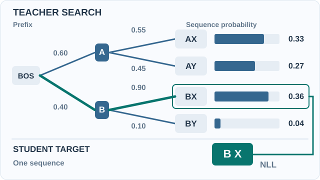

# 序列層級知識蒸餾

序列層級知識蒸餾在教師的輸出序列上訓練學生序列模型，而不是在教師每個字詞的機率上訓練。Kim 與 Rush 為神經機器翻譯提出此方法，因為在每一步都要儲存與使用教師在大型詞彙表上的分布，成本太高。學生以一般的監督式學習，在教師最佳的譯文上訓練；論文報告學生速度約為教師的 10 倍，而效能損失很小。它是[知識蒸餾](../../index.zh-TW.md)在[語言模型](../index.zh-TW.md)上的形式。

## 問題

詞層級的蒸餾，是在每一步匹配教師在整個詞彙表上的完整分布。對翻譯而言，這代表每個句子中的每個位置都要儲存並比較數以萬計詞彙的分布；此外，學生在測試時還得以 beam search 執行，速度很慢。

## 核心想法

以序列的眾數取代序列上的分布，眾數以教師的 beam search 輸出來近似。對每個來源句子，教師產生分數最高的譯文，學生被訓練去產生該譯文。學生於是每個來源句子只看到一個目標序列，儲存成本低，也與推論時的使用方式一致。

## 公式或演算法

令 \(Q(y \mid x)\) 為教師對來源 \(x\) 的目標序列分布，\(P_\theta\) 為學生的分布。序列層級的目標是對教師分布套用交叉熵，但這在所有序列上是難以計算的。Kim 與 Rush 以教師的 beam search 輸出 \(\hat{y}\) 來近似：

\[
\mathcal{L}_{\text{SeqKD}} \approx -\sum_{(x, \hat{y})} \log P_\theta(\hat{y} \mid x)
\]

實務上，學生在配對 \((x, \hat{y})\) 上以標準的最大似然訓練。論文也研究序列層級的插值，即訓練於較接近參考譯文的教師輸出，以及蒸餾後套用的權重剪枝。

### 算例：從搜尋到單一目標

假設完整序列均有兩個 token（且必定終止）。教師給出 $Q(A\mid x)=0.6$、$Q(B\mid x)=0.4$，接著 $Q(X\mid A,x)=0.55$、$Q(X\mid B,x)=0.9$，剩餘機率分配給 $Y$。AX、AY、BX、BY 的聯合機率分別為 $0.33,0.27,0.36,0.04$。貪婪解碼選擇 AX，而保留兩個前綴、寬度為二的 beam search 找到 BX。此例評估所有四個完整候選，因而得到精確解；實際 beam search 只是近似搜尋。

選出的序列成為學生最大似然訓練的硬目標：$-\log P_\theta(B\mid x)-\log P_\theta(X\mid B,x)$（若模型包含終止機率，另計 EOS 項）。這個單一目標並不直接匹配教師的其餘機率。動畫中的分支代表機率分解與搜尋，而非梯度更新。

*原創 12 秒教學動畫（CC BY-SA 4.0）。所有機率皆為示意值，並非模型實測輸出。MkDocs 提供可用鍵盤操作的播放／暫停及減少動態效果的回退畫面；GitHub 顯示靜態結果。[原始論文](https://arxiv.org/abs/1606.07947)。*

[靜態預覽](../../../../../assets/concept-animations/seqkd-beam-mode-still.svg) · [完整 SVG 動畫](../../../../../assets/concept-animations/seqkd-beam-mode-motion.svg).

### 為什麼硬目標會捨棄分布資訊

沿用相同四個完整候選，假設學生初始機率皆為 $1/4$。此時完整教師交叉熵與硬目標負對數似然均為 $\log 4$，但梯度不同。對完整序列建立示意類別 softmax（並非 token logits），按照 AX、AY、BX、BY 順序，軟目標梯度為 $P-Q=(-0.08,-0.02,-0.11,0.21)$，硬目標 BX 的梯度則為 $P-\delta_{\mathrm{BX}}=(0.25,0.25,-0.75,0.25)$。單點損失相同不代表學習訊號相同；特別是 AX 的梯度符號相反。這是示意算例，並非模型實測梯度。

## 結果

摘要報告，最佳學生比最先進的教師快 10 倍，而效能損失很小。相較於未經蒸餾訓練的基準，最佳學生在貪婪解碼下提升 4.2 BLEU，在 beam search 下提升 1.7 BLEU。對蒸餾後的學生再做剪枝，所用的參數比教師少 13 倍，而 BLEU 約下降 0.4。

## 限制

學生只在教師的最佳輸出上訓練，因此只看見教師分布的一小部分。實驗以翻譯為對象，而教師的 beam search 在訓練集很大時會增加成本。

## 開放問題與相關變體

- **多樣性。** 只訓練單一眾數會捨棄教師的其他選項。每個輸入抽樣多個輸出，能否找回這些選項，仍是開放問題。
- **相關：** [MiniLLM](../minillm/index.zh-TW.md)改在學生自己的樣本上訓練，而不是教師的輸出，從而消除訓練與生成之間的不一致。
- **相關：** [DeepSeek-R1 蒸餾](../deepseek-r1/index.zh-TW.md)把相同的做法應用到很長的推理軌跡上。

## 相關連結

此方法是一種訓練配方，屬於[訓練](../../../../../engineering/training/index.zh-TW.md)流程的一部分。把教師所選的輸出當作標籤，與[大型語言模型](../../../../../theory/models/llm/index.zh-TW.md)頁中指令微調的想法相關。

## 參考文獻

### 開創性論文

- Kim, Y., Rush, A. M. (2016). *Sequence-Level Knowledge Distillation*. arXiv:1606.07947. https://arxiv.org/abs/1606.07947 — 在教師的 beam search 輸出上訓練翻譯學生，學生速度快 10 倍。
- Hinton, G., Vinyals, O., Dean, J. (2015). *Distilling the Knowledge in a Neural Network*. arXiv:1503.02531. https://arxiv.org/abs/1503.02531 — 序列層級方法所取代的詞層級軟目標。
- Gu, Y., Dong, L., Wei, F., Huang, M. (2023). *MiniLLM: On-Policy Distillation of Large Language Models*. arXiv:2306.08543. https://arxiv.org/abs/2306.08543 — 後續的同策略方法，在學生自己的樣本上訓練。

### 綜述與教科書

- Gou, J., et al. (2021). *Knowledge Distillation: A Survey*. International Journal of Computer Vision. https://doi.org/10.1007/s11263-021-01453-z — 依知識類型與訓練方式綜述蒸餾方法。

### 講座與影片

（本頁尚未查核任何項目）

### 文章與文件

- Sanh, V., et al. (2019). *DistilBERT, a Distilled Version of BERT: Smaller, Faster, Cheaper and Lighter*. arXiv:1910.01108. https://arxiv.org/abs/1910.01108 — 以教師的詞層級軟目標訓練的蒸餾語言模型，與序列蒸餾作對照。
