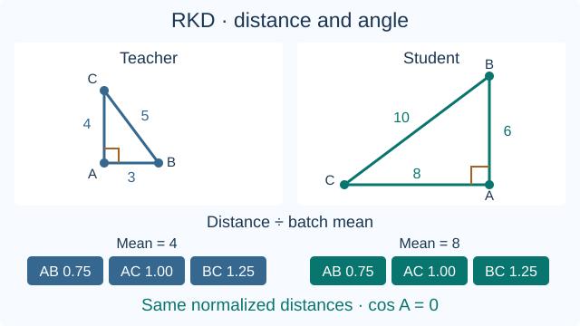

# Relational Knowledge Distillation

Relational knowledge distillation (RKD) trains a student to reproduce the geometry of the teacher's representations over a batch: the distances between pairs of examples and the angles formed by triples. The student does not need to share the teacher's coordinates, only its structure. It is a [relation-based](../index.md) method, and it was shown to improve student models and, in metric learning, to let students outperform their teachers.

## Problem

Matching individual features forces the student's representation to share the teacher's coordinates, which is unnecessary when only the structure matters, for example in retrieval or clustering.

## Core idea

Compare the relations between examples in the teacher and the student, instead of the examples themselves. Pairwise relations use distances, and higher-order relations use angles over triples, so the student reproduces the teacher's geometry.

## Equation or algorithm

A distance loss compares normalised pairwise distances between the examples of a batch in teacher and student spaces. An angle loss compares the angles formed by triples of examples. Both are added to the usual task loss, with the distances normalised by their mean so that the scale of the two spaces does not matter.

### Worked example: matching geometry across coordinate systems

Let $d_{ij}=\|z_i-z_j\|_2$ and let $\mu$ be the mean distance over distinct sample pairs in the batch. RKD-D compares $d_{ij}/\mu$ between teacher and student; RKD-A compares the cosine between the two unit displacement vectors meeting at a triplet's anchor. The original method uses a Huber penalty on the difference of these potentials (Park et al., 2019).

For three teacher points $A=(0,0), B=(3,0), C=(0,4)$ and student points $A'=(10,5), B'=(10,11), C'=(2,5)$, distances in order AB, AC, BC are $(3,4,5)$ and $(6,8,10)$. Their respective means are 4 and 8. Both normalised vectors equal $(0.75,1,1.25)$, and the cosine at A is zero in both. All angles agree because the student is a translated, rotated and uniformly scaled copy. The distance and angle losses are zero in this exact toy example, not necessarily the task loss. Coincident points or an all-zero batch mean require a numerical safeguard; the formula assumes nonzero denominators.

*Original 12-second teaching animation (CC BY-SA 4.0).* Follow the growing edges, then compare the three normalised distances and right-angle markers. The line drawing illustrates measuring relations, not a gradient update. All values are illustrative. MkDocs provides keyboard-accessible Play/Pause; GitHub shows the [static fallback](../../../../../assets/concept-animations/rkd-normalized-geometry-still.svg). [Full SVG animation](../../../../../assets/concept-animations/rkd-normalized-geometry-motion.svg).

### What the invariance does not preserve

For $z_i'=sRz_i+t$, with $s>0$ and $R^\top R=I$, all pair distances and their mean scale by $s$; both the normalised distances and the displacement-vector cosines are unchanged. This does not hold for a general anisotropic transform. For example, keep $A=(0,0)$ and $B=(3,0)$ but change $C$ from $(0,4)$ to $(0,3)$. The right angle at A survives, yet the normalised distances become $(0.878680,0.878680,1.242641)$ instead of $(0.75,1,1.25)$. The cosines at B and C become $1/\sqrt{2}$ rather than $3/5$ and $4/5$. Both RKD penalties are consequently nonzero for this constructed counterexample; checking only the marked right angle is insufficient.

During normalisation in the animation, the amber highlight links each raw edge to its corresponding normalised entry in both spaces, rather than implying that the triangle itself shrinks.

## Results

The abstract says the method improves student models with a significant margin, and that students can outperform their teachers in metric learning. It gives no single headline figure.

## Limitations

The batch-level computation adds cost, and the choice of relation affects the outcome. Results depend on the batch size, because the relations are computed within each batch.

## Open issues and related variants

- **Which relations.** The best set of relations for a given task is not known in advance.
- **Related:** [similarity-preserving distillation](../similarity-preserving/index.md) matches a simpler pairwise similarity matrix.

## Connections

Relations between examples are the central object of metric learning, and of the embedding geometry of [transformers](../../../../../theory/models/transformer/index.md). Similarity structure as a carrier of meaning is also studied in [neuroscience](../../../../../brain-mind/neuroscience/index.md), through population codes.

## References

### Seminal papers

- Park, W., Kim, D., Lu, Y., Cho, M. (2019). *Relational Knowledge Distillation*. arXiv:1904.05068. https://arxiv.org/abs/1904.05068 — Matches distances and angles between examples, improving student models with a significant margin.
- Tung, F., Mori, G. (2019). *Similarity-Preserving Knowledge Distillation*. arXiv:1907.09682. https://arxiv.org/abs/1907.09682 — Matches the pairwise similarities of activations, a simpler relation loss.
- Romero, A., et al. (2014). *FitNets: Hints for Thin Deep Nets*. arXiv:1412.6550. https://arxiv.org/abs/1412.6550 — Feature-level distillation, the contrast to relation matching.

### Surveys and textbooks

- Gou, J., et al. (2021). *Knowledge Distillation: A Survey*. International Journal of Computer Vision. https://doi.org/10.1007/s11263-021-01453-z — Surveys distillation by knowledge type, including relations.

### Lectures and videos

(none checked for this page)

### Articles and documentation

- Hinton, G., Vinyals, O., Dean, J. (2015). *Distilling the Knowledge in a Neural Network*. arXiv:1503.02531. https://arxiv.org/abs/1503.02531 — Output-level distillation, the baseline that relation methods extend.
