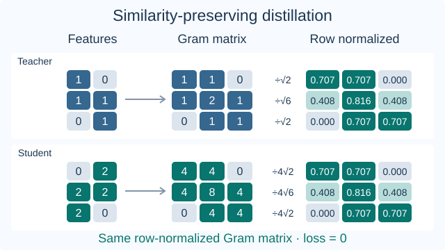

# 相似度保持知識蒸餾

相似度保持蒸餾訓練學生，使教師中產生相似激活值的樣本，在學生中也產生相似的激活值。它匹配的是一個批次上的成對相似度矩陣，而不是特徵本身。學生在自己的表示空間中保留教師的相似度，因此兩個網路不必共用特徵空間。它是比 [RKD](../rkd/index.zh-TW.md) 更簡單的[以關係為基礎](../index.zh-TW.md)方法。

## 問題

整個批次上的關係損失可能很昂貴，而且不清楚哪些關係最能轉移知識。

## 核心想法

語意相近的輸入在訓練好的網路中，傾向於引發相似的激活模式。以此作為目標：計算教師在一個批次上激活值的成對相似度，並訓練學生產生相同的相似度模式。

## 公式或演算法

對一個批次，教師與學生的相似度矩陣都由其激活值計算，先計算批次 Gram 矩陣，再對其各列（row）做 L2 正規化。學生被訓練去匹配兩個矩陣，這項損失再加到一般的任務損失上。

### 算例：逐列 L2 正規化的 Gram 矩陣

將批次中 $b$ 個攤平特徵向量排成矩陣 $Q$ 的各列（row），Tung 與 Mori（2019）定義 $G=QQ^\top$，再逐列正規化：$\widetilde G_{i,:}=G_{i,:}/\|G_{i,:}\|_2$。該層損失為 $\|\widetilde G_T-\widetilde G_S\|_F^2/b^2$。這**不是**成對餘弦相似度：分母是整列 Gram 向量的範數，所得矩陣不一定對稱。

依相同樣本順序，教師特徵列為 $(1,0),(1,1),(0,1)$，學生為 $(0,2),(2,2),(2,0)$。學生 Gram 矩陣是教師的四倍。教師各列範數為 $\sqrt{2},\sqrt{6},\sqrt{2}$，學生為其四倍。兩者正規化後的矩陣各列皆為 $(1,1,0)/\sqrt{2}$、$(1,2,1)/\sqrt{6}$ 與 $(0,1,1)/\sqrt{2}$，捨入前該層損失為零。全零 Gram 列需採用安全的正規化約定。此為人工算例，並非模型實測或訓練軌跡。

*原創 12 秒教學動畫（CC BY-SA 4.0）。* 觀察 Gram 矩陣逐列出現，再呈現各列精確除數與取三位小數的正規化元素。逐列揭露是教學順序，而非矩陣乘法核心的實際排程。 數值均為示意。MkDocs 提供鍵盤可操作的播放／暫停；GitHub 顯示 [靜態回退圖](../../../../../assets/concept-animations/sp-row-gram-normalization-still.svg)。 [完整 SVG 動畫](../../../../../assets/concept-animations/sp-row-gram-normalization-motion.svg).

### 整體縮放與逐樣本縮放的差異

若 $s$ 為共同的正縮放係數、$R$ 為正交特徵變換，將 $Q$ 換成 $sQR$ 會使 $G$ 乘上 $s^2$，此倍率可由逐列正規化消除。若改為對各樣本獨立進行正縮放，則 $G'=DGD$，其中對角矩陣 $D$ 儲存各樣本的倍率；此時欄（column）的縮放通常無法透過逐列正規化消除。

以動畫的教師特徵為例，僅將第一列乘以 2，得到 $(2,0),(1,1),(0,1)$。所有成對餘弦相似度維持不變，但正規化 Gram 矩陣的第一列由 $(1,1,0)/\sqrt{2}$ 變成 $(4,2,0)/\sqrt{20}$，第二列由 $(1,2,1)/\sqrt{6}$ 變成 $(2,2,1)/3$；第三列不變。該層損失由零變為約 $0.021942$。此人工算例用於區分 SP 的逐列正規化與餘弦相似度，而非實測訓練損失。

## 結果

摘要以一個觀察為依據：語意相近的輸入在訓練好的網路中傾向引發相似的激活模式。實驗數字見論文。

## 限制

相似度矩陣的大小隨批次大小的平方增長，而且此方法是在分類任務上評估的。

## 開放問題與相關變體

- **批次大小。** 如何在大批次下維持相似度矩陣的成本低，是實務上的問題。
- **相關：** [RKD](../rkd/index.zh-TW.md)加入三元組的角度關係，承載的結構更多。

## 相關連結

成對相似度是度量學習的基礎，而「相似的輸入共用一種編碼」的想法，與[神經科學](../../../../../brain-mind/neuroscience/index.zh-TW.md)中的群體編碼相關。

## 參考文獻

### 開創性論文

- Tung, F., Mori, G. (2019). *Similarity-Preserving Knowledge Distillation*. arXiv:1907.09682. https://arxiv.org/abs/1907.09682 — 訓練學生在自己的激活值中保留教師的成對相似度。
- Park, W., Kim, D., Lu, Y., Cho, M. (2019). *Relational Knowledge Distillation*. arXiv:1904.05068. https://arxiv.org/abs/1904.05068 — 匹配距離與角度，是較豐富的關係集合。
- Romero, A., et al. (2014). *FitNets: Hints for Thin Deep Nets*. arXiv:1412.6550. https://arxiv.org/abs/1412.6550 — 特徵層級的蒸餾，需要共用的特徵空間，是此方法的替代方案。

### 綜述與教科書

- Gou, J., et al. (2021). *Knowledge Distillation: A Survey*. International Journal of Computer Vision. https://doi.org/10.1007/s11263-021-01453-z — 依知識類型綜述蒸餾，包括關係知識。

### 講座與影片

（本頁尚未查核任何項目）

### 文章與文件

- Hinton, G., Vinyals, O., Dean, J. (2015). *Distilling the Knowledge in a Neural Network*. arXiv:1503.02531. https://arxiv.org/abs/1503.02531 — 輸出層級的基準，相似度匹配是對它的補充。
