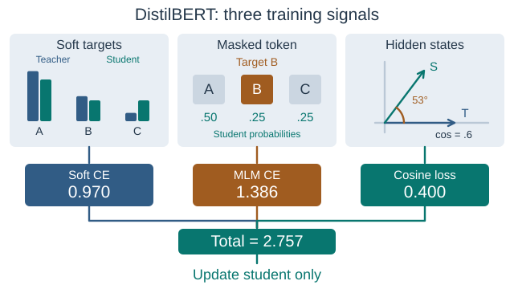

# DistilBERT

DistilBERT is a distilled version of BERT with half the layers. It is trained during pretraining with three losses: the soft-target distillation loss from the teacher, the masked language modelling loss, and a cosine loss that aligns the student's hidden states with the teacher's. It is the standard reference for distilling a language model at pretraining time, and a [response-based](../index.md) method that adds hidden-state alignment.

## Problem

BERT is accurate but large and slow for many production uses, and fine-tuning a smaller model from scratch loses much of the accuracy that pretraining gives.

## Core idea

Initialise the student from the teacher's weights, with half of the layers removed, and train it during pretraining with the teacher's soft predictions as one target. The student is also aligned with the teacher's hidden states, so it keeps the teacher's internal structure.

### Visual walkthrough: three simultaneous objectives

[GitHub-readable fallback](../../../../../assets/concept-animations/distilbert-triple-loss-still.svg) · [Full 12-second animation](../../../../../assets/concept-animations/distilbert-triple-loss-motion.svg)

DistilBERT combines the three pretraining losses rather than using them in separate training phases (Sanh et al., 2019). For a **single illustrative masked token**, set the temperature to 1 and use teacher probabilities $p=(0.6,0.3,0.1)$ and student probabilities $q=(0.5,0.25,0.25)$ over a toy vocabulary A/B/C, with B as the true masked token. Let the aligned nonzero hidden states be $h_T=(1,0)$ and $h_S=(3,4)$. Then

$
L_{\rm KD}=-\sum_i p_i\log q_i\approx0.970406,\quad
L_{\rm MLM}=-\log q_B\approx1.386294,
$

$
L_{\rm cos}=1-\frac{h_T^\top h_S}{\|h_T\|\|h_S\|}=0.4.
$

With illustrative unit coefficients, the sum is approximately 2.757 (rounded after adding unrounded losses). In general the three terms have separate coefficients. Soft-target cross-entropy differs from KL divergence by the fixed teacher entropy; the MLM target is the actual token, not the teacher's most probable token. Cosine loss matches direction, not vector magnitude. The three signals contribute to the same student update; the teacher is fixed. The order of animation is explanatory, not a sequential training schedule. These are constructed numbers, not model measurements or the paper's hyperparameters.

**Why the objectives can disagree.** The bars show the full soft distributions; the orange token is the hard target, and the hidden-state arrows depict direction only (the angle is about 53 degrees). At temperature 1, write $q=\operatorname{softmax}(z)$ and $e_B=(0,1,0)$. The gradients with respect to student logits are $\nabla_z L_{\rm KD}=q-p=(-0.10,-0.05,0.15)$ and $\nabla_z L_{\rm MLM}=q-e_B=(0.50,-0.75,0.25)$. They disagree on logit A: gradient descent on KD alone would increase it, whereas MLM alone would decrease it. With unit coefficients their sum is $(0.40,-0.80,0.40)$. This is only the output-loss contribution; cosine loss backpropagates through the hidden representation, and the full parameter update uses the chain rule. The example does not simulate an optimizer step or a trained model.

On MkDocs use Play/Pause (Enter or Space); GitHub and reduced-motion readers can inspect the complete static result. Original diagram, **CC BY-SA 4.0**.

## Equation or algorithm

The student is trained on three objectives together. A temperature-scaled distillation loss matches the teacher's soft predictions over the vocabulary. The masked language modelling loss is the usual pretraining objective. A cosine embedding loss aligns the student's hidden-state vectors with the teacher's at each token.

## Results

The abstract reports that DistilBERT reduces the size of a BERT model by 40% while retaining 97% of its language understanding capabilities, and that it is 60% faster.

## Limitations

The student is still bounded by the teacher's knowledge, and the reported results are on language understanding benchmarks, which do not cover every use. The pretraining distillation needs a large corpus and substantial compute.

## Open issues and related variants

- **Alignment choice.** Which hidden states to align, and how, is a design choice that the paper makes but does not fully explore.
- **Related:** [Hinton distillation](../hinton-distillation/index.md) is the output-only objective that DistilBERT extends.

## Connections

DistilBERT is the language-model form of the distillation that [LLM methods](../../llm-distillation/index.md) use today. The pretraining cost it saves matters most for [training](../../../../../engineering/training/index.md) at scale.

## References

### Seminal papers

- Sanh, V., et al. (2019). *DistilBERT, a Distilled Version of BERT: Smaller, Faster, Cheaper and Lighter*. arXiv:1910.01108. https://arxiv.org/abs/1910.01108 — Halves BERT's layers with output distillation and hidden-state alignment, keeping 97% of its language understanding.
- Hinton, G., Vinyals, O., Dean, J. (2015). *Distilling the Knowledge in a Neural Network*. arXiv:1503.02531. https://arxiv.org/abs/1503.02531 — The soft-target objective that DistilBERT uses.
- Romero, A., et al. (2014). *FitNets: Hints for Thin Deep Nets*. arXiv:1412.6550. https://arxiv.org/abs/1412.6550 — Intermediate-layer hints, the same idea behind the hidden-state alignment.

### Surveys and textbooks

- Gou, J., et al. (2021). *Knowledge Distillation: A Survey*. International Journal of Computer Vision. https://doi.org/10.1007/s11263-021-01453-z — Surveys distillation methods across knowledge types and training schemes.

### Lectures and videos

(none checked for this page)

### Articles and documentation

- Kim, Y., Rush, A. M. (2016). *Sequence-Level Knowledge Distillation*. arXiv:1606.07947. https://arxiv.org/abs/1606.07947 — Distils sequence models by training on the teacher's outputs, the earlier language-model setting.
