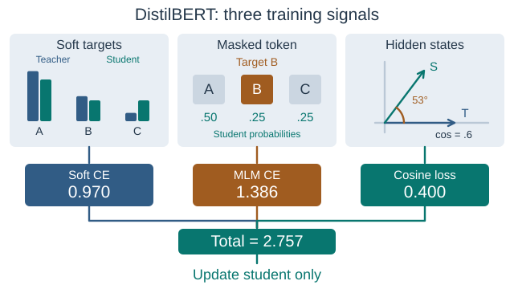

# DistilBERT

DistilBERT 是層數減半的 BERT 蒸餾版本。它在預訓練期間以三個損失一起訓練：來自教師的軟目標蒸餾損失、遮罩語言建模損失，以及把學生隱藏狀態與教師對齊的餘弦損失。它是在預訓練時蒸餾語言模型的標準參考，也是加入隱藏狀態對齊的[以回應為基礎](../index.zh-TW.md)方法。

## 問題

BERT 準確，但對許多生產用途而言體積大、速度慢。而從頭微調一個較小的模型，會失去預訓練所帶來的大部分準確度。

## 核心想法

以教師的權重初始化學生，並移除一半的層，然後在預訓練期間把教師的軟預測當作其中一個目標。學生同時與教師的隱藏狀態對齊，因此保留了教師的內部結構。

### 動畫解讀：三項同時最佳化的目標

[GitHub 靜態預覽](../../../../../assets/concept-animations/distilbert-triple-loss-still.svg) · [完整 12 秒動畫](../../../../../assets/concept-animations/distilbert-triple-loss-motion.svg)

DistilBERT 將三項預訓練損失共同最佳化，而不是分成三個訓練階段（Sanh 等人，2019）。考慮**單一示意遮罩 token**，設定溫度為 1，在 A/B/C 的簡化詞彙表中使用教師機率 $p=(0.6,0.3,0.1)$、學生機率 $q=(0.5,0.25,0.25)$，真實遮罩 token 為 B。令對齊的非零隱藏狀態為 $h_T=(1,0)$ 與 $h_S=(3,4)$，則

$
L_{\rm KD}=-\sum_i p_i\log q_i\approx0.970406,\quad
L_{\rm MLM}=-\log q_B\approx1.386294,
$

$
L_{\rm cos}=1-\frac{h_T^\top h_S}{\|h_T\|\|h_S\|}=0.4.
$

示意權重係數皆為 1 時，總和約為 2.757（先加總未捨入的損失，再捨入）。一般情況三項損失各有權重係數。軟目標交叉熵與 KL 散度相差固定的教師熵；MLM 目標是真實 token，不是教師機率最大的 token。餘弦損失對齊方向而非向量長度。三項訊號共同貢獻至學生的一次更新，教師維持固定。動畫的揭露順序是為了教學，並非依序訓練三個階段。以上為人工示意數值，並非模型實測或論文超參數。

**為何訓練目標可能不一致。** 長條呈現完整的軟機率分布，橘色 token 為硬目標，隱藏狀態箭頭僅示意方向（夾角約 53 度）。溫度為 1 時，令 $q=\operatorname{softmax}(z)$、$e_B=(0,1,0)$。對學生 logits 的梯度為 $\nabla_z L_{\rm KD}=q-p=(-0.10,-0.05,0.15)$ 與 $\nabla_z L_{\rm MLM}=q-e_B=(0.50,-0.75,0.25)$。兩者對 logit A 的更新方向不同：單獨執行蒸餾的梯度下降會提高 A，單獨執行 MLM 則會降低 A。係數皆為 1 時，兩項梯度相加為 $(0.40,-0.80,0.40)$。這只是輸出損失的貢獻；餘弦損失透過隱藏表示反向傳播，完整參數更新須使用鏈式法則。此算例未模擬最佳化器更新或模型實際訓練。

MkDocs 網站使用播放／暫停（Enter 或 Space）；GitHub 與減少動態效果偏好的讀者可檢視完整靜態結果。原創圖示，**CC BY-SA 4.0**。

## 公式或演算法

學生同時以三個目標訓練。溫度縮放的蒸餾損失匹配教師在整個詞彙表上的軟預測。遮罩語言建模損失是常見的預訓練目標。餘弦嵌入損失則使學生在每個 token 上的隱藏狀態向量與教師對齊。

## 結果

摘要報告，DistilBERT 使 BERT 模型的大小減少 40%，同時保留 97% 的語言理解能力，且速度快 60%。

## 限制

學生仍受限於教師的知識，而報告的結果是在語言理解基準上取得的，未涵蓋所有用途。預訓練蒸餾需要大型語料與可觀的運算資源。

## 開放問題與相關變體

- **對齊的選擇。** 要對齊哪些隱藏狀態，以及如何對齊，是論文做出的設計選擇，但未充分探討。
- **相關：** [Hinton 蒸餾](../hinton-distillation/index.zh-TW.md)是 DistilBERT 所擴展的純輸出目標。

## 相關連結

DistilBERT 是語言模型形式的蒸餾，也是今日[大型語言模型方法](../../llm-distillation/index.zh-TW.md)所使用的基礎。它節省的預訓練成本在大規模[訓練](../../../../../engineering/training/index.zh-TW.md)中最為重要。

## 參考文獻

### 開創性論文

- Sanh, V., et al. (2019). *DistilBERT, a Distilled Version of BERT: Smaller, Faster, Cheaper and Lighter*. arXiv:1910.01108. https://arxiv.org/abs/1910.01108 — 以輸出蒸餾與隱藏狀態對齊將 BERT 層數減半，並保留 97% 的語言理解能力。
- Hinton, G., Vinyals, O., Dean, J. (2015). *Distilling the Knowledge in a Neural Network*. arXiv:1503.02531. https://arxiv.org/abs/1503.02531 — DistilBERT 所使用的軟目標。
- Romero, A., et al. (2014). *FitNets: Hints for Thin Deep Nets*. arXiv:1412.6550. https://arxiv.org/abs/1412.6550 — 中間層提示，是隱藏狀態對齊背後的相同想法。

### 綜述與教科書

- Gou, J., et al. (2021). *Knowledge Distillation: A Survey*. International Journal of Computer Vision. https://doi.org/10.1007/s11263-021-01453-z — 依知識類型與訓練方式綜述蒸餾方法。

### 講座與影片

（本頁尚未查核任何項目）

### 文章與文件

- Kim, Y., Rush, A. M. (2016). *Sequence-Level Knowledge Distillation*. arXiv:1606.07947. https://arxiv.org/abs/1606.07947 — 以教師的輸出蒸餾序列模型，是較早的語言模型設定。
