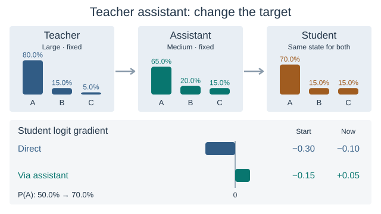

# Teacher Assistant Knowledge Distillation

Teacher assistant knowledge distillation (TAKD) addresses the case where the teacher is much larger than the student. Mirzadeh et al. showed that the student's accuracy drops when the gap is large, and that inserting an intermediate-size model, the teacher assistant, between teacher and student recovers much of the loss. It is a [response-based](../index.md) method that changes the teacher, not the objective.

## Problem

A very large teacher gives a student a weaker signal than a medium-size teacher would. The student cannot match outputs that are too far beyond its capacity, so the benefit of the teacher is lost as the gap grows.

## Core idea

Train an intermediate model, the teacher assistant, from the large teacher. Then distil the student from the assistant rather than from the large teacher. The assistant is closer in capacity to the student and gives a learnable target.

### Visual walkthrough: direct versus assistant targets

[GitHub-readable fallback](../../../../../assets/concept-animations/teacher-assistant-target-gradient-still.svg) · [Full 12-second animation](../../../../../assets/concept-animations/teacher-assistant-target-gradient-motion.svg)

Mirzadeh et al. (2019) introduce intermediate-capacity teachers to bridge the student–teacher gap. In this **constructed example**, let the large teacher's distribution be $p_T=(0.80,0.15,0.05)$ and the trained assistant's distribution be $p_A=(0.65,0.20,0.15)$ over classes A/B/C. The animation interpolates to the assistant's prescribed output; it is not a simulated training trajectory.

To isolate the effect of the target, constrain a toy student to $q=(a,(1-a)/2,(1-a)/2)$ with $a=\sigma(z)$. With temperature 1, the soft-target cross-entropy for any fixed distribution $p$ reduces to

$
L(z)=-p(A)\log a-(1-p(A))\log((1-a)/2),\quad
\frac{\partial L}{\partial z}=a-p(A).
$

At the same starting point $z=0$ ($a=0.5$), direct distillation gives $-0.30$ and assistant-mediated distillation gives $-0.15$. The teacher-to-assistant signal precedes the assistant-to-student signal; the assistant is fixed when used as the student's teacher. The two gradients are evaluated independently at the same student state, not summed. Smaller gradient magnitude is not a guarantee of better accuracy, nor does the example claim that the assistant's distribution is an optimal fit. Real TAKD runs train models on datasets and may also use hard-label losses. All probabilities and gradients are schematic, not model measurements.

On MkDocs use Play/Pause (Enter or Space); GitHub and reduced-motion readers can inspect the complete static result. Original diagram, **CC BY-SA 4.0**.

## Equation or algorithm

The procedure is a chain. The large teacher distils a teacher assistant of intermediate size. The assistant, using the same soft-target objective as [Hinton distillation](../hinton-distillation/index.md), then distils the student. Several assistants can be chained when the gap is very large.

## Results

The paper reports that the student's performance degrades as the teacher-student gap grows, and that a teacher assistant improves the student's accuracy. The figures are in the paper's tables.

## Limitations

Each assistant is an extra training run, which adds cost. The choice of assistant size, and how many to use, is made by experiment.

## Open issues and related variants

- **Assistant size.** A rule that predicts the best size of the assistant from the teacher and student is not known.
- **Related:** [self-distillation](../../self-distillation/index.md) shows that a student can match a teacher of its own size, which removes the gap altogether.

## Connections

The gap problem is a capacity problem, which connects to how models are chosen for [deployment hardware](../../../../../engineering/hardware/index.md). The chain of intermediate models is a common pattern in curriculum-style training; see [training](../../../../../engineering/training/index.md).

## References

### Seminal papers

- Mirzadeh, S.-I., et al. (2019). *Improved Knowledge Distillation via Teacher Assistant*. arXiv:1902.03393. https://arxiv.org/abs/1902.03393 — Introduces an intermediate teacher assistant to reduce the gap between a large teacher and a small student.
- Hinton, G., Vinyals, O., Dean, J. (2015). *Distilling the Knowledge in a Neural Network*. arXiv:1503.02531. https://arxiv.org/abs/1503.02531 — The soft-target objective used at each step of the chain.
- Furlanello, T., et al. (2018). *Born Again Neural Networks*. arXiv:1805.04770. https://arxiv.org/abs/1805.04770 — Shows that a student of the teacher's own size can match or exceed it, which removes the gap.

### Surveys and textbooks

- Gou, J., et al. (2021). *Knowledge Distillation: A Survey*. International Journal of Computer Vision. https://doi.org/10.1007/s11263-021-01453-z — Surveys distillation methods across knowledge types and training schemes.

### Lectures and videos

(none checked for this page)

### Articles and documentation

- Sanh, V., et al. (2019). *DistilBERT, a Distilled Version of BERT: Smaller, Faster, Cheaper and Lighter*. arXiv:1910.01108. https://arxiv.org/abs/1910.01108 — A fixed-size student distilled from a larger teacher, where the gap question also applies.
