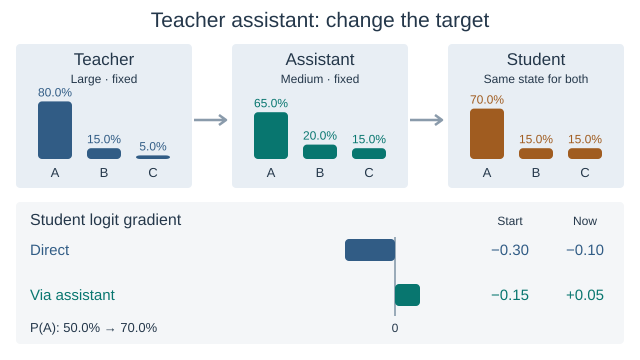

# 助教知識蒸餾

助教知識蒸餾（TAKD）處理教師遠大於學生的情況。Mirzadeh 等人指出，當差距很大時學生的準確度會下降；在教師與學生之間插入一個大小居中的模型，也就是助教，可以挽回大部分的損失。它是一種[以回應為基礎](../index.zh-TW.md)的方法，改變的是教師，而不是目標。

## 問題

非常大的教師給學生的訊號，比中等大小的教師弱。學生無法匹配超出其容量太多的輸出，因此隨著差距擴大，教師的好處就流失了。

## 核心想法

從大型教師訓練一個中間模型，也就是助教。然後從助教而不是大型教師蒸餾學生。助教在容量上較接近學生，並提供可以學習的目標。

### 動畫解讀：直接蒸餾與助教目標

[GitHub 靜態回退圖](../../../../../assets/concept-animations/teacher-assistant-target-gradient-still.svg) · [完整 12 秒動畫](../../../../../assets/concept-animations/teacher-assistant-target-gradient-motion.svg)

Mirzadeh 等人（2019）提出以中間容量的教師縮小師生差距。在此**人工建構的算例**中，大型教師的機率分布為 $p_T=(0.80,0.15,0.05)$，訓練後的助教分布為 $p_A=(0.65,0.20,0.15)$，類別為 A/B/C。動畫以插值呈現助教預先指定的輸出，而非模擬實際訓練軌跡。

為了獨立觀察目標分布的影響，限制示意學生為 $q=(a,(1-a)/2,(1-a)/2)$，其中 $a=\sigma(z)$。溫度為 1 時，任意固定分布 $p$ 的軟目標交叉熵可寫成

$
L(z)=-p(A)\log a-(1-p(A))\log((1-a)/2),\quad
\frac{\partial L}{\partial z}=a-p(A).
$

在相同起點 $z=0$（$a=0.5$），直接蒸餾的梯度為 $-0.30$，經助教蒸餾則為 $-0.15$。教師至助教的訊號先於助教至學生的訊號；助教成為學生的教師時保持固定。兩個梯度分別在相同學生狀態下計算，不會相加。較小的梯度幅度不保證較高的準確度，算例也未宣稱助教分布為最佳擬合。實際 TAKD 需在資料集上訓練模型，也可能納入硬標籤損失。所有機率與梯度皆為示意，並非模型實測值。

在 MkDocs 使用播放／暫停（Enter 或空白鍵）；GitHub 與減少動態效果的讀者可查看完整靜態結果。原創圖示，**CC BY-SA 4.0**。

## 公式或演算法

此程序是一條鏈。大型教師蒸餾出大小居中的助教。助教再以與 [Hinton 蒸餾](../hinton-distillation/index.zh-TW.md)相同的軟目標蒸餾學生。當差距非常大時，可以串接多個助教。

## 結果

論文報告，隨著教師與學生的差距增大，學生的表現會下降，而助教能提高學生的準確度。數字見論文的表格。

## 限制

每個助教都是額外的訓練，增加成本。助教的大小與數量，需要靠實驗來決定。

## 開放問題與相關變體

- **助教的大小。** 目前還沒有能從教師與學生預測最佳助教大小的規則。
- **相關：** [自我蒸餾](../../self-distillation/index.zh-TW.md)顯示學生可以匹配與自己同大小的教師，因此能完全消除差距。

## 相關連結

差距問題是容量問題，與如何為[部署硬體](../../../../../engineering/hardware/index.zh-TW.md)選擇模型有關。中間模型的串接，是課程式訓練中常見的模式，見[訓練](../../../../../engineering/training/index.zh-TW.md)。

## 參考文獻

### 開創性論文

- Mirzadeh, S.-I., et al. (2019). *Improved Knowledge Distillation via Teacher Assistant*. arXiv:1902.03393. https://arxiv.org/abs/1902.03393 — 引入中間的教師助教，以縮小大型教師與小型學生之間的差距。
- Hinton, G., Vinyals, O., Dean, J. (2015). *Distilling the Knowledge in a Neural Network*. arXiv:1503.02531. https://arxiv.org/abs/1503.02531 — 鏈中每一步所使用的軟目標。
- Furlanello, T., et al. (2018). *Born Again Neural Networks*. arXiv:1805.04770. https://arxiv.org/abs/1805.04770 — 顯示與教師同大小的學生可以匹配甚至超越教師，因此消除了差距。

### 綜述與教科書

- Gou, J., et al. (2021). *Knowledge Distillation: A Survey*. International Journal of Computer Vision. https://doi.org/10.1007/s11263-021-01453-z — 依知識類型與訓練方式綜述蒸餾方法。

### 講座與影片

（本頁尚未查核任何項目）

### 文章與文件

- Sanh, V., et al. (2019). *DistilBERT, a Distilled Version of BERT: Smaller, Faster, Cheaper and Lighter*. arXiv:1910.01108. https://arxiv.org/abs/1910.01108 — 從較大的教師蒸餾出固定大小的學生，差距的問題同樣適用。
