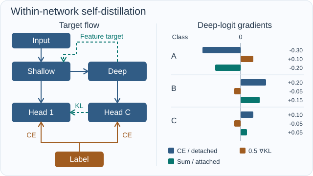

# 自己當老師

Be Your Own Teacher 是一種自我蒸餾方法，在單次訓練中改善同一個網路。網路被切分成若干區段，每段接一個分類器，最深分類器的知識再向較淺的分類器傳遞。Zhang 等人報告平均準確率比基線高 2.65%。它是一種[自我蒸餾](../index.zh-TW.md)方法，不需要另外訓練教師。

## 問題

以獨立的教師與學生網路進行知識蒸餾成本很高，因為必須先訓練大型教師。單一網路應該能在一次訓練中自我改善，同時維持相同的推論成本。

## 核心想法

把卷積網路切成數段，每段都有一個瓶頸層與一個分類器。每個淺層分類器同時以真實標籤、最深分類器的輸出，以及最深區段的特徵圖訓練。最深分類器充當其下所有層的教師，它本身只以標籤訓練。因此訓練時，知識會在網路內向下流動。

## 公式或演算法

總損失是所有 \(C\) 個分類器的損失總和：

\[
\mathcal{L} = \sum_{i=1}^{C} \Big( (1-\alpha)\,\mathrm{CE}(q^i, y) + \alpha\,\mathrm{KL}(q^i \,\Vert\, q^C) + \lambda\,\Vert F_i - F_C \Vert_2^2 \Big)
\]

其中 \(q^i\) 是第 \(i\) 個分類器的 softmax 輸出，\(q^C\) 是最深分類器的輸出，\(y\) 是標籤，\(F_i\) 與 \(F_C\) 分別是第 \(i\) 段與最深段的特徵圖。第一項是標籤損失，第二項是蒸餾項，第三項是特徵提示項，使淺層特徵圖與最深層對齊。論文將最深分類器的 \(\alpha\) 與 \(\lambda\) 設為零。softmax 溫度通常設為 1。淺層分類器可用於深度可調的推論，作者提議用於資源受限的裝置。

*原創 12 秒教學動畫（CC BY-SA 4.0）。* 以兩個分類器簡化原論文的多區段與瓶頸層架構。藍色移動訊號代表前向激活值，青綠色虛線由最深區段傳遞特徵與輸出目標，橘色路徑將相同真實標籤提供給兩個分類器。最深分類器自身的損失項只有標籤交叉熵；共享的上游層仍可能收到其他損失的梯度貢獻。目標箭頭並非微分方向，也不表示深層網路是另外預訓練且凍結的教師。移動訊號呈現監督目標的傳遞；接著帶符號長條顯示深層標籤梯度（藍色）、假設保留目標梯度時的 0.5 倍 KL 梯度（橘色）及兩者總和（青綠色）。僅有藍色長條代表目標執行 detach 的情況。青綠色長條從標籤梯度長度變化至總和；此為固定 logits 下的比較，並非最佳化步驟。[原始論文](https://arxiv.org/abs/1905.08094)。

以溫度 1 的人工算例比較目標：淺層與深層類別分布分別為 $q^1=(0.5,0.3,0.2)$ 與 $q^C=(0.7,0.2,0.1)$，真實標籤為 A。兩者的標籤交叉熵分別為 $-\log 0.5\approx0.6931$ 與 $-\log 0.7\approx0.3567$。依上方公式的 KL 方向，$D_{\mathrm{KL}}(q^1\Vert q^C)\approx0.0920$ nats。假設已對齊的特徵向量為 $(0.2,0.6)$ 與 $(0.5,0.4)$，平方距離為 $0.13$。這些是人工示意值，不是模型實測；特徵項需使用相容形狀。訓練時共同最佳化三項損失，部署時若只使用最深分類器，便不必執行輔助分類器。

MkDocs 可使用鍵盤操作播放／暫停；GitHub 提供 [靜態回退圖](../../../../../assets/concept-animations/byot-deep-head-targets-still.svg)，亦可開啟 [完整 SVG 動畫](../../../../../assets/concept-animations/byot-deep-head-targets-motion.svg)。

### 目標傳遞方向與梯度方向

上述 KL 項的梯度也取決於計算圖的設定。令 $q$ 與 $p$ 分別為淺層與深層 softmax 分布，深層 logits 為 $z_C$。固定淺層 logits，依上方公式的 KL 方向可得

$
\nabla_{z_C}D_{\mathrm{KL}}(q\Vert p)=p-q.
$

若允許梯度穿過深層目標，本算例的 KL 梯度為 $(0.2,-0.1,-0.1)$。當淺層蒸餾權重 $\alpha=0.5$ 時，其對深層 logits 的直接貢獻為 $(0.1,-0.05,-0.05)$。加上深層分類器自身的標籤梯度 $p-e_A=(-0.3,0.2,0.1)$，得到 $(-0.2,0.15,0.05)$。若對深層目標執行 detach，KL 的直接貢獻則消失，只剩 $p-e_A$。此比較假設各分類器 logits 獨立，且省略特徵損失；目的是隔離自動微分的設定差異，而非宣稱原作者採用特定實作。不論何者，共享網路參數仍可能收到淺層分類器的梯度。

## 結果

論文的主要表格在 CIFAR-100 上比較基線與自我蒸餾，數字為最深分類器的準確率：

| 網路 | 基線 (%) | 自我蒸餾 (%) |
|---|---|---|
| VGG19 (BN) | 64.47 | 67.73 |
| ResNet18 | 77.09 | 78.64 |
| ResNet50 | 77.68 | 80.56 |
| ResNet101 | 77.98 | 81.23 |
| ResNet152 | 79.21 | 81.61 |
| ResNeXt29-8 | 81.29 | 81.51 |

摘要報告平均準確率提升 2.65%，從 ResNeXt 的 0.61% 到 VGG19 的 4.07%。表格也列出較淺分類器與分類器集成的結果，本頁不重複。

## 限制

此方法增加了分類器與訓練項，因此訓練成本高於基線，雖然推論成本不變。論文評估的是卷積網路的影像分類。同樣的向下流動是否對層間功能差異較大的 transformer 有效，論文未測試。損失權重 \(\alpha\) 與 \(\lambda\) 論文未固定，必須自行調校。

## 未解問題與相關變體

- **架構。** 同樣的向下流動是否對 transformer 有效，仍是未解問題。
- **完整重訓的替代方案。** [Born-again networks](../born-again-networks/index.zh-TW.md) 透過訓練同架構的完整新一代網路達到類似效果，但訓練成本高得多。
- **特徵目標。** 特徵提示項沿用 [FitNets](../../feature-based/fitnets/index.zh-TW.md) 的想法。

## 與其他主題的連結

此方法是一種深度監督，中間層會接收自己的訓練訊號。從深層分類器向淺層的向下流動，也是[深度學習理論](../../../../../theory/deep-learning/index.zh-TW.md)的問題。

## 參考文獻

### 奠基性論文

- Zhang, L., Song, J., Gao, A., Chen, J., Bao, C., Ma, K. (2019). *Be Your Own Teacher: Improve the Performance of Convolutional Neural Networks via Self Distillation*. arXiv:1905.08094. https://arxiv.org/abs/1905.08094 — 以輔助分類器進行深層自我蒸餾；平均準確率提升 2.65%，從 0.61%（ResNeXt）到 4.07%（VGG19）。
- Furlanello, T., Lipton, Z. C., Tschannen, M., Itti, L., Anandkumar, A. (2018). *Born Again Neural Networks*. arXiv:1805.04770. https://arxiv.org/abs/1805.04770 — 與教師架構相同、經蒸餾訓練的學生，可以超越那些教師。
- Hinton, G., Vinyals, O., Dean, J. (2015). *Distilling the Knowledge in a Neural Network*. arXiv:1503.02531. https://arxiv.org/abs/1503.02531 — 淺層分類器所用的蒸餾目標。

### 綜述與教科書

- Gou, J., Yu, B., Maybank, S. J., Tao, D. (2021). *Knowledge Distillation: A Survey*. arXiv:2006.05525. https://arxiv.org/abs/2006.05525 — 蒸餾方法綜述，包括自我蒸餾；arXiv 頁面列出已發表版本為 https://doi.org/10.1007/s11263-021-01453-z。

### 講座與影片

（本頁未檢核任何項目）

### 文章與文件

- Romero, A., et al. (2014). *FitNets: Hints for Thin Deep Nets*. arXiv:1412.6550. https://arxiv.org/abs/1412.6550 — 中間層提示，是深層自我教學在特徵層級的對應方法。
