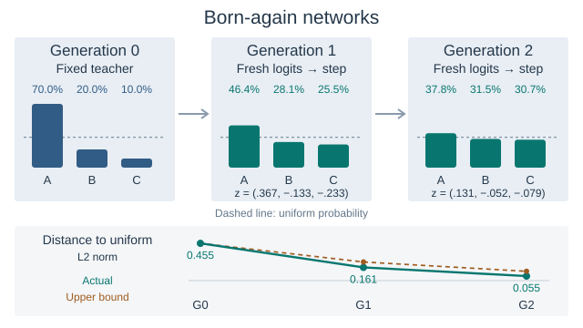

# Born-Again Neural Networks

Born-again networks are students with the same architecture as their teachers, trained on the teacher's predictions. Furlanello et al. showed that these students can outperform their teachers, which contradicted the assumption that distillation needs a larger teacher. The approach is a [self-distillation](../index.md) method, repeated over several generations if needed.

## Problem

Distillation was assumed to work only when the student is smaller than the teacher, so a larger teacher was thought necessary.

## Core idea

Train a student with the same architecture as its teacher, using the teacher's softened predictions as the target. The authors found that the resulting born-again networks outperform their teachers, and that the gain can be repeated over generations.

### Visual walkthrough: fresh students and changing targets

[GitHub-readable fallback](../../../../../assets/concept-animations/born-again-generation-step-still.svg) · [Full 12-second animation](../../../../../assets/concept-animations/born-again-generation-step-motion.svg)

Furlanello et al. (2018) study distillation between identically parameterized architectures. Each new student is trained separately; the preceding trained student becomes the fixed teacher for the next generation. This differs from continuing to update one network.

For a **constructed one-example, one-step demonstration**, start with $p_0=(0.7,0.2,0.1)$, let each new student's logits start at $z=0$, use temperature 1, and optimize only soft-target cross-entropy with learning rate 1. For a fixed teacher $p_k$, the gradient is $\operatorname{softmax}(z)-p_k$. Thus

$
z_{k+1}=p_k-\tfrac13(1,1,1),\qquad
p_{k+1}=\operatorname{softmax}(z_{k+1}).
$

The first step produces logits approximately $(0.367,-0.133,-0.233)$ and probabilities $(0.464,0.281,0.255)$. The next generation starts from zero logits again, uses the unrounded preceding probabilities as its target, and produces logits approximately $(0.131,-0.052,-0.079)$ and probabilities $(0.378,0.315,0.307)$. The animated bars interpolate between the initial and computed final probabilities; they do not depict extra SGD steps.

This example only demonstrates the transfer and fresh initialization. If each student could exactly match the teacher distribution everywhere, pure soft-target cross-entropy alone would reproduce that distribution. The example does not explain or guarantee the paper's empirical accuracy gains, and the increased entropy here is not a general property of born-again training. Actual training uses many examples and optimization steps, and may include hard labels. The numbers are not measurements.

### Why the one-step example approaches uniformity

For this toy protocol only, allow a positive learning rate $\eta$ while still starting each generation at zero logits and taking exactly one step. Shift invariance of softmax gives $F_\eta(p)=\operatorname{softmax}(\eta p)$, with uniform fixed point $u=(1/3,1/3,1/3)$. The softmax Jacobian at output $q$ is $J=\operatorname{diag}(q)-qq^\top$. It is symmetric, and each row's absolute sum is $2q_i(1-q_i)\leq 1/2$, so its spectral norm is at most $1/2$. Integrating the Jacobian along the line segment between two inputs gives

$
\|F_\eta(p)-F_\eta(u)\|_2\leq \frac{\eta}{2}\|p-u\|_2.
$

Thus for $0<\eta<2$ the repeated fresh one-step protocol contracts toward uniformity (at most a factor of $1/2$ per generation when $\eta=1$). This result is about the constructed probability update, not the convergence, entropy, or accuracy of general born-again networks. Multiple optimization steps, hard labels, and model parameterization change the map.

The lower plot makes the bound explicit: for $\eta=1$, define $d_k=\|p_k-u\|_2$. The computed distances are $0.455$, $0.161$, and $0.055$ (rounded); the dashed amber curve is the cumulative bound $d_0/2^k$, not a measured trajectory. The dashed horizontal reference in each probability panel represents $1/3$. The graph records only completed generations; it does not measure an intermediate interpolated bar.

On MkDocs use Play/Pause (Enter or Space); GitHub and reduced-motion readers can inspect the complete static result. Original diagram, **CC BY-SA 4.0**.

## Equation or algorithm

Each generation minimises the distillation loss against the previous generation's softened predictions, with the same architecture and no larger model. The first generation is trained on the labels. Each later generation uses the one before it as its teacher.

## Results

The abstract states that the born-again networks outperform their teachers significantly, in computer vision and in language modelling.

## Limitations

Each generation costs a full training run. The reported gains depend on the setting and on the number of generations.

## Open issues and related variants

- **Saturation.** Whether repeated generations keep improving, or saturate for large models, is open.
- **Related:** [Be Your Own Teacher](../be-your-own-teacher/index.md) achieves a similar effect inside a single training run.

## Connections

The method shows that a network can improve by relearning its own predictions. The same idea appears in [continual learning](../../../../../theory/paradigms/continual/index.md), where an earlier state of a model guides later training.

## References

### Seminal papers

- Furlanello, T., et al. (2018). *Born Again Neural Networks*. arXiv:1805.04770. https://arxiv.org/abs/1805.04770 — Students with the same architecture as their teachers outperform the teachers in vision and language.
- Zhang, L., et al. (2019). *Be Your Own Teacher: Improve the Performance of Convolutional Neural Networks via Self Distillation*. arXiv:1905.08094. https://arxiv.org/abs/1905.08094 — Deep-layer self-distillation within one network, a related self-teaching method.
- Hinton, G., Vinyals, O., Dean, J. (2015). *Distilling the Knowledge in a Neural Network*. arXiv:1503.02531. https://arxiv.org/abs/1503.02531 — The distillation loss that each generation reuses.

### Surveys and textbooks

- Gou, J., et al. (2021). *Knowledge Distillation: A Survey*. International Journal of Computer Vision. https://doi.org/10.1007/s11263-021-01453-z — Surveys distillation methods across knowledge types and training schemes.

### Lectures and videos

(none checked for this page)

### Articles and documentation

- Mirzadeh, S.-I., et al. (2019). *Improved Knowledge Distillation via Teacher Assistant*. arXiv:1902.03393. https://arxiv.org/abs/1902.03393 — Shows that the gap between teacher and student affects the student, the question that self-distillation removes.
