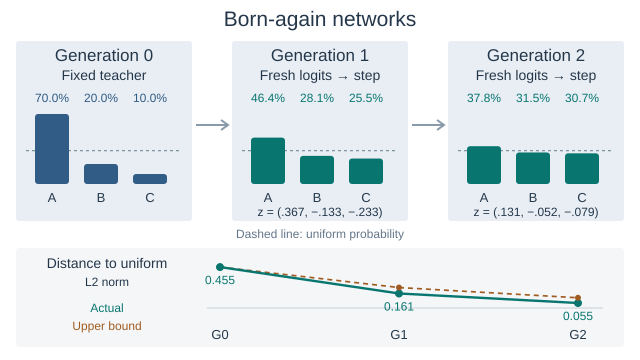

# 重生神經網路

重生網路是與其教師架構相同的學生，在教師的預測上訓練。Furlanello 等人表明，這些學生可以超越它們的教師，這與「蒸餾需要更大的教師」的假設相反。此方法是[自我蒸餾](../index.zh-TW.md)的一種，必要時可以重複多個世代。

## 問題

人們原本認為，只有學生比教師小時蒸餾才有效，因此需要一個更大的教師。

## 核心想法

訓練一個與教師架構相同的學生，以教師經軟化的預測作為目標。作者發現，所得的重生網路優於其教師，而且這種增益可以跨世代重複。

### 動畫解讀：新初始化學生與世代目標

[GitHub 靜態回退圖](../../../../../assets/concept-animations/born-again-generation-step-still.svg) · [完整 12 秒動畫](../../../../../assets/concept-animations/born-again-generation-step-motion.svg)

Furlanello 等人（2018）研究參數化架構相同的模型之間的知識蒸餾。每個新學生獨立訓練，前一代訓練完成的學生成為下一代固定教師；這與持續更新同一個網路不同。

在此**單筆資料、單步更新的人工算例**中，起始教師分布為 $p_0=(0.7,0.2,0.1)$，每一代新學生均從 $z=0$ 的 logits 開始，溫度為 1，僅使用軟目標交叉熵與學習率 1。固定教師 $p_k$ 時，梯度為 $\operatorname{softmax}(z)-p_k$，因此

$
z_{k+1}=p_k-\tfrac13(1,1,1),\qquad
p_{k+1}=\operatorname{softmax}(z_{k+1}).
$

第一步得到約 $(0.367,-0.133,-0.233)$ 的 logits 與 $(0.464,0.281,0.255)$ 的機率。下一代再次從零 logits 開始，將前一代未捨入的機率作為目標，得到約 $(0.131,-0.052,-0.079)$ 的 logits 與 $(0.378,0.315,0.307)$ 的機率。動畫長條以插值呈現初始與計算後的機率，不代表額外的 SGD 步驟。

此算例只說明知識傳遞與重新初始化。若每個學生皆能在所有輸入上精確匹配教師分布，單純使用軟目標交叉熵只會重現該分布。此算例不解釋或保證論文的實驗準確度增益，這裡熵增加也不是重生訓練的一般性質。實際訓練包含大量資料與最佳化步驟，也可能納入硬標籤。數值並非模型實測結果。

### 為何單步算例會趨近均勻分布

僅針對此示意流程，允許正學習率 $\eta$，但每代仍從零 logits 開始且只更新一次。由 softmax 的平移不變性可得 $F_\eta(p)=\operatorname{softmax}(\eta p)$，均勻分布 $u=(1/3,1/3,1/3)$ 為其不動點。softmax 在輸出 $q$ 處的 Jacobian 為 $J=\operatorname{diag}(q)-qq^\top$。此矩陣為對稱矩陣，各列元素絕對值總和為 $2q_i(1-q_i)\leq 1/2$，故譜範數不超過 $1/2$。沿兩個輸入間的線段積分 Jacobian，可得

$
\|F_\eta(p)-F_\eta(u)\|_2\leq \frac{\eta}{2}\|p-u\|_2.
$

所以在 $0<\eta<2$ 時，反覆執行此重新初始化的單步流程會收縮至均勻分布（$\eta=1$ 時每代距離至多為前一代的一半）。此結論只適用於人工建構的機率更新，不能推廣為一般重生網路的收斂、熵或準確度保證。多步最佳化、硬標籤與模型參數化都會改變這個映射。

下方曲線將上界視覺化：當 $\eta=1$，令 $d_k=\|p_k-u\|_2$，計算出的距離分別約為 $0.455$、$0.161$、$0.055$。琥珀色虛線表示累積上界 $d_0/2^k$，不是實測軌跡。各機率長條區域的水平虛線表示 $1/3$。曲線只記錄已完成的世代，不量測長條插值期間的中間狀態。

在 MkDocs 使用播放／暫停（Enter 或空白鍵）；GitHub 與減少動態效果的讀者可查看完整靜態結果。原創圖示，**CC BY-SA 4.0**。

## 公式或演算法

每一代都以相同架構，最小化與前一代經軟化預測之間的蒸餾損失，不需要更大的模型。第一代以標籤訓練，之後每一代都以前一代作為教師。

## 結果

摘要表示，重生網路在電腦視覺與語言建模任務上都顯著優於其教師。

## 限制

每一代都需要完整的訓練。報告的改善取決於設定與世代數。

## 開放問題與相關變體

- **飽和。** 重複的世代會持續改善，還是對大型模型會飽和，目前尚不清楚。
- **相關：** [做你自己的老師](../be-your-own-teacher/index.zh-TW.md)在單次訓練中達到相似的效果。

## 相關連結

此方法顯示，網路可以透過重新學習自己的預測而改進。同樣的想法也出現在[持續學習](../../../../../theory/paradigms/continual/index.zh-TW.md)中，其中模型的早期狀態用來引導後續訓練。

## 參考文獻

### 開創性論文

- Furlanello, T., et al. (2018). *Born Again Neural Networks*. arXiv:1805.04770. https://arxiv.org/abs/1805.04770 — 與教師架構相同的學生，在視覺與語言任務上表現優於教師。
- Zhang, L., et al. (2019). *Be Your Own Teacher: Improve the Performance of Convolutional Neural Networks via Self Distillation*. arXiv:1905.08094. https://arxiv.org/abs/1905.08094 — 同一網路內的深層自我蒸餾，是相關的自我教學方法。
- Hinton, G., Vinyals, O., Dean, J. (2015). *Distilling the Knowledge in a Neural Network*. arXiv:1503.02531. https://arxiv.org/abs/1503.02531 — 每一代所重用的蒸餾損失。

### 綜述與教科書

- Gou, J., et al. (2021). *Knowledge Distillation: A Survey*. International Journal of Computer Vision. https://doi.org/10.1007/s11263-021-01453-z — 依知識類型與訓練方式綜述蒸餾方法。

### 講座與影片

（本頁尚未查核任何項目）

### 文章與文件

- Mirzadeh, S.-I., et al. (2019). *Improved Knowledge Distillation via Teacher Assistant*. arXiv:1902.03393. https://arxiv.org/abs/1902.03393 — 顯示教師與學生之間的差距，會影響學生的表現，這正是自我蒸餾所消除的問題。
