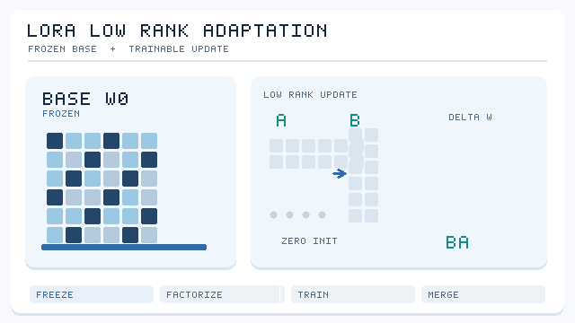

# LoRA

Low-Rank Adaptation (LoRA) fine-tunes a large model by learning a low-rank update on top of frozen weights. Hu et al. reported that, for GPT-3 175B, LoRA reduces the number of trainable parameters by up to 10,000 times and GPU memory by about three times, with model quality on par with or better than full fine-tuning. LoRA uses the same low-rank mathematics as [compression](../index.md), but it does not make the base model smaller, so it belongs to the family only as a contrast.

## Problem

Adapting a large pretrained model to each task means storing a full copy of its weights for each one, and training all of them is expensive in memory. A method that changes only a small part of the model is needed, so that one base model can serve many tasks.

## Core idea

Freeze the pretrained weight matrix \(W_0\), and learn an update \(\Delta W = BA\) where \(B\) and \(A\) are thin matrices of rank \(r\). Only \(A\) and \(B\) are trained and stored per task. The base model is shared by all of them.

*Original animated schematic, CC BY-SA 4.0.* The pretrained matrix \(W_0\) remains frozen while the trainable path applies \(A\) **then** \(B\) to an input, giving \(\Delta W = BA\) with rank at most \(r\). LoRA typically initialises \(B\) to zero, so the initial update vanishes. After fine-tuning, \(W_0+BA\) can be merged for inference; **LoRA does not compress the frozen base weights**. Matrix colours, pulse positions and dimensions are schematic, not measured training values. [Hu et al. (2021)](https://arxiv.org/abs/2106.09685).

## Equation or algorithm

The layer computes \(h = W_0 x + BA x\). With \(W_0 \in \mathbb{R}^{m \times n}\), the update has \(r(m+n)\) parameters, which is far fewer than \(mn\) when \(r\) is small. Hu et al. initialise \(B\) to zero, so training starts from the pretrained model. After training, \(BA\) can be merged into \(W_0\), which removes any extra cost at inference.

## Results

The abstract reports that LoRA reduces trainable parameters by up to 10,000 times and GPU memory by about three times compared with GPT-3 175B adapted with Adam. It performs on par with or better than fine-tuning on RoBERTa, DeBERTa, GPT-2 and GPT-3, with no added inference latency once merged.

## Limitations

LoRA reduces the cost of training and of storing task-specific weights, but not the size of the base model that must be served. The choice of rank and of which matrices to adapt affects quality, and the method's advantage over full fine-tuning on very different tasks is less clear.

## Open issues and related variants

- **Rank choice.** How the rank should depend on the task and the layer is not settled, and it is usually tuned by experiment.
- **Related:** [truncated SVD](../truncated-svd/index.md) uses the same low-rank structure to compress a trained matrix rather than to adapt it.
- **Composition.** Whether LoRA updates can be combined with quantised base models without losing accuracy is an active practical question. [QLoRA](qlora.md) answers it for a 4-bit base, and reports matching 16-bit LoRA on the benchmarks it tests.

## Connections

LoRA is a training method, so it sits with the fine-tuning practice described under [training](../../../../engineering/training/index.md). It is often used together with quantisation of the base model, which is a separate step covered under [quantisation](../../quantisation/index.md).

## References

### Seminal papers

- Hu, E. J., et al. (2021). *LoRA: Low-Rank Adaptation of Large Language Models*. arXiv:2106.09685. https://arxiv.org/abs/2106.09685 — Learns low-rank updates on frozen weights, reducing trainable parameters by up to 10,000 times for GPT-3 175B.
- Denton, R., Zaremba, W., Bruna, J., LeCun, Y., Fergus, R. (2014). *Exploiting Linear Structure Within Convolutional Networks for Efficient Evaluation*. arXiv:1404.0736. https://arxiv.org/abs/1404.0736 — The compression use of low-rank structure in convolutional filters, for contrast with adaptation.
- Jaderberg, M., Vedaldi, A., Zisserman, A. (2014). *Speeding up Convolutional Neural Networks with Low Rank Expansions*. arXiv:1405.3866. https://arxiv.org/abs/1405.3866 — Low-rank expansions that compress a trained convolutional network.

### Surveys and textbooks

- Hoefler, T., et al. (2021). *Sparsity in Deep Learning: Pruning and Growth for Efficient Inference and Training in Neural Networks*. arXiv:2102.00554. https://arxiv.org/abs/2102.00554 — Surveys training-time and inference-time efficiency methods.

### Lectures and videos

(none checked for this page)

### Articles and documentation

- Ainslie, J., et al. (2023). *GQA: Training Generalized Multi-Query Transformer Models from Multi-Head Checkpoints*. arXiv:2305.13245. https://arxiv.org/abs/2305.13245 — An efficient attention design that also changes the model's cost at inference.
