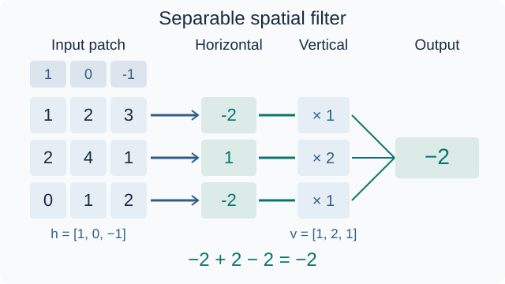

# 低秩濾波器展開

低秩濾波器展開把每個卷積濾波器近似為少數可分離濾波器的組合。Jaderberg 等人表明，可以用受低秩約束學得的一串較便宜濾波器，取代標準卷積；在場景文字辨識網路上，報告可能有 2.5 倍的加速且準確度沒有損失。它是一種[低秩分解](../index.zh-TW.md)方法，也是[截斷 SVD](../truncated-svd/index.zh-TW.md)單一 SVD 的替代方案。

## 問題

在許多通道上使用 \(k \times k\) 濾波器的標準卷積成本很高，而其中大部分濾波器高度冗餘。一般而言無法精確分解每個濾波器，因此需要一個能保留準確度的近似。

## 核心想法

以由可分離濾波器（即可分解為垂直與水平兩部分的濾波器）組成的低秩基底，表示某層的濾波器。原本的卷積接著以一串較便宜的卷積計算。係數的選擇使其近似訓練好的濾波器，之後再微調網路以恢復準確度。

## 公式或演算法

一個 \(k \times k\) 濾波器以 \(r\) 個可分離濾波器之和來近似，每個可分離濾波器都是一個垂直向量與一個水平向量的外積。該層的乘加運算量大致與 \(r\) 除以 \(k\) 成比例下降，因此對大型卷積核而言，小的秩就能帶來大幅節省。秩逐層設定，近似則以匹配原始響應來最佳化。

*原創 12 秒教學動畫（CC BY-SA 4.0）。* 秩一空間卷積核分解成兩次一維運算。 網站支援鍵盤操作播放／暫停；GitHub 顯示[靜態回退圖](../../../../assets/concept-animations/separable-filter-two-pass-still.svg)。[完整 SVG 動畫](../../../../assets/concept-animations/separable-filter-two-pass-motion.svg)。[原始論文](https://arxiv.org/abs/1405.3866)。

考慮秩一空間卷積核 $K=vh^\top$，其中 $h=(1,0,-1)^\top$、$v=(1,2,1)^\top$。依 CNN 常用的互相關慣例，先對輸入區塊 $X$ 進行水平運算得到 $u=Xh$，再垂直運算得到 $v^\top u$：

$
X=\begin{bmatrix}1&2&3\\2&4&1\\0&1&2\end{bmatrix},
\quad u=(-2,1,-2)^\top,\quad v^\top u=-2.
$

其結果恰為 $\sum_{ij}K_{ij}X_{ij}$。對大型單通道特徵圖，若中間特徵與輸出的空間尺寸相近，秩 $r$ 分解藉由重用水平中間結果，每個輸出約需 $2kr$ 次乘加，原始運算則需 $k^2$ 次。圖中的獨立區塊實際需要三次水平內積及一次垂直內積，本身並未展示這項攤銷後的節省。多通道成本依分解方式及中間通道數而異。此人工算例不是實測加速結果。

## 結果

摘要報告，在場景文字字元辨識網路上，可能有 2.5 倍的加速且沒有準確度損失；加速 4.5 倍時，準確度下降不到 1%。其他網路的結果見論文。

## 限制

近似按層設定，而秩的搜尋成本很高。收益取決於大型卷積核，而可分離濾波器會損失部分表達能力，微調也只能部分恢復。

## 開放問題與相關變體

- **層的選擇。** 哪些層能容忍低秩而不損失準確度，事前並不清楚，而且不同網路各不相同。
- **相關：** [截斷 SVD](../truncated-svd/index.zh-TW.md)對權重矩陣做一次分解，而不是對卷積濾波器分解。
- **相關：** [深度可分離卷積](../../../models/cnn/convolution-variants/depthwise-separable-convolution/index.zh-TW.md)是一種高效架構，把相同類型的節省直接內建到設計中。

## 相關連結

可分離濾波器是影像處理中的經典概念，相同的分解也出現在卷積網路的[卷積變體](../../../models/cnn/convolution-variants/index.zh-TW.md)中。它對真實卷積速度的影響取決於硬體，見 [AI 硬體](../../../../engineering/hardware/index.zh-TW.md)。

## 參考文獻

### 開創性論文

- Jaderberg, M., Vedaldi, A., Zisserman, A. (2014). *Speeding up Convolutional Neural Networks with Low Rank Expansions*. arXiv:1405.3866. https://arxiv.org/abs/1405.3866 — 低秩濾波器展開，在文字辨識網路上，可能有 2.5 倍加速且沒有準確度損失。
- Denton, R., Zaremba, W., Bruna, J., LeCun, Y., Fergus, R. (2014). *Exploiting Linear Structure Within Convolutional Networks for Efficient Evaluation*. arXiv:1404.0736. https://arxiv.org/abs/1404.0736 — 同年的平行結果，對卷積濾波器做低秩近似。
- Howard, A. G., 等人 (2017). *MobileNets: Efficient Convolutional Neural Networks for Mobile Vision Applications*. arXiv:1704.04861. https://arxiv.org/abs/1704.04861 — 深度可分離卷積，是把同類節省內建到設計中的方法。

### 綜述與教科書

- Hoefler, T., 等人 (2021). *Sparsity in Deep Learning: Pruning and Growth for Efficient Inference and Training in Neural Networks*. arXiv:2102.00554. https://arxiv.org/abs/2102.00554 — 綜述效率方法，包括卷積層的分解。

### 講座與影片

（本頁尚未查核任何項目）

### 文章與文件

- Hu, E. J., 等人 (2021). *LoRA: Low-Rank Adaptation of Large Language Models*. arXiv:2106.09685. https://arxiv.org/abs/2106.09685 — 用於微調的低秩更新，是同一結構的另一種用途。
