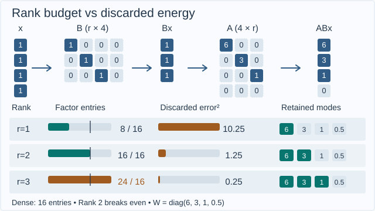

# Truncated SVD

Truncated SVD compresses a trained weight matrix by keeping only its largest singular values. It replaces a large matrix with the product of two thinner ones, which needs fewer parameters and fewer multiply-adds when the kept rank is small. Denton et al. applied the idea to the filters of convolutional layers and reported speed-ups of about 2 times on CPU and GPU with accuracy kept within 1%. It is a [low-rank factorisation](../index.md) method that works after training.

## Problem

A dense layer with an \(m \times n\) weight matrix costs \(mn\) parameters, and large layers dominate the size and the compute of many models. If the matrix is close to low rank, most of that cost is spent on directions that carry little signal.

## Core idea

Decompose the matrix by singular value decomposition, \(W = U \Sigma V^\top\), and keep only the \(r\) largest singular values. The truncated product \(U_r \Sigma_r V_r^\top\) is the best rank-\(r\) approximation of \(W\) in the Frobenius norm. Writing it as two layers, \(W \approx AB\) with \(A = U_r \Sigma_r\) and \(B = V_r^\top\), turns one layer into two thinner ones.

## Equation or algorithm

The parameter count falls from \(mn\) to \(r(m+n)\), so the saving is positive whenever \(r < \frac{mn}{m+n}\). The approximation error is given by the discarded singular values, \(\lVert W - W_r \rVert_F^2 = \sum_{i > r} \sigma_i^2\), which provides a direct way to choose \(r\) for a given error budget. In practice the rank is chosen layer by layer, and the factorised model is usually fine-tuned afterwards to recover accuracy.

### Rank budget and discarded energy

Take the illustrative matrix $W=\operatorname{diag}(6,3,1,0.5)$ and $x=(1,1,1,1)^\top$. Here $U=V=I$, so $W_rx$ retains the first $r$ components directly. The animation selects successive singular values, reveals output components, and compares the storage of ordinary dense factors $A\in\mathbb R^{4\times r}$ and $B\in\mathbb R^{r\times4}$.

| Rank $r$ | $W_rx$ | Factor entries / original entries | $\|W-W_r\|_F^2$ |
|---:|---|---:|---:|
| 1 | $(6,0,0,0)$ | 8 / 16 | 10.25 |
| 2 | $(6,3,0,0)$ | 16 / 16 | 1.25 |
| 3 | $(6,3,1,0)$ | 24 / 16 | 0.25 |

Increasing rank reduces matrix approximation error but need not compress storage. The count assumes dense storage and excludes bias, alignment and intermediate buffers; a diagonal matrix itself admits other structured storage formats. For general inputs, output error depends on projections onto right singular vectors and is not the Frobenius error. All values are constructed examples, not model measurements or latency results.

*Original 12-second teaching animation (CC BY-SA 4.0).* Use Play/Pause on MkDocs; the focusable container scrolls horizontally on narrow screens. GitHub displays the [static preview](../../../../assets/concept-animations/svd-factor-rank-budget-still.svg); the [full animation](../../../../assets/concept-animations/svd-factor-rank-budget-motion.svg) is also linked.

## Results

Denton et al. report, for convolutional layers, speed-ups of about 2 times on both CPU and GPU, with accuracy kept within 1% of the original model. The exact figures for each network are in the paper.

## Limitations

The method works only when the layer is close to low rank. Errors can grow quickly in the layers that matter most, so the gains are uneven across a network. A factorised layer also needs two matrix multiplications instead of one, which can offset the saving on hardware that favours a single large operation.

## Open issues and related variants

- **Rank selection.** Choosing \(r\) per layer is usually done by searching against validation accuracy, and an automatic rule is not established.
- **Related:** [low-rank filter expansion](../low-rank-filter-expansion/index.md) factorises convolutional filters into a basis of separable filters instead of a single SVD.
- **Related:** [LoRA](../lora/index.md) applies the same low-rank structure during fine-tuning, without compressing the base model.

## Connections

The singular value decomposition is a basic tool of [linear algebra](../../../math/index.md), and the best low-rank approximation is a standard result in numerical analysis. The dense layers it compresses are the same ones described on the [multilayer perceptron](../../../models/mlp/index.md) page.

## References

### Seminal papers

- Denton, R., Zaremba, W., Bruna, J., LeCun, Y., Fergus, R. (2014). *Exploiting Linear Structure Within Convolutional Networks for Efficient Evaluation*. arXiv:1404.0736. https://arxiv.org/abs/1404.0736 — Applies low-rank approximations to convolutional filters, with speed-ups of about 2 times and accuracy kept within 1%.
- Jaderberg, M., Vedaldi, A., Zisserman, A. (2014). *Speeding up Convolutional Neural Networks with Low Rank Expansions*. arXiv:1405.3866. https://arxiv.org/abs/1405.3866 — Low-rank expansions of convolutional filters, an alternative to a single SVD per layer.
- Hu, E. J., et al. (2021). *LoRA: Low-Rank Adaptation of Large Language Models*. arXiv:2106.09685. https://arxiv.org/abs/2106.09685 — The same low-rank structure used as a fine-tuning update rather than a compression step.

### Surveys and textbooks

- Hoefler, T., et al. (2021). *Sparsity in Deep Learning: Pruning and Growth for Efficient Inference and Training in Neural Networks*. arXiv:2102.00554. https://arxiv.org/abs/2102.00554 — Surveys efficiency methods, including the factorisation of weight matrices.

### Lectures and videos

(none checked for this page)

### Articles and documentation

- Gholami, A., et al. (2021). *A Survey of Quantization Methods for Efficient Neural Network Inference*. arXiv:2103.13630. https://arxiv.org/abs/2103.13630 — Compares low-bit precision with other compression methods such as factorisation.
