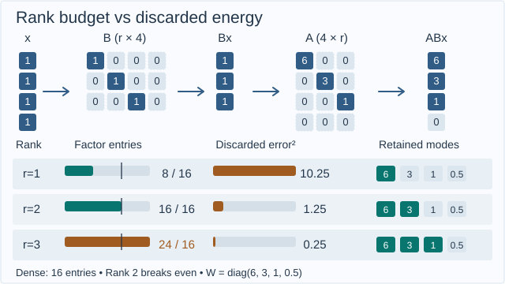

# 截斷奇異值分解

截斷奇異值分解（截斷 SVD）只保留訓練好的權重矩陣中最大的幾個奇異值，以壓縮該矩陣。它以兩個較瘦矩陣的乘積取代一個大矩陣，在保留的秩很小時，所需的參數與乘加運算都較少。Denton 等人把這個想法應用於卷積層的濾波器，報告在 CPU 與 GPU 上速度約提升 2 倍，且準確度維持在 1% 以內。它是一種[低秩分解](../index.zh-TW.md)方法，在訓練後套用。

## 問題

一個 \(m \times n\) 的稠密層權重矩陣需要 \(mn\) 個參數，而大型層往往主導許多模型的大小與計算量。若矩陣接近低秩，大部分成本就花在攜帶很少訊號的方向上。

## 核心想法

以奇異值分解 \(W = U \Sigma V^\top\) 分解矩陣，只保留最大的 \(r\) 個奇異值。截斷後的乘積 \(U_r \Sigma_r V_r^\top\) 是 \(W\) 在 Frobenius 範數下最好的秩 \(r\) 近似。把它寫成兩層，\(W \approx AB\)，其中 \(A = U_r \Sigma_r\)、\(B = V_r^\top\)，即可把一層變成兩個較瘦的層。

## 公式或演算法

參數數量從 \(mn\) 降為 \(r(m+n)\)，因此只要 \(r < \frac{mn}{m+n}\)，就能節省。近似誤差由被捨棄的奇異值決定，\(\lVert W - W_r \rVert_F^2 = \sum_{i > r} \sigma_i^2\)，這提供了依誤差預算選擇 \(r\) 的直接方法。實務上，秩是逐層選擇的，分解後的模型通常再微調以恢復準確度。

### 秩預算與捨棄能量

取示意矩陣 $W=\operatorname{diag}(6,3,1,0.5)$ 與 $x=(1,1,1,1)^\top$。此例的 $U=V=I$，所以 $W_rx$ 直接保留前 $r$ 個分量。動畫逐步建構兩個因子及中介激活值，揭露輸出分量，並比較一般稠密因子 $A\in\mathbb R^{4\times r}$、$B\in\mathbb R^{r\times4}$ 的儲存成本。

| 秩 $r$ | $W_rx$ | 因子元素數 / 原矩陣元素數 | $\|W-W_r\|_F^2$ |
|---:|---|---:|---:|
| 1 | $(6,0,0,0)$ | 8 / 16 | 10.25 |
| 2 | $(6,3,0,0)$ | 16 / 16 | 1.25 |
| 3 | $(6,3,1,0)$ | 24 / 16 | 0.25 |

增加秩會降低矩陣近似誤差，但不一定能壓縮儲存量。這裡採稠密儲存假設，忽略偏差、對齊及中介緩衝區；對角矩陣本身也能用其他結構化格式儲存。一般輸入的輸出誤差取決於其在右奇異向量方向上的投影，不等於 Frobenius 誤差。所有數值均為人工算例，不是模型實測或延遲測量。

上方動畫呈現實際的兩因子計算：$h=Bx$ 與 $y_r=Ah$。$B$ 的有效列為單位矩陣的前 $r$ 列，$A$ 的有效欄為對應的縮放單位矩陣欄。秩每增加一，$B$ 增加一列（四個元素），$A$ 增加一欄（四個元素），中介激活值則增加一個。虛線格表示目前因子中不存在的元素；實線格中的零值則仍計入稠密儲存成本。儲存量長條中的垂直標記代表原矩陣的 16 個元素。靜態預覽呈現秩三的因子及三種秩預算的比較。計算 $Ah$ 時不需要先重建完整權重矩陣。

對一般 SVD，特定輸入的輸出平方誤差為

$
\| (W-W_r)x\|_2^2=\sum_{i>r}\sigma_i^2(v_i^\top x)^2.
$

例如秩一時，$x=(1,0,0,0)^\top$ 的輸出平方誤差為零，而 $x=(0,1,0,0)^\top$ 的輸出平方誤差為 9；矩陣近似誤差則仍為 10.25。這說明只依權重能量選擇秩，並不等同於最小化特定輸入分布上的誤差。

*原創 12 秒教學動畫（CC BY-SA 4.0）。* MkDocs 可使用播放／暫停控制；較窄畫面可透過鍵盤聚焦的容器水平捲動。GitHub 顯示[靜態預覽](../../../../assets/concept-animations/svd-factor-rank-budget-still.svg)，另可開啟[完整動畫](../../../../assets/concept-animations/svd-factor-rank-budget-motion.svg)。

## 結果

Denton 等人報告，對卷積層而言，在 CPU 與 GPU 上速度約提升 2 倍，且準確度維持在原模型的 1% 以內。各網路的確切數字見論文。

## 限制

此方法只在層接近低秩時有效。在最重要的層中誤差可能迅速增大，因此收益在整個網路中並不平均。分解後的層需要兩次矩陣乘法而非一次，在偏好單一大型運算的硬體上，可能抵銷節省的成本。

## 開放問題與相關變體

- **秩的選擇。** 每層的 \(r\) 通常靠對驗證準確度的搜尋來決定，尚未建立自動規則。
- **相關：** [低秩濾波器展開](../low-rank-filter-expansion/index.zh-TW.md)把卷積濾波器分解為可分離濾波器的基底，而不是對單一矩陣做一次 SVD。
- **相關：** [LoRA](../lora/index.zh-TW.md)在微調時套用相同的低秩結構，且不壓縮基礎模型。

## 相關連結

奇異值分解是[線性代數](../../../math/index.zh-TW.md)的基本工具，而最佳低秩近似是數值分析中的標準結果。它所壓縮的稠密層，與[多層感知器](../../../models/mlp/index.zh-TW.md)頁面中描述的相同。

## 參考文獻

### 開創性論文

- Denton, R., Zaremba, W., Bruna, J., LeCun, Y., Fergus, R. (2014). *Exploiting Linear Structure Within Convolutional Networks for Efficient Evaluation*. arXiv:1404.0736. https://arxiv.org/abs/1404.0736 — 對卷積濾波器做低秩近似，速度約提升 2 倍，準確度維持在 1% 以內。
- Jaderberg, M., Vedaldi, A., Zisserman, A. (2014). *Speeding up Convolutional Neural Networks with Low Rank Expansions*. arXiv:1405.3866. https://arxiv.org/abs/1405.3866 — 卷積濾波器的低秩展開，是單一 SVD 的另一種選擇。
- Hu, E. J., 等人 (2021). *LoRA: Low-Rank Adaptation of Large Language Models*. arXiv:2106.09685. https://arxiv.org/abs/2106.09685 — 同樣的低秩結構，用作微調時的更新，而非壓縮步驟。

### 綜述與教科書

- Hoefler, T., 等人 (2021). *Sparsity in Deep Learning: Pruning and Growth for Efficient Inference and Training in Neural Networks*. arXiv:2102.00554. https://arxiv.org/abs/2102.00554 — 綜述效率方法，包括權重矩陣的分解。

### 講座與影片

（本頁尚未查核任何項目）

### 文章與文件

- Gholami, A., 等人 (2021). *A Survey of Quantization Methods for Efficient Neural Network Inference*. arXiv:2103.13630. https://arxiv.org/abs/2103.13630 — 比較低位元精度與分解等其他壓縮方法。
