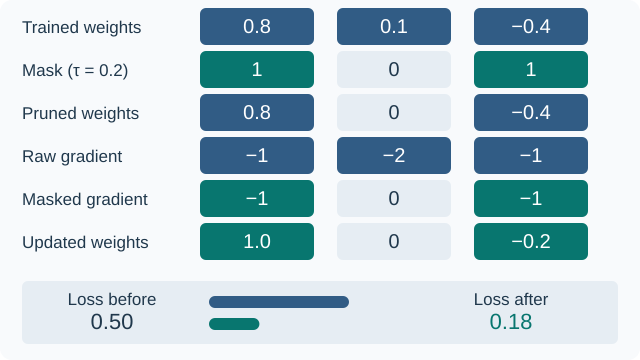

# Learning Both Weights and Connections

Learning both weights and connections is the 2015 pruning method that showed a large network could lose most of its parameters after training, then regain its accuracy with retraining. It is the origin of the prune-and-retrain pipeline used across the [pruning](../index.md) family, and it sets the baseline that later methods such as [magnitude pruning](../magnitude-pruning/index.md) and [N:M sparsity](../n-m-sparsity/index.md) are compared against.

## Problem

Large networks, such as AlexNet for image classification, contain far more parameters than they need. Storing them is expensive on mobile systems, where memory and bandwidth are limited.

## Core idea

Train the network to learn which connections matter, prune the weak ones, and retrain. The pruned network keeps its accuracy while having far fewer connections.

### Visual walkthrough

[GitHub-readable fallback](../../../../assets/concept-animations/prune-fixed-mask-gradient-still.svg) · [Full 12-second animation](../../../../assets/concept-animations/prune-fixed-mask-gradient-motion.svg)

In a schematic linear predictor with $x=(1,2,1)$, target $y^*=1.4$, trained weights $w=(0.8,0.1,-0.4)$, and threshold $\tau=0.2$, the fixed mask is $m=(1,0,1)$. Start retraining from $v=m\odot w=(0.8,0,-0.4)$, not from the original initialization. The squared loss is $L=\frac12(v^\top x-y^*)^2$. The prediction is 0.4 and the residual is -1, so the gradient with respect to the effective weights before applying the mask is $g=(-1,-2,-1)$. With learning rate $\eta=0.2$ and plain SGD, the constrained update is

$v'=m\odot(v-\eta g)=(1,0,-0.2).$

The new prediction is 0.8, and the loss changes from 0.50 to 0.18. In a parameterization $v=m\odot w$, the chain rule gives $\nabla_wL=m\odot g$; the removed connection has zero gradient even when its unconstrained gradient is nonzero. Reapplying the fixed mask also guards against optimizer state or other updates reintroducing nonzero effective weights. This isolates one retraining step of [Han et al.](https://arxiv.org/abs/1506.02626), not an empirical recovery of accuracy or a guarantee that every step decreases loss. All values are schematic.

The moving gradient signals now follow individual parameter lanes: the second lane stops at the mask gate while the first and third continue to the update. Zeroing a gradient alone is not equivalent to projecting a directly stored sparse parameter after an optimizer step. For example, with momentum $u'_2=0.9u_2+g_2$ and an existing buffer $u_2=-2$, the masked gradient $g_2=0$ still yields $u'_2=-1.8$. A direct update from zero with learning rate 0.2 produces 0.36; projection by $m_2=0$ restores zero. A masked forward parameterization instead keeps the effective weight zero regardless of the latent value. Clearing or masking optimizer state may also be appropriate for permanent pruning.

For the fixed-mask plain SGD toy example, write the prediction residual as $e_t=v_t^\top x-y^*$. Then $e_{t+1}=(1-\eta\|m\odot x\|_2^2)e_t=(1-2\eta)e_t$. Hence the loss contracts by $(1-2\eta)^2$ for $0<\eta<1$ when the residual is nonzero, but this is a single-example linear result, not a general neural-network training guarantee.

On MkDocs, use Play/Pause (Enter/Space) to inspect the operations. GitHub and reduced-motion readers use the static fallback. Original visual, **CC BY-SA 4.0**.

## Equation or algorithm

Weights whose magnitude is below a threshold are set to zero and held there with a mask. The network is then retrained on the remaining weights. The abstract describes three steps: learn which connections matter, prune the low-weight ones, and retrain the surviving connections.

## Results

The abstract reports that the method reduced the number of parameters of AlexNet by a factor of 9, from 61 million to 6.7 million, without loss of accuracy.

## Limitations

Retraining costs about as much as training. The unstructured result needs sparse software or hardware to run faster. The method was developed for convolutional networks, before large transformers.

## Open issues and related variants

- **Iterative cost.** Repeated pruning and retraining is expensive, which is why one-shot and gradual methods were developed; see [gradual pruning](../magnitude-pruning/gradual-pruning/index.md).
- **Related:** the Deep Compression pipeline (Han et al., 2016) adds quantisation and coding after this pruning step; see [quantisation](../../quantisation/index.md).

## Connections

The unstructured masks this method produces are a poor fit for dense hardware, which is why [N:M sparsity](../n-m-sparsity/index.md) was introduced. The memory savings matter most for [mobile and edge deployment](../../../../engineering/hardware/index.md).

## References

### Seminal papers

- Han, S., Pool, J., Tran, J., Dally, W. J. (2015). *Learning both Weights and Connections for Efficient Neural Networks*. arXiv:1506.02626. https://arxiv.org/abs/1506.02626 — Shows that prune-and-retrain cuts AlexNet's parameters from 61 million to 6.7 million.
- Han, S., Mao, H., Dally, W. J. (2016). *Deep Compression: Compressing Deep Neural Networks with Pruning, Trained Quantization and Huffman Coding*. ICLR. https://arxiv.org/abs/1510.00149 — Adds quantisation and coding to pruning, for a combined reduction of 35 to 49 times.
- Frankle, J., Carbin, M. (2018). *The Lottery Ticket Hypothesis: Finding Sparse, Trainable Neural Networks*. arXiv:1803.03635. https://arxiv.org/abs/1803.03635 — Shows that the pruned subnetworks can be trained from their original initial weights.
- Zhu, M., Gupta, S. (2017). *To prune, or not to prune: exploring the efficacy of pruning for model compression*. arXiv:1710.01878. https://arxiv.org/abs/1710.01878 — Compares large pruned networks with small dense networks at identical memory footprint.

### Surveys and textbooks

- Hoefler, T., et al. (2021). *Sparsity in Deep Learning: Pruning and Growth for Efficient Inference and Training in Neural Networks*. arXiv:2102.00554. https://arxiv.org/abs/2102.00554 — A broad survey of sparsity methods across training and inference.

### Lectures and videos

(none checked for this page)

### Articles and documentation

- Gale, T., Elsen, E., Hooker, S. (2019). *The State of Sparsity in Deep Neural Networks*. arXiv:1902.09574. https://arxiv.org/abs/1902.09574 — Benchmarks sparsity methods and finds simple magnitude pruning a strong baseline.
