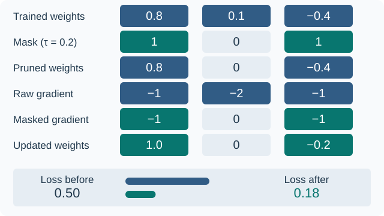

# 同時學習權重與連接

同時學習權重與連接是 2015 年的剪枝方法，它顯示大型網路在訓練後可以失去大部分參數，再透過重新訓練恢復準確度。它是[剪枝](../index.zh-TW.md)家族中剪除後重新訓練流程的起源，也是後來的[量值剪枝](../magnitude-pruning/index.zh-TW.md)與 [N:M 稀疏](../n-m-sparsity/index.zh-TW.md)等方法的比較基準。

## 問題

AlexNet 這類用於影像分類的大型網路，包含的參數遠多於所需。在記憶體與頻寬有限的行動系統上，儲存這些參數成本很高。

## 核心想法

訓練網路以學習哪些連接重要，剪除較弱的連接，再重新訓練。剪枝後的網路能保持準確度，而連接數大幅減少。

### 動畫解讀

[GitHub 靜態預覽](../../../../assets/concept-animations/prune-fixed-mask-gradient-still.svg) · [完整 12 秒動畫](../../../../assets/concept-animations/prune-fixed-mask-gradient-motion.svg)

考慮人工線性預測器：輸入 $x=(1,2,1)$、目標 $y^*=1.4$、訓練後權重 $w=(0.8,0.1,-0.4)$、剪枝門檻 $\tau=0.2$。固定遮罩為 $m=(1,0,1)$。重新訓練從 $v=m\odot w=(0.8,0,-0.4)$ 開始，而非原始初始化。平方損失為 $L=\frac12(v^\top x-y^*)^2$。預測值為 0.4、殘差為 -1，因此遮罩梯度之前，對有效權重的梯度為 $g=(-1,-2,-1)$。取學習率 $\eta=0.2$ 並使用基本 SGD，受限更新為

$v'=m\odot(v-\eta g)=(1,0,-0.2).$

新預測值為 0.8，損失從 0.50 降至 0.18。若參數化為 $v=m\odot w$，鏈式法則給出 $\nabla_w L=m\odot g$；即使被移除連接的未受限梯度非零，對應的參數梯度仍為零。重新套用固定遮罩也可防止最佳化器狀態或其他更新使有效權重重新出現非零值。此例僅分離展示 [Han 等人](https://arxiv.org/abs/1506.02626) 剪枝後重新訓練中的一次更新，並非準確度恢復的實測結果，也不保證每次更新皆使損失下降。所有數值皆為示意。

在 MkDocs 網站可使用播放／暫停（Enter／Space）觀察各步驟；GitHub 與減少動態效果模式採用靜態回退圖。原創視覺，**CC BY-SA 4.0**。

## 公式或演算法

量值低於門檻的權重設為零，並以遮罩固定。接著在剩餘權重上重新訓練。摘要描述三個步驟：學習哪些連接重要、剪除權重較小的連接，再重新訓練保留下來的連接。

## 結果

摘要報告，此方法使 AlexNet 的參數減少為原來的九分之一，從 6100 萬降到 670 萬，且沒有準確度損失。

## 限制

重新訓練的成本與訓練相當。非結構化的結果需要稀疏軟體或硬體才能加速。此方法是為卷積網路開發的，早於大型 Transformer。

## 開放問題與相關變體

- **迭代成本。** 反覆剪枝與重新訓練成本很高，因此才發展出單次與漸進方法；見[漸進剪枝](../magnitude-pruning/gradual-pruning/index.zh-TW.md)。
- **相關**：Deep Compression 流程（Han 等人，2016）在這個剪枝步驟之後加入量化與編碼；見[量化](../../quantisation/index.zh-TW.md)。

## 相關連結

此方法產生的非結構化遮罩不適合稠密硬體，這也是 [N:M 稀疏](../n-m-sparsity/index.zh-TW.md)被提出的原因。記憶體節省在[行動與邊緣部署](../../../../engineering/hardware/index.zh-TW.md)中最有價值。

## 參考文獻

### 開創性論文

- Han, S., Pool, J., Tran, J., Dally, W. J. (2015). *Learning both Weights and Connections for Efficient Neural Networks*. arXiv:1506.02626. https://arxiv.org/abs/1506.02626 — 顯示剪枝加重新訓練使 AlexNet 的參數從 6100 萬降到 670 萬。
- Han, S., Mao, H., Dally, W. J. (2016). *Deep Compression: Compressing Deep Neural Networks with Pruning, Trained Quantization and Huffman Coding*. ICLR. https://arxiv.org/abs/1510.00149 — 在剪枝之外加入量化與編碼，合併後可縮小 35 到 49 倍。
- Frankle, J., Carbin, M. (2018). *The Lottery Ticket Hypothesis: Finding Sparse, Trainable Neural Networks*. arXiv:1803.03635. https://arxiv.org/abs/1803.03635 — 顯示剪枝後的子網路可以從原始初始權重訓練。
- Zhu, M., Gupta, S. (2017). *To prune, or not to prune: exploring the efficacy of pruning for model compression*. arXiv:1710.01878. https://arxiv.org/abs/1710.01878 — 比較剪枝後的大型網路與記憶體佔用相同的小型稠密網路。

### 綜述與教科書

- Hoefler, T., 等人 (2021). *Sparsity in Deep Learning: Pruning and Growth for Efficient Inference and Training in Neural Networks*. arXiv:2102.00554. https://arxiv.org/abs/2102.00554 — 涵蓋訓練與推論稀疏化方法的廣泛綜述。

### 講座與影片

（本頁尚未查核任何項目）

### 文章與文件

- Gale, T., Elsen, E., Hooker, S. (2019). *The State of Sparsity in Deep Neural Networks*. arXiv:1902.09574. https://arxiv.org/abs/1902.09574 — 比較稀疏化方法，發現簡單的量值剪枝是強基準。
