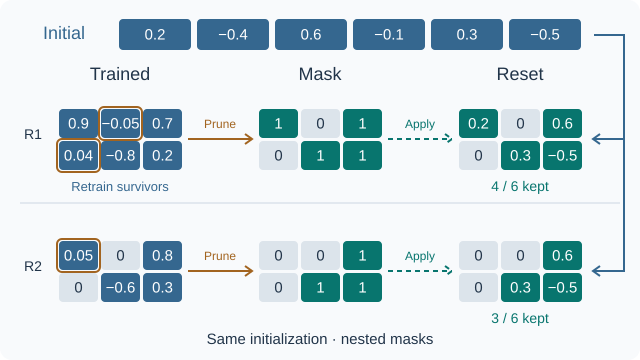

# The Lottery Ticket Hypothesis

The lottery ticket hypothesis says that a dense, randomly initialised network contains a small sparse subnetwork that, trained alone from its original initial weights, reaches accuracy comparable to the full network. Such a subnetwork is a **winning ticket**. It is the paper that started the [lottery ticket](../index.md) line of work, and it changed how researchers think about [pruning](../../index.md): the valuable part of a large network may be a lucky initialisation as much as the trained weights.

## Problem

Pruning removes most weights of a trained network. It was unclear why the remaining subnetwork can be trained at all, or whether it could have been trained from the start.

## Core idea

A dense network contains sparse subnetworks that, from their original initial weights, train to comparable accuracy in isolation. Iterative magnitude pruning with resetting to the initialisation finds them.

## Equation or algorithm

Initialise the network to \(\theta_0\), train it to \(\theta_T\), and prune the smallest weights to a mask \(m\). Reset the surviving weights to \(m \odot \theta_0\), and train again. Repeat with increasing pruning. If the reset subnetwork reaches the accuracy of the dense network, the mask and \(\theta_0\) together form a winning ticket. Resetting to new random weights instead destroys the effect, so the original initialisation matters.

### Worked animation

*Original 12-second teaching animation (CC BY-SA 4.0).* Values are schematic, not model measurements. MkDocs provides Play/Pause; focus the scroll region to navigate horizontally by keyboard. GitHub shows the [static fallback](../../../../../assets/concept-animations/lottery-ticket-initial-reset-still.svg).

One schematic round begins at $\theta_0=(0.2,-0.4,0.6,-0.1,0.3,-0.5)$ and ends training at $\theta_T=(0.9,-0.05,0.7,0.04,-0.8,0.2)$. Prune the two smallest absolute trained weights, positions 2 and 4 (one-based), giving $m=(1,0,1,0,1,1)$. The moving blue signal retrieves the **original initialization**; the dashed teal path supplies the mask. Their combination gives $m\odot\theta_0=(0.2,0,0.6,0,0.3,-0.5)$, not $m\odot\theta_T=(0.9,0,0.7,0,-0.8,0.2)$. The latter would retain trained values for fine-tuning. Retrain with the new fixed mask; further iterative pruning selects among surviving weights and resets them again. In round 2, suppose retraining the survivors gives $(0.05,0,0.8,0,-0.6,0.3)$. Among the four surviving positions, prune position 1 (absolute value 0.05), not either previously masked zero. The cumulative mask is $(0,0,1,0,1,1)$, and the second reset is $(0,0,0.6,0,0.3,-0.5)$, taken from the same original initialization. Amber outlines indicate newly pruned positions; gray cells denote already masked values or zeros in the reset. In both rounds the blue path retrieves the initial values; the mask determines which entries survive. The two trained vectors are constructed examples, not an actual training trajectory. The mask and initialization qualify as a winning ticket only if the subsequent training meets the comparative performance criterion; sparsity alone does not establish this.

[Full SVG animation](../../../../../assets/concept-animations/lottery-ticket-initial-reset-motion.svg).

## Results

The abstract states that dense, randomly initialised feed-forward networks contain subnetworks that reach accuracy comparable to the original network when trained in isolation.

## Limitations

The experiments are on small networks and datasets of the time. Resetting to the original initialisation fails for deeper networks, which motivated the stabilised version.

## Open issues and related variants

- **Deeper networks.** The reset to initialisation does not give winning tickets for deeper networks; the fix is in the [stabilised lottery ticket](../stabilised-lottery-ticket/index.md).
- **Related:** [gradual pruning](../../magnitude-pruning/gradual-pruning/index.md) reaches similar sparsity without repeated training runs.

## Connections

The ticket view connects to why overparameterised networks train well, covered under [deep learning theory](../../../../../theory/deep-learning/index.md). The idea that the brain forms more connections than it keeps is discussed in [neuroscience](../../../../../brain-mind/neuroscience/index.md).

## References

### Seminal papers

- Frankle, J., Carbin, M. (2018). *The Lottery Ticket Hypothesis: Finding Sparse, Trainable Neural Networks*. arXiv:1803.03635. https://arxiv.org/abs/1803.03635 — Sparse subnetworks trained from their original initialisation match the dense network's accuracy.
- Frankle, J., Dziugaite, G. K., Roy, D. M., Carbin, M. (2019). *Stabilizing the Lottery Ticket Hypothesis*. arXiv:1903.01611. https://arxiv.org/abs/1903.01611 — Rewinds to an early training point to find tickets in deeper networks.
- Han, S., Pool, J., Tran, J., Dally, W. J. (2015). *Learning both Weights and Connections for Efficient Neural Networks*. arXiv:1506.02626. https://arxiv.org/abs/1506.02626 — The prune-and-retrain pipeline that the lottery ticket procedure builds on.

### Surveys and textbooks

- Hoefler, T., et al. (2021). *Sparsity in Deep Learning: Pruning and Growth for Efficient Inference and Training in Neural Networks*. arXiv:2102.00554. https://arxiv.org/abs/2102.00554 — Surveys sparse training and inference, including tickets.

### Lectures and videos

(none checked for this page)

### Articles and documentation

- Gale, T., Elsen, E., Hooker, S. (2019). *The State of Sparsity in Deep Neural Networks*. arXiv:1902.09574. https://arxiv.org/abs/1902.09574 — Finds that sparse architectures learned by pruning cannot be trained from scratch to the same accuracy as jointly sparsified and optimised models.
