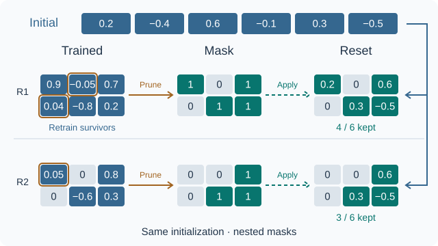

# 彩票假說

彩票假說指出，隨機初始化的稠密網路中包含一個小型稀疏子網路；若單獨從其原始初始權重訓練，它能達到與完整網路相近的準確度。這樣的子網路稱為**獲勝彩票**。它是[彩票假說](../index.zh-TW.md)系列研究的起點，也改變了研究者對[剪枝](../../index.zh-TW.md)的看法：大型網路中有價值的部分，可能和訓練後的權重一樣，取決於幸運的初始化。

## 問題

剪枝會移除訓練後網路的大部分權重。不清楚為何剩下的子網路能被訓練，或它能否從一開始就被訓練。

## 核心想法

稠密網路中包含稀疏子網路，若從原始初始權重開始，單獨訓練即可達到相近的準確度。迭代量值剪枝加上重設到初始化，能找到它們。

## 公式或演算法

初始化為 \(\theta_0\)，訓練到 \(\theta_T\)，剪除最小的權重得到遮罩 \(m\)，然後重設為 \(m \odot \theta_0\)，再訓練。如果重設後的子網路達到稠密網路的準確度，遮罩與 \(\theta_0\) 合起來就是獲勝彩票。重設為新的隨機權重會使效果消失，因此原始初始化很重要。

### 動畫算例

*原創 12 秒教學動畫（CC BY-SA 4.0）。* 數值為示意，非模型實測值。MkDocs 提供播放／暫停；聚焦捲動區域後可使用鍵盤水平捲動。GitHub 顯示[靜態回退圖](../../../../../assets/concept-animations/lottery-ticket-initial-reset-still.svg)。

單輪示例從 $\theta_0=(0.2,-0.4,0.6,-0.1,0.3,-0.5)$ 開始，訓練結束時為 $\theta_T=(0.9,-0.05,0.7,0.04,-0.8,0.2)$。剪除訓練後絕對值最小的兩個權重（從 1 起算的位置 2、4），得到 $m=(1,0,1,0,1,1)$。移動的藍色訊號取回**原始初始化值**，青綠色虛線傳遞遮罩。兩者結合得到 $m\odot\theta_0=(0.2,0,0.6,0,0.3,-0.5)$，而不是保留訓練後值的 $m\odot\theta_T=(0.9,0,0.7,0,-0.8,0.2)$；後者是微調的起點。以新固定遮罩重新訓練，後續迭代只從存活權重中選擇剪除項目，再次重設其餘權重。第二輪假設重新訓練存活權重後得到 $(0.05,0,0.8,0,-0.6,0.3)$。只在四個存活位置中選擇剪除位置 1（絕對值 0.05），而非已被遮罩的兩個零值。累積遮罩為 $(0,0,1,0,1,1)$，第二次重設得到 $(0,0,0.6,0,0.3,-0.5)$，同樣取自原始初始化。琥珀色外框標示新剪除位置，灰色表示已遮罩的權重或重設後的零值。兩輪均由藍色路徑取回初始值，遮罩決定哪些位置保留。兩組訓練後權重皆為人工示意，並非實際訓練軌跡。只有後續訓練符合比較效能條件時，遮罩與初始化才構成獲勝彩票；稀疏度本身不能證明這點。

[完整 SVG 動畫](../../../../../assets/concept-animations/lottery-ticket-initial-reset-motion.svg).

## 結果

摘要指出，隨機初始化的稠密前饋網路中包含子網路，單獨訓練時能達到與原網路相近的準確度。

## 限制

實驗使用當時的小型網路與資料集。重設到原始初始化在較深的網路上會失敗，這促成了穩定彩票的方法。

## 開放問題與相關變體

- **較深的網路。** 重設到初始化在較深網路上無法產生獲勝彩票；解法見[穩定彩票](../stabilised-lottery-ticket/index.zh-TW.md)。
- **相關**：[漸進剪枝](../../magnitude-pruning/gradual-pruning/index.zh-TW.md)不需要反覆的訓練，就能達到相近的稀疏度。

## 相關連結

彩票的觀點連結到為什麼過參數化的網路能良好訓練，這在[深度學習理論](../../../../../theory/deep-learning/index.zh-TW.md)中討論。大腦一開始形成的連接比最後保留的多，這與[神經科學](../../../../../brain-mind/neuroscience/index.zh-TW.md)相關。

## 參考文獻

### 開創性論文

- Frankle, J., Carbin, M. (2018). *The Lottery Ticket Hypothesis: Finding Sparse, Trainable Neural Networks*. arXiv:1803.03635. https://arxiv.org/abs/1803.03635 — 從原始初始化訓練的稀疏子網路，能達到稠密網路的準確度。
- Frankle, J., Dziugaite, G. K., Roy, D. M., Carbin, M. (2019). *Stabilizing the Lottery Ticket Hypothesis*. arXiv:1903.01611. https://arxiv.org/abs/1903.01611 — 倒回到訓練的早期點，在較深的網路中找到彩票。
- Han, S., Pool, J., Tran, J., Dally, W. J. (2015). *Learning both Weights and Connections for Efficient Neural Networks*. arXiv:1506.02626. https://arxiv.org/abs/1506.02626 — 彩票程序所依據的剪枝加重新訓練流程。

### 綜述與教科書

- Hoefler, T., 等人 (2021). *Sparsity in Deep Learning: Pruning and Growth for Efficient Inference and Training in Neural Networks*. arXiv:2102.00554. https://arxiv.org/abs/2102.00554 — 涵蓋稀疏訓練與推論，包括彩票。

### 講座與影片

（本頁尚未查核任何項目）

### 文章與文件

- Gale, T., Elsen, E., Hooker, S. (2019). *The State of Sparsity in Deep Neural Networks*. arXiv:1902.09574. https://arxiv.org/abs/1902.09574 — 比較找到的稀疏網路與其他方法，並指出經剪枝學得的稀疏架構，無法從頭訓練到與聯合稀疏化和最佳化的模型相同的準確度。
