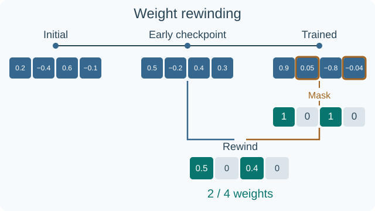

# Stabilised Lottery Tickets

The stabilised lottery ticket work extends the [lottery ticket hypothesis](../lottery-ticket-hypothesis/index.md) to deeper networks. Frankle and colleagues found that resetting the surviving weights to their initialisation fails for larger models, and that rewinding them to an early point in training recovers winning tickets. The rewind point is chosen so that the subnetwork is stable under training noise.

## Problem

The original procedure resets the surviving weights to their values at initialisation. For deeper networks such as ResNet-50 on ImageNet, that reset does not produce trainable winning tickets, so the hypothesis appeared to hold only for small models.

## Core idea

Rewind the surviving weights to an early iteration \(k\) of training, rather than to the initialisation. Early in training the network goes through an unstable phase, and the early iterations of the network, just after this phase, are the point from which the subnetwork can be trained stably. The paper defines stability as the distance between two trained copies of the same subnetwork that differ only in the training noise. It considers two kinds of noise: different data orders, and training the subnetwork alone versus inside the full network.

## Equation or algorithm

The paper's iterative magnitude pruning (IMP) with rewinding has these steps:

1. Initialise the network \(f(x; m \odot W_0)\) with an all-ones mask \(m\).
2. Train for \(k\) iterations to obtain the weights \(W_k\).
3. Train for the remaining \(T - k\) iterations to obtain \(W_T\).
4. Prune the lowest-magnitude surviving weights of \(W_T\), setting their mask entries to 0.
5. If the subnetwork is satisfactory, stop. Otherwise rewind the surviving weights to \(W_k\) and repeat from step 3.

The change from the original lottery ticket procedure is in step 5: the surviving weights are rewound to \(W_k\), not to \(W_0\). The mask is always taken from the fully trained network, and only the weights are rewound.

### Worked animation

*Original 12-second teaching animation (CC BY-SA 4.0).* All values are schematic, not model measurements. MkDocs provides Play/Pause; focus the scroll region to navigate horizontally by keyboard. GitHub displays the [static fallback](../../../../../assets/concept-animations/lottery-early-checkpoint-rewind-still.svg).

Let $W_0=(0.2,-0.4,0.6,-0.1)$, $W_k=(0.5,-0.2,0.4,0.3)$ and $W_T=(0.9,0.05,-0.8,-0.04)$. Prune the two smallest trained magnitudes (positions 2 and 4), so $m=(1,0,1,0)$. The moving blue signal represents the early checkpoint supplying values, while the amber path supplies the mask. The rewind result is $m\odot W_k=(0.5,0,0.4,0)$; initialization reset would give $(0.2,0,0.6,0)$ and retaining trained weights gives $(0.9,0,-0.8,0)$. The mask is the same, but the starting parameters differ. No stability or accuracy is measured here; selecting a successful rewind point requires training experiments.

[Full SVG animation](../../../../../assets/concept-animations/lottery-early-checkpoint-rewind-motion.svg).

**Two distinct stability comparisons.** For a schematic fixed mask $m=(1,0,1,0)$, suppose two completed sparse training runs with different data orders yield $a=(0.7,0,0.4,0)$ and $b=(0.6,0,0.5,0)$. Their Euclidean endpoint distance is $\|a-b\|_2=\sqrt{0.02}$. If a completed dense run instead yields the masked endpoint $c=(0.9,0,-0.8,0)$, the sparse-versus-dense comparison for $a$ is $\|a-c\|_2=\sqrt{1.48}$. The latter compares training with and without the other weights, not two data orders. These invented endpoints are distinct from the starting weights above and are not measured stability results. A small endpoint distance alone does not establish task accuracy.

## Results

The abstract reports that the modified procedure finds subnetworks that could have been obtained by pruning early in training, and that it extends the tickets to deeper networks. The paper reports the following examples:

- Rewinding ResNet-18 and VGG-19 on CIFAR-10 saturates accuracy and stability at iteration 500 and iteration 100 respectively.
- For ResNet-50 on ImageNet, the paper rewinds at about epoch 4, and the iterative experiment rewinds to epoch 6. The abstract's claim is an 80% sparse ResNet-50 that matches the original accuracy on ImageNet. The body reports that the one-shot experiments match the original accuracy at 70% pruned, and that the 80% figure comes from the iterative experiment.

## Limitations

Finding tickets still needs a dense training run to the rewind point and then the repeated pruning rounds, so the approach does not save training compute on its own. The rewind point depends on the network and dataset, and it is chosen by experiment rather than by a rule. The paper's stability measure is a distance between trained copies, which is a proxy for trainability rather than a guarantee.

## Open issues and related variants

- **Rewind point.** The right point to rewind to depends on the network and the dataset, and it is found by a sweep over rewinding iterations.
- **Single-run alternative.** [Gradual pruning](../../magnitude-pruning/gradual-pruning/index.md) removes the need for repeated training runs by pruning during a single run.
- **Sparse training.** The field's survey of sparse training, including tickets found by rewinding, is in [Hoefler et al. (2021)](https://arxiv.org/abs/2102.00554).

## Connections

The stabilised procedure is the version that scales the ticket idea to the networks used in [training](../../../../../engineering/training/index.md) practice. The question of which sparse subnetworks train well is also a question of [deep learning theory](../../../../../theory/deep-learning/index.md).

## References

### Seminal papers

- Frankle, J., Dziugaite, G. K., Roy, D. M., Carbin, M. (2019). *Stabilizing the Lottery Ticket Hypothesis*. arXiv:1903.01611. https://arxiv.org/abs/1903.01611 — Rewinds to an early training point, finding subnetworks of deeper networks that could have been pruned early in training.
- Frankle, J., Carbin, M. (2018). *The Lottery Ticket Hypothesis: Finding Sparse, Trainable Neural Networks*. arXiv:1803.03635. https://arxiv.org/abs/1803.03635 — The original reset-to-initialisation procedure that this work modifies.
- Han, S., Pool, J., Tran, J., Dally, W. J. (2015). *Learning both Weights and Connections for Efficient Neural Networks*. arXiv:1506.02626. https://arxiv.org/abs/1506.02626 — The iterative prune-and-retrain pipeline that the ticket procedure extends; AlexNet's parameters are reduced 9x and VGG-16's 13x without loss of accuracy.

### Surveys and textbooks

- Hoefler, T., Alistarh, D., Ben-Nun, T., Dryden, N., Peste, A. (2021). *Sparsity in Deep Learning: Pruning and Growth for Efficient Inference and Training in Neural Networks*. arXiv:2102.00554. https://arxiv.org/abs/2102.00554 — Survey and tutorial of more than 300 studies on sparse training and inference.

### Lectures and videos

(none checked for this page)

### Articles and documentation

- Gale, T., Elsen, E., Hooker, S. (2019). *The State of Sparsity in Deep Neural Networks*. arXiv:1902.09574. https://arxiv.org/abs/1902.09574 — Benchmarks sparsification methods on a Transformer and ResNet-50, and finds that simple magnitude pruning often matches the more complex methods.
