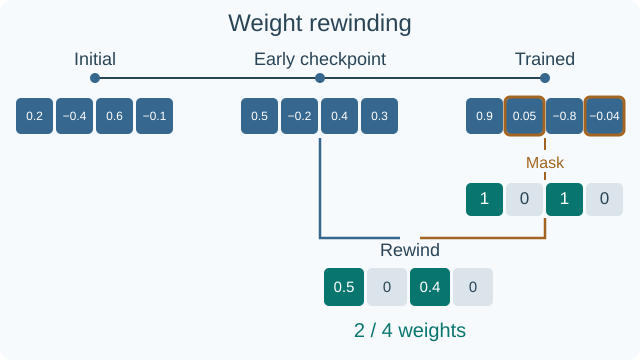

# 穩定的彩票假說

穩定彩票的研究把[彩票假說](../lottery-ticket-hypothesis/index.zh-TW.md)延伸到更深的網路。Frankle 等人發現，把存活的權重重設回初始化值，在較大的模型上會失效；但把它們倒回訓練初期的某一點，就能找回獲勝的彩票。倒回的時間點被選在子網路對訓練雜訊具有穩定性的位置。

## 問題

原始程序會把存活的權重重設為初始化時的值。對於深層網路（例如 ImageNet 上的 ResNet-50），這種重設無法產生可訓練的獲勝彩票，因此該假說看起來只對小模型成立。

## 核心想法

把存活的權重倒回訓練的早期迭代 \(k\)，而不是初始化。訓練初期網路會經歷一段不穩定階段，緊接在此階段之後的早期迭代，就是子網路能穩定訓練的起點。論文把穩定性定義為：同一子網路在僅有訓練雜訊不同的兩次訓練之後，兩個訓練副本之間的距離。它考慮兩種雜訊：不同的資料順序，以及單獨訓練子網路與在完整網路內訓練子網路。

## 公式或演算法

論文中帶倒回的迭代式幅度剪枝（IMP）步驟如下：

1. 以全為一的遮罩 \(m\) 初始化網路 \(f(x; m \odot W_0)\)。
2. 訓練 \(k\) 次迭代，得到權重 \(W_k\)。
3. 再訓練其餘 \(T - k\) 次迭代，得到 \(W_T\)。
4. 對 \(W_T\) 中存活的權重，剪除幅度最小者，並把其遮罩項設為 0。
5. 若子網路令人滿意即停止；否則把存活的權重倒回 \(W_k\)，從第 3 步重複。

與原始彩票程序的差異在第 5 步：存活的權重倒回 \(W_k\)，而不是 \(W_0\)。遮罩永遠取自完整訓練後的網路，倒回的只有權重。

### 動畫算例

*原創 12 秒教學動畫（CC BY-SA 4.0）。* 數值皆為人工示意，並非模型實測。MkDocs 提供播放／暫停；可聚焦捲動區域後使用鍵盤水平捲動。GitHub 顯示[靜態回退圖](../../../../../assets/concept-animations/lottery-early-checkpoint-rewind-still.svg).

令 $W_0=(0.2,-0.4,0.6,-0.1)$、$W_k=(0.5,-0.2,0.4,0.3)$、$W_T=(0.9,0.05,-0.8,-0.04)$。剪除訓練後絕對值最小的兩個權重（位置 2、4），得到 $m=(1,0,1,0)$。藍色移動訊號表示早期檢查點提供數值，琥珀色路徑提供遮罩。倒回結果為 $m\odot W_k=(0.5,0,0.4,0)$；重設至初始化則為 $(0.2,0,0.6,0)$，保留訓練後權重則為 $(0.9,0,-0.8,0)$。三者遮罩相同，但訓練起點的參數不同。此處未量測穩定性或準確率，選擇成功的倒回點仍需訓練實驗。

[完整 SVG 動畫](../../../../../assets/concept-animations/lottery-early-checkpoint-rewind-motion.svg).

**兩種不同的穩定性比較。** 固定示意遮罩 $m=(1,0,1,0)$，假設兩次使用不同資料順序的稀疏訓練完成後，分別得到 $a=(0.7,0,0.4,0)$ 與 $b=(0.6,0,0.5,0)$。兩者的歐氏端點距離為 $\|a-b\|_2=\sqrt{0.02}$。若另一次稠密訓練完成後得到遮罩端點 $c=(0.9,0,-0.8,0)$，則 $a$ 與稠密訓練結果的比較為 $\|a-c\|_2=\sqrt{1.48}$。後者比較其他權重是否參與訓練，並非比較兩種資料順序。這些人工設定的訓練端點不同於上方的訓練起始權重，並非實測的穩定性結果；端點距離小也不代表任務準確率必然良好。

## 結果

摘要報告，修改後的程序能找到那些可在訓練早期剪枝得到的子網路，並把彩票延伸到更深的網路。論文報告的例子包括：

- 在 CIFAR-10 上，ResNet-18 與 VGG-19 的準確率與穩定性分別在第 500 與第 100 次迭代時達到飽和。
- 對 ImageNet 上的 ResNet-50，論文約在第 4 個 epoch 倒回，迭代實驗則倒回到第 6 個 epoch。摘要的主張是：稀疏度 80% 的 ResNet-50 能達到原始的 ImageNet 準確率。正文指出，一次性剪枝實驗在剪除 70% 時就能達到原始準確率，80% 的數字來自迭代實驗。

## 限制

找到彩票仍需要先做一次完整的稠密訓練到倒回點，再加上多輪重複剪枝，因此此方法本身不節省訓練運算量。倒回點取決於網路與資料集，只能靠實驗選擇，沒有通用規則。論文的穩定性指標是訓練副本之間的距離，它是可訓練性的代理指標，而非保證。

## 未解問題與相關變體

- **倒回點。** 合適的倒回點取決於網路與資料集，需透過對倒回迭代次數的掃描找到。
- **單次訓練的替代方案。** [漸進式剪枝](../../magnitude-pruning/gradual-pruning/index.zh-TW.md)在單次訓練中邊訓練邊剪枝，免去反覆的訓練循環。
- **稀疏訓練。** 該領域的綜述（包括以倒回找到的彩票）見 [Hoefler 等人（2021）](https://arxiv.org/abs/2102.00554)。

## 與其他主題的連結

穩定化的程序，是把彩票概念延伸到[訓練](../../../../../engineering/training/index.zh-TW.md)實務所用網路的版本。哪些稀疏子網路能良好訓練，也是[深度學習理論](../../../../../theory/deep-learning/index.zh-TW.md)的問題。

## 參考文獻

### 奠基性論文

- Frankle, J., Dziugaite, G. K., Roy, D. M., Carbin, M. (2019). *Stabilizing the Lottery Ticket Hypothesis*. arXiv:1903.01611. https://arxiv.org/abs/1903.01611 — 倒回到早期訓練點，找到深層網路中那些可在訓練早期剪枝得到的子網路。
- Frankle, J., Carbin, M. (2018). *The Lottery Ticket Hypothesis: Finding Sparse, Trainable Neural Networks*. arXiv:1803.03635. https://arxiv.org/abs/1803.03635 — 本研究所修改的原始重設初始化程序。
- Han, S., Pool, J., Tran, J., Dally, W. J. (2015). *Learning both Weights and Connections for Efficient Neural Networks*. arXiv:1506.02626. https://arxiv.org/abs/1506.02626 — 彩票程序所延伸的迭代式剪枝再訓練流程；AlexNet 的參數減少 9 倍、VGG-16 減少 13 倍，且不損失準確率。

### 綜述與教科書

- Hoefler, T., Alistarh, D., Ben-Nun, T., Dryden, N., Peste, A. (2021). *Sparsity in Deep Learning: Pruning and Growth for Efficient Inference and Training in Neural Networks*. arXiv:2102.00554. https://arxiv.org/abs/2102.00554 — 涵蓋三百多篇研究的稀疏訓練與推論綜述與導論。

### 講座與影片

（本頁未檢核任何項目）

### 文章與文件

- Gale, T., Elsen, E., Hooker, S. (2019). *The State of Sparsity in Deep Neural Networks*. arXiv:1902.09574. https://arxiv.org/abs/1902.09574 — 在 Transformer 與 ResNet-50 上比較各種稀疏化方法，發現簡單的幅度剪枝往往與較複雜的方法不相上下。
