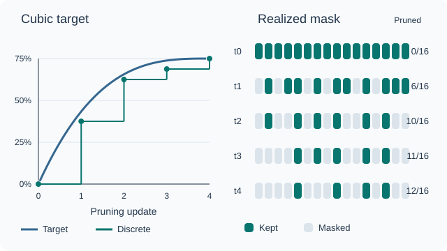

# Gradual Pruning

Gradual pruning raises the sparsity of a network smoothly during training, rather than cutting it in one step. Zhu and Gupta used it to compare large sparse networks with small dense networks, and found that the sparse networks were consistently better. It is a schedule layered on top of [magnitude pruning](../index.md).

## Problem

Pruning papers compared pruned networks with the dense networks they came from. It was unclear whether pruning was a better use of a fixed budget than training a smaller dense network from the start.

## Core idea

Compare large sparse models with small dense models at a matched size, and prune the large model gradually during training. The network can adapt to each small cut, so a gradual schedule recovers more accuracy than a single cut to the same sparsity.

## Equation or algorithm

Sparsity rises from an initial value \(s_i\) (usually zero) to a final target \(s_f\) along a cubic schedule:

\[
s_t = s_f + (s_i - s_f)\left(1 - \frac{t - t_0}{n\,\Delta t}\right)^3
\]

for \(t \in \{t_0, t_0 + \Delta t, \dots, t_0 + n\,\Delta t\}\). Here \(t_0\) is the training step at which pruning starts, \(n\) is the number of pruning steps and \(\Delta t\) is the pruning frequency in training steps. At each pruning step the lowest-magnitude weights are masked until the current sparsity is reached, and training continues on the remaining weights. The cubic form prunes quickly at first, when the network has the most redundancy, and slowly near the target.

### Worked animation

*Original 12-second teaching animation (CC BY-SA 4.0).* Values are schematic, not model measurements. MkDocs provides Play/Pause; focus the scroll region to navigate horizontally by keyboard. GitHub shows the [static fallback](../../../../../assets/concept-animations/gradual-pruning-cubic-mask-still.svg).

With 16 weights, set $s_i=0$, $s_f=0.75$ and four pruning intervals. The blue curve is the continuous target extension $s_i+(s_f-s_i)[1-(1-u)^3]$, where $u=(t-t_0)/(4\Delta t)$ lies in $[0,1]$. At the five scheduled evaluations choose $\lfloor16s_t\rfloor$ masked weights: $0,6,10,11,12$. The teal staircase is the realized mask fraction, not the continuous target. In this illustrative example the magnitude ranking is fixed and masks are nested; real training can change magnitude rankings, and mask-update implementations can differ in whether previously masked weights can re-enter. Between scheduled updates the count is unchanged while training continues. Integer rounding is a choice for this example, not a prescribed rule of the paper. No accuracy or runtime is measured.

### Rounding and mask membership

For the floor convention used above, $0\le s_t-\widehat{s}_t<1/N$, where $\widehat{s}_t=\lfloor Ns_t\rfloor/N$. A monotonically increasing target constrains the number of masked positions, not their identities. For example, with four weights, suppose the candidate absolute magnitudes at two updates are $(1,3,5,7)$ and $(8,1,2,7)$, and the requested masked counts are 1 and 2. If previously masked candidates may re-enter (for example, through a separately maintained unmasked candidate tensor), the masked sets can change from $\{1\}$ to $\{2,3\}$; a permanently nested mask instead keeps position 1 masked and adds position 2, yielding $\{1,2\}$. Both reach 50% at the second update, but only the nested version preserves all earlier removals. These are schematic candidate magnitudes, not measured training values.

[Full SVG animation](../../../../../assets/concept-animations/gradual-pruning-cubic-mask-motion.svg).

## Results

The paper's abstract reports that large-sparse models consistently outperform small-dense models. The comparison is made at an equal number of non-zero parameters in some experiments, and at a comparable memory footprint, including the overhead of sparse storage, in others. The experiments use final sparsities from 50% to 97.5%.

## Limitations

The gradual schedule adds training steps and has its own hyperparameters: the start step, the number of steps and the frequency. Matching parameter count is not the same as matching compute, because sparse layers may not run faster on dense hardware.

## Open issues and related variants

- **Schedule transfer.** Whether a schedule tuned for one architecture transfers to another without retuning is not settled.
- **Related:** the [lottery ticket](../../lottery-ticket/lottery-ticket-hypothesis/index.md) procedure also prunes iteratively, but it rewinds the surviving weights to an early point in training.

## Connections

A gradual schedule is a refinement of the iterative pruning in [learning both weights and connections](../../learning-weights-and-connections/index.md). The benchmark that places magnitude pruning among other methods is in [the state of sparsity](../state-of-sparsity/index.md).

## References

### Seminal papers

- Zhu, M., Gupta, S. (2017). *To prune, or not to prune: exploring the efficacy of pruning for model compression*. arXiv:1710.01878. https://arxiv.org/abs/1710.01878 — Introduces the cubic gradual schedule and shows that large sparse models consistently beat small dense ones.
- Han, S., Pool, J., Tran, J., Dally, W. J. (2015). *Learning both Weights and Connections for Efficient Neural Networks*. arXiv:1506.02626. https://arxiv.org/abs/1506.02626 — The iterative prune-and-retrain pipeline that gradual schedules refine.
- Gale, T., Elsen, E., Hooker, S. (2019). *The State of Sparsity in Deep Neural Networks*. arXiv:1902.09574. https://arxiv.org/abs/1902.09574 — Benchmarks gradual magnitude pruning against other sparsity methods.

### Surveys and textbooks

- Hoefler, T., Alistarh, D., Ben-Nun, T., Dryden, N., Peste, A. (2021). *Sparsity in Deep Learning: Pruning and Growth for Efficient Inference and Training in Neural Networks*. arXiv:2102.00554. https://arxiv.org/abs/2102.00554 — Surveys schedules for sparsity during training.

### Lectures and videos

(none checked for this page)

### Articles and documentation

- Frankle, J., Carbin, M. (2018). *The Lottery Ticket Hypothesis: Finding Sparse, Trainable Neural Networks*. arXiv:1803.03635. https://arxiv.org/abs/1803.03635 — The rewind-and-retrain alternative to a gradual schedule.
