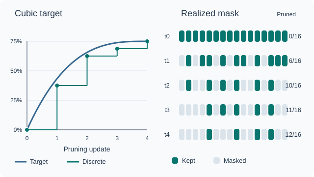

# 漸進式剪枝

漸進式剪枝在訓練期間平滑地提高網路的稀疏度，而不是一次剪掉。Zhu 與 Gupta 以它比較大型稀疏網路與小型稠密網路，發現稀疏網路始終較好。它是疊加在[幅度剪枝](../index.zh-TW.md)之上的一種排程。

## 問題

剪枝論文把剪枝後的網路與其來源的稠密網路作比較。對於固定的預算，剪枝是否比一開始就訓練較小的稠密網路更好，並不清楚。

## 核心想法

在大小相當的條件下比較大型稀疏模型與小型稠密模型，並在訓練期間逐步剪大型模型。網路能適應每次小幅度的剪除，因此漸進式排程比一次剪到相同稀疏度能恢復更多準確率。

## 公式或演算法

稀疏度沿著三次方排程，從初始值 \(s_i\)（通常為零）上升到最終目標 \(s_f\)：

\[
s_t = s_f + (s_i - s_f)\left(1 - \frac{t - t_0}{n\,\Delta t}\right)^3
\]

其中 \(t \in \{t_0, t_0 + \Delta t, \dots, t_0 + n\,\Delta t\}\)。\(t_0\) 是開始剪枝的訓練步數，\(n\) 是剪枝步數，\(\Delta t\) 是剪枝頻率（以訓練步數計）。每個剪枝步驟會遮罩幅度最小的權重，直到達到當前稀疏度，然後在剩下的權重上繼續訓練。三次方的形式在網路冗餘最多的初期剪得較快，接近目標時則放慢。

### 動畫算例

*原創 12 秒教學動畫（CC BY-SA 4.0）。* 數值為示意，非模型實測值。MkDocs 提供播放／暫停；聚焦捲動區域後可使用鍵盤水平捲動。GitHub 顯示[靜態回退圖](../../../../../assets/concept-animations/gradual-pruning-cubic-mask-still.svg)。

假設有 16 個權重，設定 $s_i=0$、$s_f=0.75$，共四個剪枝間隔。藍線為連續延伸的目標曲線 $s_i+(s_f-s_i)[1-(1-u)^3]$，其中 $u=(t-t_0)/(4\Delta t)$ 介於 $[0,1]$。五個排程更新點各遮罩 $\lfloor16s_t\rfloor$ 個權重，依序為 $0,6,10,11,12$。青綠色階梯表示實際遮罩比例，而非連續目標。本示例固定權重幅度排名，且遮罩為巢狀；實際訓練可能改變排名，不同遮罩更新實作也可能允許已遮罩的權重重新加入。兩次排程更新之間，遮罩數量不變，訓練仍持續進行。向下取整只是本算例的約定，不是論文指定的規則。本圖未量測準確率或執行時間。

### 取整與遮罩成員

對上述向下取整約定，$0\le s_t-\widehat{s}_t<1/N$，其中 $\widehat{s}_t=\lfloor Ns_t\rfloor/N$。單調增加的目標約束的是遮罩位置數量，不是其成員身分。例如有四個權重，兩次更新的候選絕對值分別為 $(1,3,5,7)$ 與 $(8,1,2,7)$，目標遮罩數量分別為 1 與 2。若允許先前遮罩的候選權重重新加入（例如另行維護未遮罩的候選張量），遮罩集合可從 $\{1\}$ 改為 $\{2,3\}$；永久巢狀遮罩則保留位置 1 的遮罩，再新增位置 2，得到 $\{1,2\}$。兩者第二次更新皆達到 50% 稀疏度，但只有巢狀版本保留所有先前剪除的位置。上述候選幅度為示意，並非實際訓練量測值。

[完整 SVG 動畫](../../../../../assets/concept-animations/gradual-pruning-cubic-mask-motion.svg).

## 結果

論文摘要報告，大型稀疏模型始終優於小型稠密模型。部分實驗在非零參數數量相等的條件下比較；另一些實驗則在記憶體佔用相當的條件下比較，並把稀疏儲存的額外開銷算進去。實驗的最終稀疏度從 50% 到 97.5% 不等。

## 限制

漸進式排程會增加訓練步數，並有自己的超參數：起始步數、步數與頻率。參數數量相等不等於運算量相等，因為稀疏層在稠密硬體上不一定跑得更快。

## 未解問題與相關變體

- **排程遷移。** 為某一架構調好的排程，能否不經重新調校地用於另一架構，尚無定論。
- **相關。** [彩票](../../lottery-ticket/lottery-ticket-hypothesis/index.zh-TW.md)程序也是迭代式剪枝，但它把存活的權重倒回訓練早期的某一點。

## 與其他主題的連結

漸進式排程是[同時學習權重與連接](../../learning-weights-and-connections/index.zh-TW.md)中迭代剪枝的改良。把幅度剪枝與其他方法並列比較的基準，見[稀疏性現況](../state-of-sparsity/index.zh-TW.md)。

## 參考文獻

### 奠基性論文

- Zhu, M., Gupta, S. (2017). *To prune, or not to prune: exploring the efficacy of pruning for model compression*. arXiv:1710.01878. https://arxiv.org/abs/1710.01878 — 提出三次方的漸進排程，並顯示大型稀疏模型始終優於小型稠密模型。
- Han, S., Pool, J., Tran, J., Dally, W. J. (2015). *Learning both Weights and Connections for Efficient Neural Networks*. arXiv:1506.02626. https://arxiv.org/abs/1506.02626 — 漸進排程所改良的迭代式剪枝再訓練流程。
- Gale, T., Elsen, E., Hooker, S. (2019). *The State of Sparsity in Deep Neural Networks*. arXiv:1902.09574. https://arxiv.org/abs/1902.09574 — 把漸進式幅度剪枝與其他稀疏化方法作基準比較。

### 綜述與教科書

- Hoefler, T., Alistarh, D., Ben-Nun, T., Dryden, N., Peste, A. (2021). *Sparsity in Deep Learning: Pruning and Growth for Efficient Inference and Training in Neural Networks*. arXiv:2102.00554. https://arxiv.org/abs/2102.00554 — 綜述訓練期間的稀疏排程。

### 講座與影片

（本頁未檢核任何項目）

### 文章與文件

- Frankle, J., Carbin, M. (2018). *The Lottery Ticket Hypothesis: Finding Sparse, Trainable Neural Networks*. arXiv:1803.03635. https://arxiv.org/abs/1803.03635 — 漸進排程的倒回再訓練替代方案。
