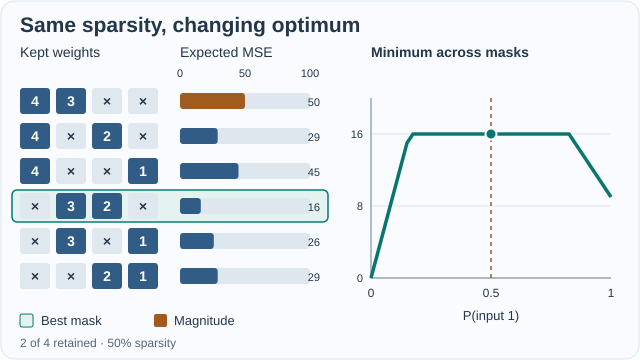

# The State of Sparsity in Deep Neural Networks

The state of sparsity is a 2019 benchmark that evaluates several pruning and sparsity methods under one protocol on large-scale tasks. Its main finding, that simple magnitude pruning matches or beats more complex methods, is the reason [magnitude pruning](../index.md) remains the baseline that newer methods must beat.

## Problem

Many sparsity methods were being proposed, each with its own setup, so their results could not be compared directly. It was unclear which gains were real and which came from differences in training.

## Core idea

Run several sparsity methods under a common protocol on large-scale image and language tasks. The methods share the same mask-and-retrain pattern and differ only in how the mask is chosen and updated, so the comparison isolates that choice.

## Equation or algorithm

The benchmark does not add a new algorithm. Each method chooses a mask at a target sparsity, the masked network is retrained, and the final accuracy is compared at matched sparsity. The paper reports the accuracy-sparsity trade-off for each method.

### Matched sparsity, different output errors

Use the illustrative linear model $w=(4,3,2,1)$ with fixed masks $m_A=(1,1,0,0)$ and $m_B=(0,0,1,1)$. The first retains the two largest absolute weights; the second is only a counterexample mask, not another algorithm from the paper. Both have 50% sparsity. For input $x$, the dense output $w^\top x$ is the reference and the masked output is $(w\odot m)^\top x$. Animated bars accumulate the individual products, then compare mean squared deviations on two inputs.

| Input | Dense | Magnitude | Alternate |
|---|---:|---:|---:|
| $(0,1,3,4)$ | 13 | 3 | 10 |
| $(1,1,0,0)$ | 7 | 7 | 0 |
| MSE relative to dense output | 0 | 50 | 29 |

Equal retained-weight counts do not ensure equal outputs, accuracy or speed. The first input emphasises the smaller weights, whereas the second does the opposite. This constructed example has no retraining and is not a result from the paper, nor does it contradict its magnitude-pruning baseline. Real comparisons should also control training and fine-tuning budgets, data, hyperparameter search and evaluation protocols, and compare task metrics at matched sparsity.

*Original 12-second teaching animation (CC BY-SA 4.0).* Use Play/Pause on MkDocs; the focusable container scrolls horizontally on narrow screens. GitHub displays the [static preview](../../../../../assets/concept-animations/matched-sparsity-output-error-still.svg); the [full animation](../../../../../assets/concept-animations/matched-sparsity-output-error-motion.svg) is also linked.

### Why activation statistics can change the preferred mask

Let $\Delta w=(1-m)\odot w$. On an input distribution with uncentred second moment $M_x=\mathbb E[xx^\top]$, the expected squared output deviation is

$
\mathbb E[(\Delta w^\top x)^2]=\Delta w^\top M_x\Delta w.
$

The diagonal terms weight each removed coefficient by its input's second moment; the off-diagonal terms account for correlations in the uncentred products. When $M_x=cI$ with $c>0$, this expression reduces to a common multiple of the squared magnitude of the removed weights, so keeping the largest magnitudes minimizes the deviation.

On the two equally weighted illustrative inputs above, exhaustive enumeration of all six fixed two-weight masks gives:

| Kept positions (1-based) | MSE relative to dense |
|---|---:|
| 1, 2 (magnitude) | 50 |
| 1, 3 | 29 |
| 1, 4 | 45 |
| 2, 3 | 16 |
| 2, 4 | 26 |
| 3, 4 (alternate) | 29 |

The best mask in this finite toy example retains positions 2 and 3, not the two largest weights and not the alternate mask in the animation. This is an exhaustive calculation on the two specified inputs, not a pruning algorithm or measured task accuracy. A different input distribution or retraining can change the ranking.

## Results

The abstract reports that on large-scale tasks, simple magnitude pruning matches or beats more complex sparsity techniques.

## Limitations

The benchmarks cover the image and language models of their time. The paper also finds that sparse architectures learned by pruning cannot be trained from scratch to the same test accuracy as models trained with joint sparsification and optimisation, a point that limits sparse-training methods.

## Open issues and related variants

- **Newer models.** Whether the same ranking holds for large transformers, where pruning is often one-shot, is not covered by the original benchmark; see [one-shot pruning of large language models](../../one-shot-llm-pruning/index.md).
- **Related:** [gradual pruning](../gradual-pruning/index.md) is the schedule that the benchmark's magnitude baseline uses.

## Connections

The benchmark motivates the choice of magnitude as a default score across the [pruning](../../index.md) family. Its trade-offs between sparsity and speed depend on the hardware that runs the result, as discussed in [AI hardware](../../../../../engineering/hardware/index.md).

## References

### Seminal papers

- Gale, T., Elsen, E., Hooker, S. (2019). *The State of Sparsity in Deep Neural Networks*. arXiv:1902.09574. https://arxiv.org/abs/1902.09574 — Benchmarks sparsity methods under one protocol and finds magnitude pruning a strong baseline.
- Zhu, M., Gupta, S. (2017). *To prune, or not to prune: exploring the efficacy of pruning for model compression*. arXiv:1710.01878. https://arxiv.org/abs/1710.01878 — Gradual magnitude pruning that the benchmark evaluates.
- Han, S., Pool, J., Tran, J., Dally, W. J. (2015). *Learning both Weights and Connections for Efficient Neural Networks*. arXiv:1506.02626. https://arxiv.org/abs/1506.02626 — The prune-and-retrain method that defines the baseline.

### Surveys and textbooks

- Hoefler, T., et al. (2021). *Sparsity in Deep Learning: Pruning and Growth for Efficient Inference and Training in Neural Networks*. arXiv:2102.00554. https://arxiv.org/abs/2102.00554 — A survey placing the benchmark's methods in a wider context.

### Lectures and videos

(none checked for this page)

### Articles and documentation

- Frankle, J., Carbin, M. (2018). *The Lottery Ticket Hypothesis: Finding Sparse, Trainable Neural Networks*. arXiv:1803.03635. https://arxiv.org/abs/1803.03635 — A sparse-training result that the benchmark's trainability finding relates to.
