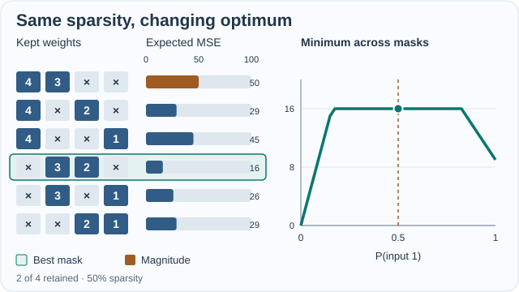

# 神經網路中稀疏性的現況

神經網路中稀疏性的現況是一個 2019 年的基準研究，在同一套協定下，於大規模任務上評估數種剪枝與稀疏化方法。它的主要發現是：簡單的量值剪枝與更複雜的方法相當或更好，這也是[量值剪枝](../index.zh-TW.md)仍是新方法必須超越的基準的原因。

## 問題

許多稀疏化方法各自使用不同的設定被提出，因此結果無法直接比較。不清楚哪些進步是真的，哪些來自訓練上的差異。

## 核心想法

在共同的協定下，於大規模的影像與語言任務上執行數種稀疏化方法。各方法共用「遮罩後重新訓練」的模式，差別只在遮罩如何選擇與更新，因此比較能分離出這個選擇的效果。

## 公式或演算法

基準本身沒有新的演算法。每個方法在目標稀疏度下選擇遮罩，對遮罩後的網路重新訓練，並在相同稀疏度下比較最終準確度。論文報告各方法的準確度與稀疏度之間的取捨。

### 相同稀疏度，不同輸出誤差

用人工線性模型 $w=(4,3,2,1)$ 比較兩個固定遮罩 $m_A=(1,1,0,0)$ 與 $m_B=(0,0,1,1)$。前者保留絕對值最大的兩個權重；後者僅是反例遮罩，不代表論文中的另一種演算法。兩者皆為 50% 稀疏度。對輸入 $x$，以稠密輸出 $w^\top x$ 為比較基準，遮罩輸出為 $(w\odot m)^\top x$。

| 輸入 | 稠密輸出 | Magnitude | Alternate |
|---|---:|---:|---:|
| $(0,1,3,4)$ | 13 | 3 | 10 |
| $(1,1,0,0)$ | 7 | 7 | 0 |
| 相對稠密輸出的 MSE | 0 | 50 | 29 |

同樣的權重保留數量並不保證相同輸出，更不保證相同準確率或加速。第一筆輸入較偏向小權重方向，第二筆則相反。這個不含重新訓練的算例不是論文的實驗結果，也不否定其 magnitude pruning 基準。實際比較還需控制訓練與微調預算、資料、超參數搜尋及評估協定，並在相同稀疏度下檢視任務指標。

### 為什麼激活值統計量會改變遮罩選擇

令 $\Delta w=(1-m)\odot w$。若輸入分布的未中心化二階動差矩陣為 $M_x=\mathbb E[xx^\top]$，則預期輸出平方偏差為

$$
\mathbb E[(\Delta w^\top x)^2]=\Delta w^\top M_x\Delta w.
$$

對角項依各輸入的二階動差加權被移除的係數，非對角項則反映未中心化交叉乘積。當 $M_x=cI$ 且 $c>0$ 時，此式化為被移除權重平方和的固定倍數，此時保留絕對值最大的權重即可最小化偏差。

對上方兩筆等權重的示意輸入，窮舉六種固定的雙權重遮罩可得：

| 保留位置（從 1 開始） | 相對稠密輸出的 MSE |
|---|---:|
| 1, 2（量值剪枝） | 50 |
| 1, 3 | 29 |
| 1, 4 | 45 |
| 2, 3 | 16 |
| 2, 4 | 26 |
| 3, 4（反例遮罩） | 29 |

此有限算例的最佳遮罩保留第 2、3 個位置，不是絕對值最大的兩個權重，也不是反例遮罩。這是針對指定兩筆輸入的窮舉計算，而非剪枝演算法或實測任務準確率。改變輸入分布或重新訓練，都可能改變排序。

在等權重混合算例中，量值剪枝移除第 3、4 個位置。只考慮對角項時，貢獻為 $2^2(4.5)+1^2(8)=26$，但被忽略的交叉項為 $2(2)(1)(6)=24$，所以完整誤差為 50。相對地，保留第 2、3 個位置會移除第 1、4 個位置：對角項貢獻為 $4^2(0.5)+1^2(8)=16$，交叉項為零。因此僅依各座標的二階動差，可能錯估共同剪枝的輸出誤差；一般而言交叉項可為正或負。這些是指定輸入上的精確算術，並非基準實測。

### 改變輸入混合分布

令 $p=\Pr(x=x_1)$，第二筆輸入的機率為 $1-p$。若某固定遮罩在兩筆輸入上的平方誤差為 $e_1,e_2$，則其預期平方偏差為 $p e_1+(1-p)e_2$。六種遮罩的仿射成本如下。

| 保留位置 | 預期平方偏差 |
|---|---:|
| 1, 2 | $100p$ |
| 1, 3 | $9+40p$ |
| 1, 4 | $9+72p$ |
| 2, 3 | $16$ |
| 2, 4 | $16+20p$ |
| 3, 4 | $49-40p$ |

最小值是這些直線的下包絡線。當 $0\le p<0.15$ 時，最佳保留位置為 1、2；當 $0.15<p<0.175$ 時為 1、3；當 $0.175<p<0.825$ 時為 2、3；當 $0.825<p\le1$ 時為 3、4。三個分界點皆有相鄰最佳遮罩並列。動畫在並列時只標示其中一個最佳解，將輸入機率由零掃至一，並刻意在 $p=0.1625$ 停留以呈現狹窄的第二個區間。六條長條共用 0–100 刻度；右側最小值曲線使用獨立的 0–20 刻度。靜態預覽對應 $p=0.5$。

每個候選遮罩內部保留的權重始終固定；改變的是輸入分布與目前被標示的最佳候選。此算例沒有模擬訓練或任務準確率。

*原創 12 秒教學動畫（CC BY-SA 4.0）。* MkDocs 可使用播放／暫停控制；較窄畫面可透過鍵盤聚焦的容器水平捲動。GitHub 顯示[靜態預覽](../../../../../assets/concept-animations/matched-sparsity-output-error-still.svg)，另可開啟[完整動畫](../../../../../assets/concept-animations/matched-sparsity-output-error-motion.svg)。

## 結果

摘要表示，在大規模任務上，簡單的量值剪枝與更複雜的稀疏化技術相當或更好。

## 限制

基準涵蓋的是當時的影像與語言模型。論文也指出，經剪枝學得的稀疏架構，無法從頭訓練到與聯合稀疏化與最佳化模型相同的測試準確度，這對稀疏訓練方法是一個限制。

## 開放問題與相關變體

- **新模型。** 同樣的排序在大型 Transformer 上是否成立，原始基準沒有涵蓋；大型 Transformer 的剪枝常是單次進行，見[大型語言模型單次剪枝](../../one-shot-llm-pruning/index.zh-TW.md)。
- **相關**：[漸進剪枝](../gradual-pruning/index.zh-TW.md)是基準中量值基準所使用的排程。

## 相關連結

這個基準使量值作為整個[剪枝](../../index.zh-TW.md)家族預設分數的選擇有了依據。它的稀疏度與速度之間的取捨，取決於執行結果的硬體，見 [AI 硬體](../../../../../engineering/hardware/index.zh-TW.md)。

## 參考文獻

### 開創性論文

- Gale, T., Elsen, E., Hooker, S. (2019). *The State of Sparsity in Deep Neural Networks*. arXiv:1902.09574. https://arxiv.org/abs/1902.09574 — 在同一協定下比較稀疏化方法，發現簡單的量值剪枝是強基準。
- Zhu, M., Gupta, S. (2017). *To prune, or not to prune: exploring the efficacy of pruning for model compression*. arXiv:1710.01878. https://arxiv.org/abs/1710.01878 — 基準評估的漸進量值剪枝。
- Han, S., Pool, J., Tran, J., Dally, W. J. (2015). *Learning both Weights and Connections for Efficient Neural Networks*. arXiv:1506.02626. https://arxiv.org/abs/1506.02626 — 定義基準基線的剪枝加重新訓練方法。

### 綜述與教科書

- Hoefler, T., 等人 (2021). *Sparsity in Deep Learning: Pruning and Growth for Efficient Inference and Training in Neural Networks*. arXiv:2102.00554. https://arxiv.org/abs/2102.00554 — 將基準中的方法放在更廣的脈絡中的綜述。

### 講座與影片

（本頁尚未查核任何項目）

### 文章與文件

- Frankle, J., Carbin, M. (2018). *The Lottery Ticket Hypothesis: Finding Sparse, Trainable Neural Networks*. arXiv:1803.03635. https://arxiv.org/abs/1803.03635 — 與基準中可訓練性發現相關的稀疏訓練結果。
